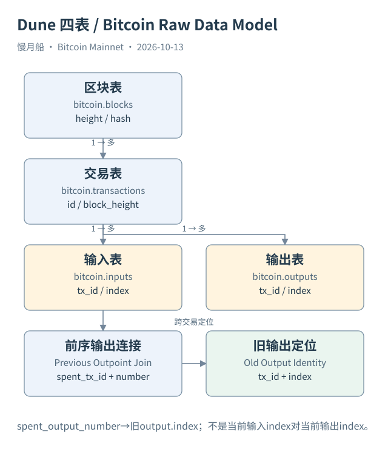

# 19｜四张表，怎样把 Bitcoin 历史接起来？

你已经知道运行时发生了什么：交易引用旧输出，验证通过后创建新输出。现在换一个问题：如果所有这些记录进入数仓，怎样安排表格，才能让 SQL 分析师把历史重新接起来？Dune 的四张 Bitcoin 基础表为我们提供了清晰入口。

区块表 `bitcoin.blocks` 以区块为粒度，包含高度 height、哈希 hash、时间 time、交易数量及大小等列。交易表 `bitcoin.transactions` 以交易在区块中的记录为粒度，交易标识叫 id，区块位置用 block_height、block_hash 和 index 表达。两张表的时间列和日期分区名称不同，不能凭其他链的命名习惯直接填写。

输入表 `bitcoin.inputs` 把交易输入展开，每条输入有当前交易的 tx_id 和当前输入 index。前序引用则用 spent_tx_id 与 spent_output_number。输出表 `bitcoin.outputs` 每条记录对应一个创建输出，用 tx_id 加 index 表达输出点。输入与输出中的 index 分别属于不同列表。

最关键的连接跨过两笔交易：输入的 spent_tx_id 对应旧输出的 tx_id，spent_output_number 对应旧输出的 index。连接当前交易 id 与输入 tx_id，是找当前交易有哪些输入；连接前序字段与旧输出，则是追问这些输入具体花掉了什么。两种 Join 的问题不同。

交易表也有嵌套的 input、output 数组，可以从一条交易记录展开。DuneSQL 数组位置从一开始，而 Bitcoin 输出索引从零开始。数组第二个元素可能对应 index 等于一的输出，不能因为读取 `output[1]` 就将它命名为 vout 1。最好以元素中的明确索引字段为准。

本轮通过 MCP 实际取得四张表的实时 Catalog，核对字段名、类型、空值声明和分区。文档提供业务说明，Catalog 证明查询层暴露哪些列；二者都不能独立证明全历史没有重复、没有缺失或永远实时更新。需要更进一步的数据质量查询才能检验实际覆盖。

作者既有 Dashboard 218997 的十条研究 Query 也已只读取回。其中九条是正式展示，另一条用于质量核对。旧 QA 在高度 963924 对比了 1860 条交易、4062 条输入和5207 条输出。这个有界样本证明其样本关系一致，不代表全链已经通过同样检查；本轮没有重跑旧 Query。

金额是另一个需要保留来源的地方。平铺输入、输出和交易金额列为 DOUBLE，官方主 Schema 说明采用 BTC。交易页嵌套说明却出现 Satoshi 文案，本篇记录这一冲突，教学优先使用平铺表，精确金额回查整数聪 API 或原始字节，不自行猜一个全局换算规则。

你现在拥有两张地图：运行地图说明旧输出怎样被验证和消费，数据地图说明它们怎样成为列与行。后续 SQL 的任务，就是用前序输出连接把这两张地图接起来，同时保留平台推导、金额精度和观察范围的边界。

表之间并非任意相近字段都能连接。blocks的coinbase列是特殊输入数据，不是Coinbase交易的TxID；要找首笔交易，应核对交易位置或is_coinbase，不按名字相似直接Join。

[编辑此图](../../assets/diagrams/dune-model.drawio)

依据：[dune-blocks](https://docs.dune.com/data-catalog/bitcoin/blocks)；[dune-transactions](https://docs.dune.com/data-catalog/bitcoin/transactions)；[dune-inputs](https://docs.dune.com/data-catalog/bitcoin/inputs)；[dune-outputs](https://docs.dune.com/data-catalog/bitcoin/outputs)。研究基准日：2026-10-13。来源获取状态见[来源目录](../../research/source_catalog.md)。

[上一章](../part-05/18-proposals-and-activation.md) · [目录](../../SUMMARY.md) · [下一章](../part-05/20-core-rpc.md)
