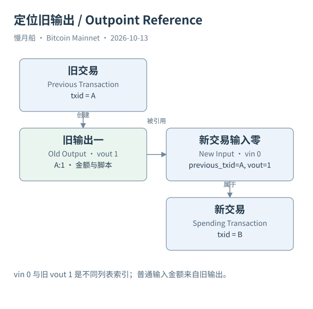

# 21｜怎样用 SQL 读完一笔交易，而不漏掉旧输出？

拿到一个真实 TxID 后，最好的第一步不是立即画资金流图，而是先读完交易本身。SQL 01 找交易层记录，SQL 02 展开输入，SQL 03 展开输出，SQL 04 核对费用。每个查询都回答一个清楚问题，能够避免先猜付款方向，再挑选看起来符合猜测的行。

交易表的标识列叫 id，输入和输出表则叫 tx_id，类型是 VARBINARY。教学 SQL 使用明确的十六进制字节常量过滤，不把哈希当普通文本。显示时可以用 `to_hex` 转为可读字符串；显示转换与过滤表达式分开，通常也更容易保留正确类型。

日期分区需要用真实案例所在 UTC 日期。Bitcoin 区块时间不是交易首次广播时间，但可用于对应确认数据分区。固定 TxID、日期和高度能缩小查询范围。本书 SQL 01 至 04 的默认种子是 Case 01：高度 170 的真实交易；它不是当前链头样本，也不是整网统计。

读取输入时，保留当前输入 index、前序 TxID、前序输出编号和金额。若要回查历史输出，旧输出的分区日期可能与当前交易不同。不能为了省扫描把两边都强制到同一天，再把没匹配的输入宣布为异常。正确范围来自实际前序定位，成本与覆盖需要一起说明。

读取输出时，按 index 排序并保留 value、type、script_hex 和 address。地址可能为空，脚本和金额仍可能有效。任何把空地址行直接丢弃的查询，都应在结果说明中承认它没有覆盖全部输出；如果这些输出恰好是协议数据，还会改变你对交易用途的理解。

费用应在普通交易上计算。Case 01 的一个输入来自五十 BTC 旧输出，新输出分别是十 BTC 和四十 BTC，差额为零。这个真实算例验证输入输出关系，不把四十 BTC 的输出自动认定为已由钱包证实的找零。教学图中已知 Alice 控制的假设，与真实样本的未知身份分别保留。

本轮只静态审查新增 SQL，没有执行它们。已有作者 QA 的真实旧结果可以支持平铺金额与引用关系的样本解释，但不能替代 SQL 01 今日执行记录。读者应区分“可以据这些字段编写查询”“语法与口径已审查”和“已经在服务端执行并复核返回”三个层次。

完整查询文件放在 examples/sql，注释注明来源、单位、粒度和观察窗口。正文不复制很长代码，而是告诉你拿到结果后怎样核对：交易行是否唯一，输入输出数量是否匹配，前序编号是否合理，普通费用是否与整数来源一致。返回空行时，再检查分区和索引覆盖。

当这些基础核对完成，交易就从一个哈希变成一组可复查记录。你可以确定它消费哪些旧输出、创建哪些新输出，但还没有自动知道哪笔是业务付款或谁是受益人。后面图谱和归因章节将建立在这份清楚的结构之上。

[编辑此图](../../assets/diagrams/outpoint.drawio)

依据：[dune-transactions](https://docs.dune.com/data-catalog/bitcoin/transactions)；[dune-inputs](https://docs.dune.com/data-catalog/bitcoin/inputs)；[dune-outputs](https://docs.dune.com/data-catalog/bitcoin/outputs)。研究基准日：2026-10-13。来源获取状态见[来源目录](../../research/source_catalog.md)。

[上一章](../part-05/20-core-rpc.md) · [目录](../../SUMMARY.md) · [下一章](../part-06/22-join-grain.md)
