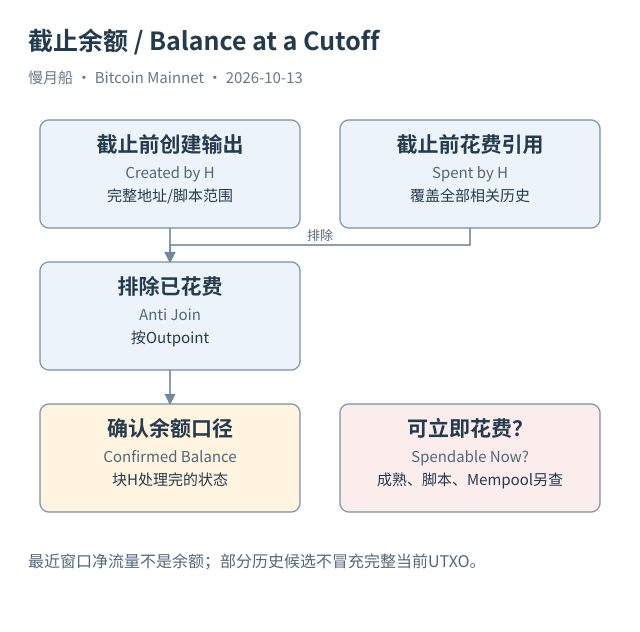

# 23｜怎样计算某地址在指定高度的余额？

你想知道一个地址在高度 H 的余额。直接把它收到过的输出全部相加，会得到历史接收总额；它可能已经花掉其中大部分。只看最近一天转入减转出，也无法得到完整余额，因为窗口开始之前可能已经有很多未花费输出。

地址范围内的确认余额，可以从在截止位置以前创建的相关输出开始，再排除截至同一位置已经被花费的输出。连接仍然使用前序 TxID 与输出编号。SQL 06 查询一个有界输出集合的未花费候选，SQL 07 给出指定高度的完整地址余额查询，并把所需历史覆盖与成本审核写进文件。

“在高度 H”通常表示处理完该区块后的状态。同块内先创建、后消费的输出，到了块末已经不在未花费集合中。如果想问区块中某笔交易执行后状态，就还要考虑块内顺序，不能只用高度过滤。截点定义不同，余额可以合理地不同。

计算所有地址完整历史余额需要覆盖该地址此前全部相关创建记录，以及截止前所有花费记录。只筛选一个月输出，会遗漏更早出生的 UTXO；只筛选一个月输入，会漏掉它们在此前的花费。为了控制成本，本书的候选查询限定一个日期，完整余额查询则明确需要此前全部相关历史。它没有执行，不能拿候选结果代替完整余额。

地址识别本身也有边界。常见脚本能映射为地址，一些输出却没有单一普通地址。OP_RETURN 等明确不可花费输出应另行处理；Coinbase 成熟性、时间锁和多签能力也影响立即可用金额。确认地址相关未花费金额，不一定等于钱包界面的 spendable balance。

Mempool 还可能包含待花费。四张确认表计算的块末余额，通常没有自动减去某节点交易池里的交易。若把节点 `gettxout` 的 include_mempool 打开，结果可能不同。不要拿不同观察视图的差异直接认定余额数据错误，应先对齐截点、网络和未确认口径。

本篇保存 Case 01 的两个真实输出和后续花费边。它们可以用来解释“创建记录仍在、未花费状态已改变”。地址查询另选有明确P2PKH地址的Case 03，以高度481824为截止位置；它不是宣称早期输出今天仍有相同余额，也不根据旧地址活动去识别普通私人用户。

金额单位也需要谨慎。Dune DOUBLE 的 BTC 先逐输出舍入转换为聪，只是带假设的近似重建，应核对整数 API；在大范围累计时仍可能有精度或覆盖问题。精确金额、正确范围和完整花费覆盖缺一不可，不是换个数字类型就完成了审计。

最终结果最好附上一句明确说明：统计的是哪些脚本或地址、哪条链、哪份快照、哪个截止高度、是否考虑未确认交易，以及已知覆盖范围。一个有这些限定的余额数字，远比没有观察条件的“此地址拥有多少 BTC”更容易复查。

[编辑此图](../../assets/diagrams/balance.drawio)

依据：[dune-inputs](https://docs.dune.com/data-catalog/bitcoin/inputs)；[dune-outputs](https://docs.dune.com/data-catalog/bitcoin/outputs)；[rpc-gettxout](https://bitcoincore.org/en/doc/31.0.0/rpc/blockchain/gettxout/)。研究基准日：2026-10-13。来源获取状态见[来源目录](../../research/source_catalog.md)。

[上一章](../part-06/22-join-grain.md) · [目录](../../SUMMARY.md) · [下一章](../part-06/24-age-and-cdd.md)
