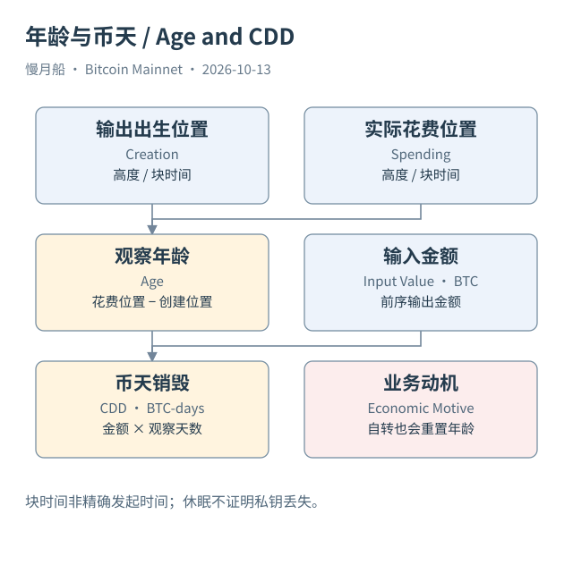

# 24｜一个输出很久没动，究竟说明什么？

一笔输出出生十年后才被花费，你可能说“十年老币醒了”。这个说法有直观吸引力，但技术上先要明确：我们观察到的是同一个输出在这段确认历史中没有被消费，直到后来交易引用它。它不直接证明同一个人持有十年，也不告诉我们期间有没有链外所有权变化。

输出年龄（UTXO Age）可以按区块高度差或区块时间差计算。前者衡量经过多少个确认位置，后者用头部时间形成近似时间间隔。两者不是固定十分钟相乘的绝对等价物；区块时间也不是精确创建现实时间。指标名称应说明采用高度还是天数。

已花费输出的年龄可以由创建和花费两端计算；尚未花费输出的年龄则相对观察截点计算。它们对应不同样本：只统计已花费记录，会忽略仍在等待的长寿输出。比较“平均持有年龄”时，先看分母包含谁，避免把花费选择造成的样本差异解释成全部持有人的行为。

币天销毁（Coin Days Destroyed，CDD）把花费金额与年龄相乘，再按定义汇总。假设一笔一 BTC 输出经过一百天被花费，在该口径下贡献一百 BTC-days。它不是销毁了一百 BTC，也不是 Coinbase 供应减少；名字中的销毁说的是累计币天这个推导指标被消费。

一次自我整合也可能产生很高 CDD。钱包把长时间未动的输出合并到新输出，旧输出年龄结束，新输出年龄重新开始，即使经济控制者没有改变。交易所内部整理也有类似问题。因此，高 CDD 不能单独证明大量持有人卖出，也不能直接作为市场价格方向证据。

SQL 11 和 12 使用明确日期窗口及前序输出范围连接计算年龄和币天。教学种子窗口覆盖2010年十一月的一段真实后续花费，结果应叫该窗口样本。若只取得近期输出而缺少古老前序记录，恰恰会低估长龄输入，这种缺口不能用零年龄填补。

Coinbase 成熟性与年龄也不同。一个 Coinbase 输出可能已达到最低成熟高度，却仍很年轻；一个普通输出可能很老，但脚本条件未必可满足。年龄描述时间位置，未花费描述状态，可花费描述条件。三者相关，却不能相互替代。

休眠 UTXO（Dormant UTXO）需要研究者指定阈值，例如超过某个高度差未花费。阈值是指标定义，不是 Bitcoin 协议内置的“丢失币标签”。除非已有明确不可花费脚本证据，否则长期没有花费并不能证明私钥已丢失，未来仍可能发生有效花费。

用这些指标时，最好在图注中写出创建时间来源、花费时间来源、样本范围和单位。它们能帮助我们描述输出生命周期与网络行为，但经济动机需要另外研究。把数据推导与行为解释分开，才能保留这些指标真正有用的部分。

[编辑此图](../../assets/diagrams/age.drawio)

依据：[dune-inputs](https://docs.dune.com/data-catalog/bitcoin/inputs)；[dune-outputs](https://docs.dune.com/data-catalog/bitcoin/outputs)；[rpc-getblockheader](https://bitcoincore.org/en/doc/31.0.0/rpc/blockchain/getblockheader/)。研究基准日：2026-10-13。来源获取状态见[来源目录](../../research/source_catalog.md)。

[上一章](../part-06/23-balance-at-height.md) · [目录](../../SUMMARY.md) · [下一章](../part-07/25-network-metrics.md)
