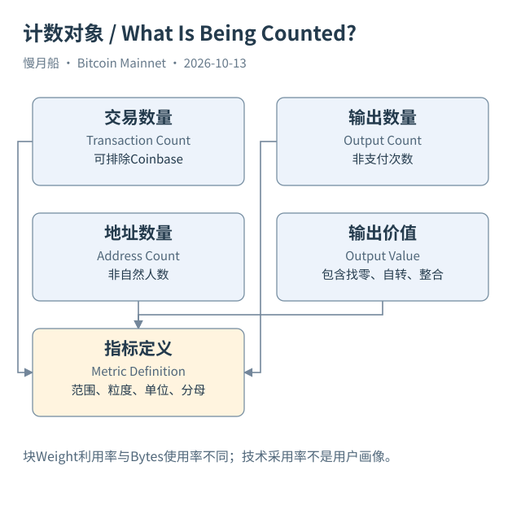

# 25｜数了很多输出，为什么仍不知道有多少用户？

你看到一天产生了一百万个输出，便想说有一百万次付款。再数出几十万个活跃地址，又想说有几十万名用户。这些数字确实来自链上，但它们的计数对象还没有变成业务对象。输出、地址、交易、钱包和现实用户之间，没有协议提供的固定一对一换算。

交易数可以按确认交易行统计，也可以排除 Coinbase 后统计普通交易。输出数描述创建记录，输入数描述当前交易引用数量。一个批量付款交易可能有许多输出，一个人也可能在一天里做多次整合。标题写成“网络结构活动”，比未经验证的“真实付款人数”更接近数据本身。

地址数量还受钱包派生和重复使用影响。新找零地址可能让一个钱包产生很多新地址；交易所则可能用一套地址和内部账本服务许多用户。输出地址为空的脚本也可能被漏掉。统计时应先说明地址识别覆盖，而不是把 distinct address 当作自然人数的精确代理。

输出价值总额尤其容易被误用。钱包自转、整合和找零会在历史中不断创建新输出，同一控制范围内的价值可能被重复搬运。把所有 output.value 求和，得到的是按定义的输出创建价值，并非去除找零后的经济支付额，也不是交易所真实成交量。

区块利用率可以用 Weight 与四百万 WU 上限比较，但它不同于原始字节使用率。见证折扣改变二者关系，Coinbase 和其他内容也属于区块资源。平台 blocks 表提供 weight、size 和 stripped_size，应选择与指标定义一致的列，不能为了曲线平滑在三种大小间随意替换。

脚本采用率也有多种分母。SQL 08 按创建输出类型统计数量及金额；另一个指标可以按已花费输入类型统计。它们描述新输出选择与实际花费活动，观察时间不同。将 P2TR 输出占比称为 Taproot 用户占比，需要额外解释，不能直接从脚本标签跳到人数。

平均费率、总费用和每笔费用同样各有意义。SQL 09 汇总普通交易费并与区块 total_fees 对照，SQL 16 按日期描述确认交易的费率分布。它们没有用户首次广播时间，因此无法独立测量每笔交易等了多少秒，更不提供费率影响等待时间的因果证据。

作者旧 Dashboard 的每日输出创建与消费图，适合帮助读者观察结构变化。但图里的创建数减消费数，不应直接命名为精确当前 UTXO 集合增长，因为还需处理不可花费输出及历史特殊项。旧结果使用 DOUBLE 汇总金额，也不能被转称为整数聪级供应证明。

一个可复现指标，至少要写清网络、确认范围、日期、粒度、单位和排除条件。读者才能知道数字变大究竟代表什么。技术科普不必把每个数字都包装成商业故事；让统计对象保持准确，就是帮助普通人读懂链上数据。

[编辑此图](../../assets/diagrams/metrics.drawio)

依据：[dune-blocks](https://docs.dune.com/data-catalog/bitcoin/blocks)；[dune-transactions](https://docs.dune.com/data-catalog/bitcoin/transactions)；[dune-outputs](https://docs.dune.com/data-catalog/bitcoin/outputs)。研究基准日：2026-10-13。来源获取状态见[来源目录](../../research/source_catalog.md)。

[上一章](../part-06/24-age-and-cdd.md) · [目录](../../SUMMARY.md) · [下一章](../part-07/26-transaction-graph.md)
