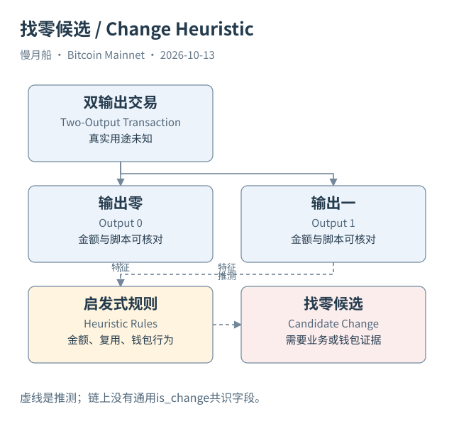

# 27｜两个输出，哪一个才是付款，哪一个是找零？

看到一笔单输入双输出交易，很多人习惯挑较小金额作为付款，较大金额作为找零。这个规则有时符合钱包行为，却不是协议保证。付款可以很大，找零可以很小；交易也可能同时付给两个人，根本没有找零。判断之前，先确认你手里有没有钱包或业务证据。

找零识别（Change Identification）通常属于启发式推测（Heuristic）。研究者根据金额形态、新地址、脚本类型、地址复用、后续花费和钱包软件习惯，形成一个或多个候选。每条规则都有适用范围，也可能与其他规则冲突；不能把“命中了几条”直接当成已证明。

例如，一个输出金额是整数字样，另一个有很多小数，后者可能像找零。但交易所批量付款、用户手工指定金额或某些协议安排都可能破坏直觉。原始金额是整数聪，所谓整齐只是显示单位和业务习惯的结果，不能靠小数位数寻找协议内置用途。

脚本类型相同也不是决定性证据。付款双方可能使用同类钱包；钱包找零可能切换到新类型。某个输出此前没出现过，既可能是新找零地址，也可能是收款人为了隐私提供的新地址。地址变化帮助产生线索，同时也扩大不确定性。

后续花费可以提供更多上下文，但不能让猜测自动变成事实。一个输出后来与某些已知钱包输出共同花费，可能支持控制范围的候选关系；协作交易又可能使共同输入规则失效。模型之间相互支持时，需检查是否只是同一个未经验证假设被重复使用。

教学交易中，我们事先设定 Alice 控制 0.699 BTC 输出，所以图可以明确标注找零。Case 01 的真实十 BTC 与四十 BTC 输出则保留用途未验证。结构相似不授权我们把教学里的人物和用途直接搬到真实哈希上，这也是贯穿本书的重要编辑习惯。

SQL 15 只筛选单输入双输出中金额等结构条件，输出字段叫 change_candidate，并标记 HEURISTIC。它没有把候选从总输出金额扣除后，再把剩余数字宣传为准确经济支付量。若实际业务需要估算，应同时报告原始总额、规则版本和候选不确定范围。

误判找零还会污染聚类。一旦把收款人的输出错误加入付款方控制范围，后续所有交易都可能被继续合并，错误扩大到许多地址。图谱看起来越来越完整，并不意味着归因越来越可靠；需要追踪每一条合并规则的来源和可能反例。

当你必须给结论时，可以写“按某条钱包行为规则，输出一是找零候选；未取得钱包内部记录”。这样的表达有明确用途和边界。确认一个输出被花费需要引用证据，认定它是找零则需要另一层研究，两者不能共享同一个确定性标签。

[编辑此图](../../assets/diagrams/change.drawio)

依据：[transactions](https://developer.bitcoin.org/devguide/transactions.html)；[clustering](https://conferences.sigcomm.org/imc/2013/papers/imc182-meiklejohnA.pdf)。研究基准日：2026-10-13。来源获取状态见[来源目录](../../research/source_catalog.md)。

[上一章](../part-07/26-transaction-graph.md) · [目录](../../SUMMARY.md) · [下一章](../part-07/28-coinjoin-and-clusters.md)
