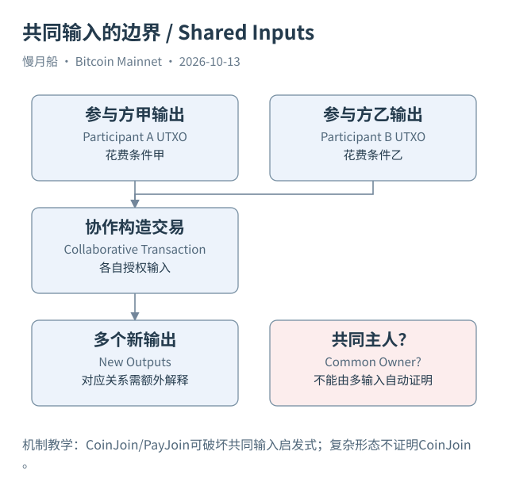

# 28｜为什么共同花费的输入，未必属于同一个人？

一笔交易把十个地址的输出一起花费，研究者便把十个地址归到同一个钱包。这是常见的共同输入所有权启发式：普通钱包构造付款时，经常一起选择自己能够控制的输出。但这个经验前提不是 Bitcoin 共识规则，多方合作构造交易可以直接打破它。

CoinJoin 让多名参与者把输入和输出放在同一笔交易中，分别提供所需授权。链上可以看见所有前序引用与新输出，却未必能确定每个输入的经济价值对应哪个参与者输出。节点验证的是交易及授权条件，不需要知道这是一场多少人的隐私协作。

PayJoin 也提醒我们，外观像普通付款的交易可能包含收款方输入。一旦共同输入启发式忽略这一可能，就会把付款人与收款人合并为同一个实体。不是只有特别明显、等额输出很多的交易才需要警惕，协作方式可以具有不同形态。

反过来，看到多个相同金额输出，也不能一律断言 CoinJoin。批量发放、业务结算或人为构造都可能形成类似模式。本篇 Case 09 有 176 个输入和十一项输出，我们把它标为复杂多输入交易，不把缺乏协议或业务证据的样本硬命名为已确认 CoinJoin。

UTXO 整合（Consolidation）通常指钱包把多个输出汇成较少新输出。SQL 14 用多输入、少输出条件寻找结构候选。它不能证明所有旧输出此前都属于同一个自然人，也不能说明用户正在出售资产。主动整理、自转和多方合作，可能产生相似的表面数据。

剥离链（Peel Chain）描述一串交易中持续保留一个较大候选输出，并产生较小输出的行为形态。它可能与钱包付款有关，但找零规则是其推断前提。若最初猜错哪个输出继续受原主体控制，后续“剥离”解释也会随之失去基础。

地址复用会让一些观察更直接：同一脚本对应的历史输出可以归入明确的脚本范围。但脚本相同不自动说明最终受益人相同，尤其机构地址和托管业务可能服务多名客户。控制层聚类与客户层身份归属仍应分开。

隐私在这里不是“交易无法追踪”。输入引用仍是公开确定的结构；不确定的是部分参与者对应、用途和归属。分析师应保留多个候选解释，并记录采用规则、反例和置信等级。不能把一个未校准的分数当成现实身份正确概率，更不能仅因图形连通就识别普通私人用户。

对读者而言，最重要的是知道何时停止合并。先确认输出与输入的引用，再判断交易是否可能协作，最后才考虑钱包范围推测。这样使用启发式，它仍能提供研究线索；把它提升为确定身份规则，才会造成看似精确而实际脆弱的结论。

[编辑此图](../../assets/diagrams/coinjoin.drawio)

依据：[coinjoin](https://bitcointalk.org/index.php?topic=279249.0)；[clustering](https://conferences.sigcomm.org/imc/2013/papers/imc182-meiklejohnA.pdf)；[bip78](https://github.com/bitcoin/bips/blob/master/bip-0078.mediawiki)。研究基准日：2026-10-13。来源获取状态见[来源目录](../../research/source_catalog.md)。

[上一章](../part-07/27-change-heuristics.md) · [目录](../../SUMMARY.md) · [下一章](../part-08/29-exchange-attribution.md)
