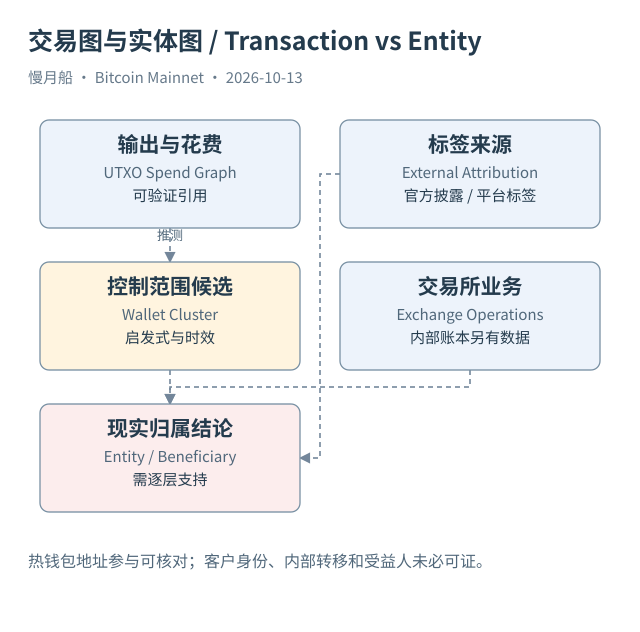

# 29｜链上为什么没有一份权威交易所地址名单？

你看见浏览器在某地址旁标了交易所名称，就把所有转入称为用户充值，所有转出称为用户提现。这种解释可能符合部分业务，却已经跨过几层证据：地址标签从何而来，该地址是否仍由机构控制，当前交易是内部整理还是客户付款，最终受益人又是谁？

Bitcoin 协议记录脚本与花费，不维护真实机构名单。实体归因（Entity Attribution）可以来自交易所公开披露、研究者交互、第三方标签或其他资料。它属于外部证据层，可靠程度取决于来源、时间和验证方式。浏览器展示一个名称，不等于协议在输出里写下机构身份。

本篇 Case 08 采用 Bitfinex 官方发布的钱包列表。文件将地址 `1Kr6QSydW9bFQG1mXiPNNu6WpJGmUa9i1g` 标为 BTC hot wallet；本轮保存了文件内容和固定版本链接，并取得该地址参与的确认交易。链上核对地址对应前序输出，热钱包与机构名称则引用官方自我披露，不伪装成独立密钥控制证明。

热钱包（Hot Wallet）、冷钱包（Cold Wallet）描述机构使用和密钥管理安排。仅凭交易频率高低或脚本类型，不能严格证明设备是否联网。官方披露提供直接业务线索，仍需要注意文件版本和时效；它也没有自动列出机构全部充值地址或内部账本客户。

充值地址（Deposit Address）可能对应某名客户在平台的入账标识，但链上没有平台内部客户号。归集到热钱包后，平台通常用内部账本区分客户余额。链上后续从热钱包付款，不能直接指定是原来某名充值者的钱，也不能把每个输出的最终受益人写成该交易所。

机构内部转移也可能被误计为流出。热钱包向冷钱包整理储备，链上结构可能像普通付款；若两个地址标签都可靠，可以作为内部转移候选处理。若只知道一端，最好保留未知，不为了画出完整进出图而把缺少标签的地址都当外部用户。

储备证明（Proof of Reserves）进一步涉及资产与负债口径。公开地址余额可以支持一定范围的链上资产观察，却不单独证明平台全部负债、资产无抵押或随时偿付能力。本书只用公开钱包披露演示归因来源，不进行机构财务安全评估，也不把储备数字作为投资建议。

给每个标签保存来源 URL、发布或取得日期、适用网络、地址范围和置信说明，可以让归因随证据更新。标签过期时，不应让历史名称继续支配今天全部交易解释；标签不存在时，也不能从某个浏览器没显示就断言该地址没有机构关系。

最终可以写“此交易花费了官方披露热钱包地址对应的输出”。这句话同时保留了链上结构和外部标签的分工。继续说“某客户提现成功”则需要平台或业务证据。本书在这里停在已核实层次，让读者知道还有哪些问题没有答案。

[编辑此图](../../assets/diagrams/entity.drawio)

依据：[bitfinex-wallets](https://github.com/bitfinexcom/pub/blob/83d06bdb5f5a2ce05d5ba2db5a426dd44c9f5128/wallets.txt)；[clustering](https://conferences.sigcomm.org/imc/2013/papers/imc182-meiklejohnA.pdf)。研究基准日：2026-10-13。来源获取状态见[来源目录](../../research/source_catalog.md)。

[上一章](../part-07/28-coinjoin-and-clusters.md) · [目录](../../SUMMARY.md) · [下一章](../part-08/30-lineage-methods.md)
