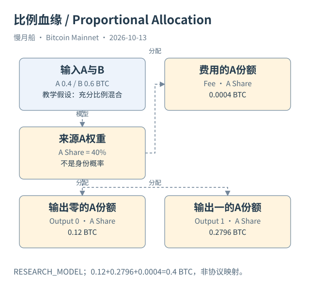

# 31｜按比例分配价值，怎样把假设写进计算？

让输入 A 为 0.4 BTC，输入 B 为 0.6 BTC。交易创建 0.3 BTC 和 0.699 BTC 两个输出，费用为 0.001 BTC。你知道 A 被花费了，但不知道经济上哪一笔新输出继承它。一个最简单的研究选择，是假设所有输入价值按比例混合，再向输出和费用分配。

在这个比例分配（Proportional Allocation）模型里，A 占输入总额的百分之四十。于是模型给 Output 0 分配 0.12 BTC 的 A 来源份额，给 Output 1 分配 0.2796 BTC，再给费用分配 0.0004 BTC。这三个数字相加为 0.4 BTC，保留了模型金额守恒。

费用必须有去向定义。如果只对新输出按原输入总额比例计算，却遗漏费用，传播到下一层的总份额就会少一部分而没有解释。另一种模型可以先扣除费用再重新归一，但它采用不同假设，结果也不同。本书明确使用把费用作为单独终点的方式，不暗中切换。

配套 Python 使用有理数 Fraction 和整数聪进行教学计算，避免浮点舍入在这个小例子里造成金额不守恒。结果可以包含分数聪，因为它表达模型期望份额，不是协议创建了半聪输出。展示时如果四舍五入，需要保留原精确分数及舍入误差。

这个模型不会自动知道找零。它对付款输出与找零候选都按同样比例分配，也不会判断哪个输入属于哪个人。若加入找零规则或钱包聚类，便成为另一种条件模型，应说明额外信息来源；不能先把找零当事实，再宣称模型独立证明了钱包归属。

路径权重（Path Weight）可以沿多层传播，但并非现实资金所有权概率。只有明确给出随机过程或抽样解释、并说明校准依据时，才可以讨论概率含义。把 0.4 的比例写成“百分之四十概率属于某人”，是把价值份额与身份概率混为一谈。

合并与分支还要防止重复计数。两条路径重新汇入同一输出时，应按模型规则汇总来源份额并检查总额边界，不能把整笔输出金额在每条路径各算一次。图谱截断后，需要另记未追踪分支和已流入费用的份额，避免剩余部分被误称为最终全部资金。

本篇保存了教学输入、模型公式、分数结果和离线守恒检查，并注明 RESEARCH_MODEL。真实交易图谱没有被强制套入这套分配。模型能帮助读者比较假设如何影响答案，但我们不把其中一个答案选出来包装成协议原生真相。

一个可靠模型报告应同时给出结构证据、分配方法、费用处理、截点和敏感性讨论。读者才知道结论究竟来自哪些数据、哪些选择。数学算得准确，只完成了计算这一层；经济解释的有效性仍取决于假设是否适合问题。

可以把另一种分配方法作为敏感性对照，但必须从头重算所有层。不要在第一层用比例、第二层突然改成顺序，再把混合结果说成一个统一模型；每次规则选择都会改变路径解释。

[编辑此图](../../assets/diagrams/probability.drawio)

依据：[tx-reference](https://developer.bitcoin.org/reference/transactions.html)；[dune-inputs](https://docs.dune.com/data-catalog/bitcoin/inputs)。研究基准日：2026-10-13。来源获取状态见[来源目录](../../research/source_catalog.md)。

[上一章](../part-08/30-lineage-methods.md) · [目录](../../SUMMARY.md) · [下一章](../part-08/32-ordinals-and-inscriptions.md)
