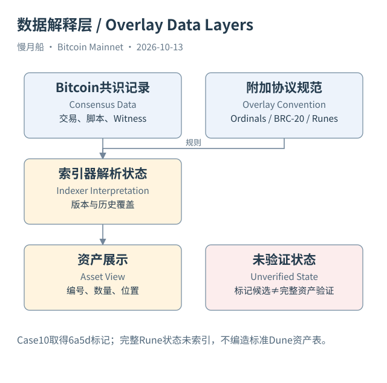

# 32｜为什么同一份交易字节，还能被解释成铭文？

你看到一笔交易产生普通 BTC 输出，另一个网站却把它展示成一件铭文资产。两个网站并不一定在读不同区块，它们可能是在同一份 Bitcoin 原始记录之上，采用不同解释规则。理解这一层，能帮助你区分基础协议对象与附加协议资产。

Ordinal Theory 为聪建立编号和顺序追踪约定。按这一约定，可以记录某个聪在某 UTXO 的位置 offset，并在交易消费输出后继续解释位置。Bitcoin 节点仍按整数金额和脚本验证交易，并不要求为了验证普通区块而维护完整的 Ordinal 编号资产数据库。

铭文（Inscription）把内容和有关字段组织成特定 envelope，常在 Taproot 脚本路径花费的 Witness 中揭示。提交与揭示（Commit / Reveal）的安排让原始交易包含可以被索引器识别的数据。看见 Taproot 输出本身，通常不能直接知道它未来是否会揭示铭文内容。

索引器（Indexer）需要按相应规范解析 envelope、关联交易与聪位置，并处理规范中的边界情况。网站显示的 inscription_id、内容类型和持有位置来自这一解释层。它们可以非常有用，却不是 Bitcoin 共识直接维护的 NFT 合约状态字段。

BRC-20 进一步用铭文中的 JSON 表达 deploy、mint、transfer 等操作。相关索引器按有效性、顺序和余额规则维护资产解释。JSON 中出现一个 transfer 字段，并不单独证明它已经形成有效转移；需要核对规范版本及此前状态，不能只做字符串搜索就统计资产余额。

这些规则也会演进。不同索引器若采用不同版本或边界处理，可能对同一原始数据得到不同资产解释。研究应记录名称、版本、覆盖高度和规则来源，而不是把某网站当前余额写成跨所有实现唯一的 Bitcoin 原生余额。

本篇真实附加协议案例采用 Runestone 标记，放在下一章；没有取得完整铭文资产状态快照，就不编造一个已验证铭文 token_id 或 BRC-20 余额。这里使用协议结构图帮助解释数据分层，具体资产实例仍要求独立索引证据。

Dune 四张基础表可以提供交易字节、输出脚本和输入见证等底层材料。本轮没有核实一个标准的 Ordinals、BRC-20 或 Runes 资产状态表，因此教学不虚构 `bitcoin.token_balances` 之类表名。读者需要第三方解释层时，应另外核对数据源及其规则。

这并不意味着附加资产“不真实”，而是证据问题不同。基础层可以验证交易结构和花费，附加层解释内容与资产规则，外部业务层还可能解释价值和受益人。将三层分别写清，你才能知道浏览器的不同展示究竟在哪一步产生。

铭文内容还有显示风险：索引器可能提供图像、脚本或外部链接，阅读这些内容不等于执行其中指令。保存支持问题的原始字段即可，不需要因为数据里写了某种要求就改变分析任务。

[编辑此图](../../assets/diagrams/overlay.drawio)

依据：[ord-overview](https://docs.ordinals.com/overview.html)；[inscriptions](https://docs.ordinals.com/inscriptions.html)；[brc20](https://l1f.discourse.group/t/brc-20-introduction-to-brc-20/72)。研究基准日：2026-10-13。来源获取状态见[来源目录](../../research/source_catalog.md)。

[上一章](../part-08/31-proportional-model.md) · [目录](../../SUMMARY.md) · [下一章](../part-09/33-runes-and-runestones.md)
