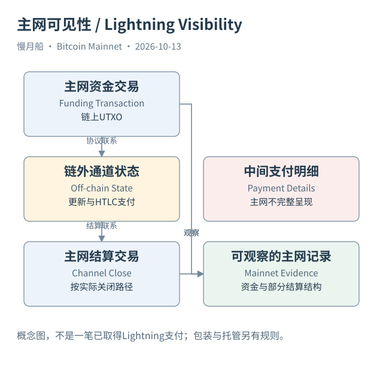

# 34｜一笔真实 BTC 支付，为什么链上可能没有对应交易？

朋友说刚刚通过 Lightning 支付了一杯咖啡，你却在 Mainnet 浏览器找不到一笔相应金额的交易。这不必说明朋友没有付款。闪电网络（Lightning Network）让参与者在通道安排和链外状态之间更新支付关系，许多支付不会每次都生成一笔新的主网交易。

支付通道（Payment Channel）通过资金交易（Funding Transaction）与主网 UTXO 联系起来。参与者按协议维护可以用于结算的状态和承诺安排，在链外交换更新。关闭通道时，链上可能出现合作关闭或单方关闭等交易，具体形式与协议版本和实际路径有关。

哈希时间锁合约（HTLC）等机制帮助多跳路由中有条件地转移支付。读者不需要在这里学习完整消息协议，但应知道路径上参与者处理的链外状态，不是四张 Mainnet 确认表中的普通交易行。不能把通道资金输出的总金额当成每次咖啡付款金额。

主网可以观察某些资金和关闭结构，有时还可结合公开通道公告帮助识别。但仅凭这些交易，通常无法复原通道期间所有支付次数、金额、路径和参与者。一个通道存续多年，中间发生的经济活动并不都写在它最终关闭的输出列表里。

通道余额也不同于钱包普通 UTXO 余额。链外状态决定参与者对资金安排的结算权利，链上输出是有关结算条件的基础对象。更新一次链外余额，不等于创建一笔新的已确认 UTXO。若指标只使用 Mainnet 交易数，就应承认没有覆盖全部 Lightning 支付活动。

托管平台内部划转也可能没有一笔即时主网交易。用户在平台中收到 BTC 余额，可能是内部账本增加，平台仍用共同钱包管理链上资产。这里的经济请求权与某个特定输出的链上控制不是一对一关系，所以无法只用 Mainnet 图谱给每个客户分配独占输出。

包装 BTC（Wrapped BTC）、桥接 BTC 和侧链资产则还有各自托管、锁定或桥接规则。一个其他网络上的代币名称带 BTC，不等于它就是 Mainnet 的某笔原生输出。研究者需要说明底层储备、发行解释和跨系统映射证据，不能仅靠名字把两张账本当成同一份数据。

本篇没有运行 Lightning 节点，也没有获取通道私有状态。图中的链外部分表达可见性边界，不虚构一笔已取得的咖啡付款。BOLT 资料提供协议解释，真实 Mainnet 样本提供链上结构，两种来源不能相互补成不存在的采集记录。

读者因此可以重新理解“所有交易公开”这句话：确认的 Bitcoin 主网交易结构公开，不代表所有涉及 BTC 的经济活动都逐笔出现在主网。分析范围说清楚后，链上数据仍然很有用，只是它不能独自承担全部商业世界的记录工作。

[编辑此图](../../assets/diagrams/lightning.drawio)

依据：[lightning](https://github.com/lightning/bolts/blob/master/02-peer-protocol.md)；[lightning-routing](https://github.com/lightning/bolts/blob/master/04-onion-routing.md)。研究基准日：2026-10-13。来源获取状态见[来源目录](../../research/source_catalog.md)。

[上一章](../part-09/33-runes-and-runestones.md) · [目录](../../SUMMARY.md) · [下一章](../part-09/35-where-is-the-btc.md)
