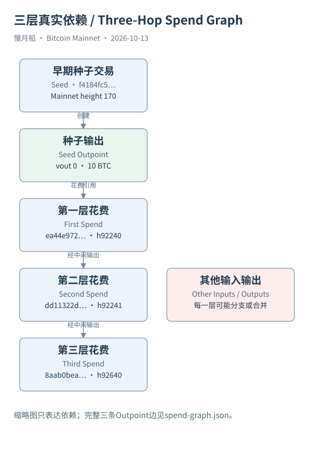

# 35｜从一笔早期交易出发，今天还能说它在哪里吗？

我们终于回到开头的问题：钱包里的 BTC 到底在哪里？现在把时间拉长，从 Case 01 的真实早期交易开始追踪。它创建十 BTC 与四十 BTC 两个输出。取得后续花费以后，你能够继续把旧输出连接到后来交易，却会发现“在哪里”其实包含几种不同问题。

如果问某个原始输出现在是否仍未花费，查它的生命周期就可以回答有界证据问题。它一旦被花费，这个输出已经结束，不能再把它的 Outpoint 当作今天仍然存在的一笔余额。历史创建记录保留，不表示旧输出身份继续存活在每个后代中。

如果问哪些后来交易依赖它，交易图谱能够逐层展开。Case 07 的本地证据保存三条连续花费边，分别核对后续 vin 引用。这里有明确停止深度，不声称已经追到当前链头，更不将三层样本最末输出标作原始 BTC 的唯一最终位置。

加入其他输入后，问题就变了。后来交易同时消费多笔旧输出，并创建多个新输出。链上记录金额守恒，却没有指定原种子经济价值在每个输出中的份额。图谱可以继续延伸，分配解释却需要 Ordinal 约定或研究模型。延伸更多节点不会自动消除这个差别。

如果采用比例模型，可以传播一组候选价值份额，并单独记录费用和未展开分支。换成顺序模型，可能得到另一组位置结果。两者都可以重复计算，但必须说明选择的定义；不能看到其中一条路线就说“找到了同一枚具有固定身份的 BTC”。

钱包找零让地址变化不必等于所有权变化，CoinJoin 和 PayJoin 让共同输入不必等于共同主人，交易所内部账本让一份链上钱包服务许多客户。公开标签只能补充特定机构关联，还不能直接复原每名客户的历史收益归属。

资金进入 Lightning 通道或其他托管、包装系统后，Mainnet 又缺少部分链外活动。你也许能观察资金和结算交易，却不能只从主网输出反推出全部中间付款。应把这里标作观察边界，并说明若要继续研究，需要哪类额外数据。

因此，一个诚实的综合报告可以有四行不同结论：已验证输出创建；已验证后续花费依赖；按某模型得到候选后代份额；最终现实受益人未确认。它们的确定性不同，但都能帮助读者理解问题，不必为了得到一个单一地址答案而隐藏中间缺口。

这也是 Bitcoin 与账户余额资产研究的重要差别。UTXO 给出强而明确的前序引用，账户余额则有另一套状态变化结构；二者不能只因为都能画箭头就照搬模型。理解每条链原生怎样记账，再选择追踪定义，才是《慢月船》连接运行地图与数据地图的方法。

[编辑此图](../../assets/diagrams/spend-graph.drawio)

依据：[tx-reference](https://developer.bitcoin.org/reference/transactions.html)；[ord-overview](https://docs.ordinals.com/overview.html)；[dune-inputs](https://docs.dune.com/data-catalog/bitcoin/inputs)。研究基准日：2026-10-13。来源获取状态见[来源目录](../../research/source_catalog.md)。

[上一章](../part-09/34-lightning-and-custody.md) · [目录](../../SUMMARY.md) · [下一章](../part-09/36-practical-evidence.md)
