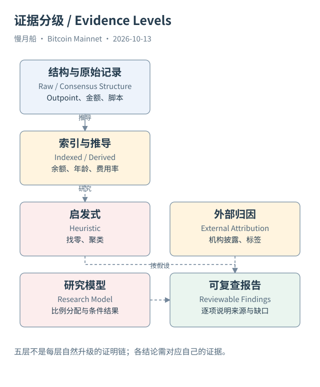

# 36｜遇到陌生交易，怎样写出一份可复查的结论？

现在给你一个陌生 TxID，你已经不需要先猜一个 From 和 To。先确认网络和状态，再取得交易、输入、输出与区块定位。接着检查旧输出引用、金额和脚本，最后决定是否有足够证据讨论用途、控制范围或经济资金分配。这条路线能让结论逐步建立，而不是先有故事再找图。

第一层保存直接结构：完整 TxID、区块高度和哈希、输入前序 Outpoint、输出索引、金额与脚本。API 的 prevout 金额来自历史回查，应注明索引增强。原始交易字节能复算标识和输出整数金额；本地没有执行的验签或 PoW 检查，不写成已经通过。

第二层保存推导：费用、费率、输出年龄、截止余额和图谱范围。每个数字说明单位、截点、覆盖与公式。DOUBLE 转聪的舍入要保留精度风险，交易层费用不在明细 Join 后重复累加，Coinbase 不进入普通输入金额公式。

第三层记录启发式：找零候选、整合候选和钱包聚类。为规则保存版本与反例，遇到协作交易可能性停止盲目合并。模型置信分数需要解释，不能因为数字有两位小数就当成经过校准的真实概率。

第四层记录外部归因：标签来自官方披露、第三方平台还是研究过程，取得日期是什么，有没有固定版本。交易涉及公开热钱包地址，可以据此说明外部关联；客户身份、法律所有权和最终受益人仍可能未知。链上不存在一张天然完成这些问题的机构名单。

第五层记录研究模型：如何将输入来源份额分配到输出与费用，采用比例还是顺序约定，怎样处理分支与截断。图中模型边必须与可验证花费边使用不同说明。计算守恒只证明模型按规则执行，不证明选择的规则就是现实业务安排。

本篇文件工程也沿这条路线交付。正文回答问题，图形保留可编辑节点，SQL 说明表与粒度，RPC 标明版本和未执行状态，JSON 保存取得资料，研究目录列出来源与缺口。验证脚本检查引用、编号、字节、金额和花费边，让读者可以继续复查。

外部工具失败时，报告服务限制而不编造链上结论。Dune 新 SQL 受只读范围限制没有运行，旧结果也不改成今日执行。没有完整资产索引就不宣布 Rune 余额已验证，没有授权节点就不伪造 Core 返回。写作可以完成，验证边界仍需要明确留下。

最终你应能够说清：这笔交易花掉哪些旧输出，创建哪些新输出，授权条件是什么，确认位置在哪里，以及哪些推断需要更多证据。做到这些，已经掌握 Bitcoin 数据分析的可靠基础。看得见的交易路径与仍未知的现实归属，可以同时被准确表达。

[编辑此图](../../assets/diagrams/evidence.drawio)

依据：[esplora](https://github.com/Blockstream/esplora/blob/master/API.md)；[dune-inputs](https://docs.dune.com/data-catalog/bitcoin/inputs)；[rpc-getrawtransaction](https://bitcoincore.org/en/doc/31.0.0/rpc/rawtransactions/getrawtransaction/)。研究基准日：2026-10-13。来源获取状态见[来源目录](../../research/source_catalog.md)。

[上一章](../part-09/35-where-is-the-btc.md) · [目录](../../SUMMARY.md)

[下一章](../appendix/glossary.md)
