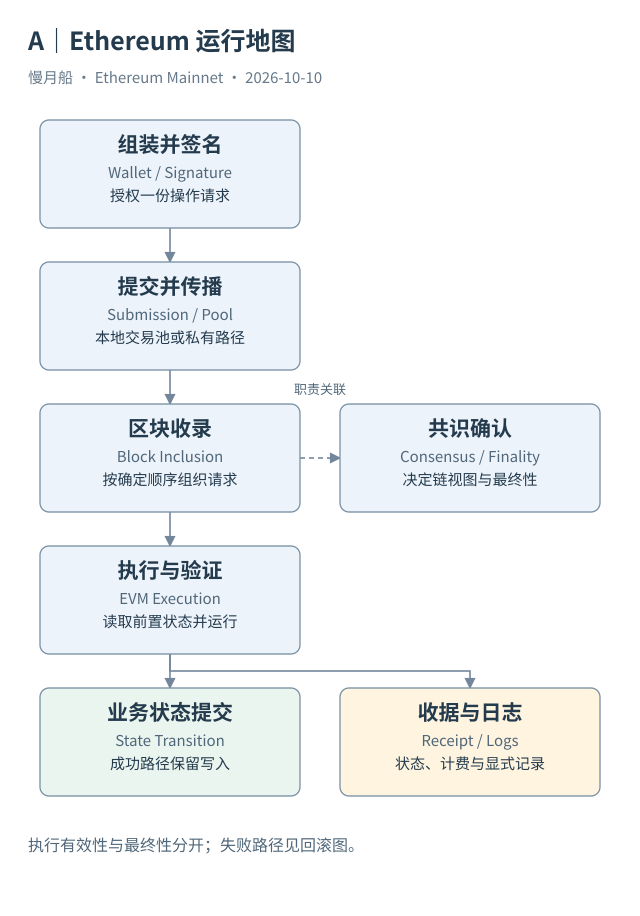

# 01｜发送 1 ETH，以太坊记录了什么？

你在钱包里填入对方地址，输入“1 ETH”，点击发送。界面只显示一条转账，但以太坊需要回答几件不同的事：谁允许转出这笔钱，钱从哪里扣，谁收到钱，这次处理消耗多少费用，以及所有节点怎样得到相同结果。

我们从一笔真实主网交易开始。2026 年 6 月 29 日 07:17:23 UTC，地址 `0xCcabD723b9EF343464F8910ca6B9B87A8B3E9c19` 向 `0xc8b30aC3a4F5f0Dae238d82A45a7f876fd1E6614` 发送了 1 ETH。完整哈希与证据保存在 [Case 01](../../examples/transactions/case-01-eth.md)。浏览器列出区块 25421774、成功状态、21,000 Gas，以及 0.000006851841948 ETH 的执行费。区块是一组按顺序收录请求的历史记录；Gas 是协议衡量处理资源的计费单位，使用量与单价决定适用范围内的执行费。

交易（Transaction）可以理解为一份获得授权的操作请求。它写明目标地址、原生金额和费用安排。这里的 Value 是 1 ETH，输入数据为空。哈希（Transaction Hash）是识别这份已签名请求的摘要，并不是收款人地址，也不是银行式的账户编号。换掉请求内容，摘要通常也会改变。

网络执行这份请求后，发送方原生余额减少转账金额和费用，接收方原生余额增加 1 ETH。钱没有存进钱包软件；余额属于链上的账户状态（Account State）。钱包负责让人查看状态并授权操作。换一款钱包查看同一地址，并不会创建另一份 ETH。

请求记录与执行结果分别有自己的证据。交易告诉我们请求转出多少；收据（Receipt）告诉我们执行是否成功、消耗多少 Gas。假如交易进入区块却执行失败，不能只看 Value 就认定对方收到钱。浏览器将这些来源组合成一页，便于阅读，但页面上的每一个标签并不都来自同一份原始数据。

这个案例适合做第一步，因为没有复杂的合约路由。我们可以先核对 From、To、Value 和 Status，再算费用。若发送前余额为一个教学假设的 2 ETH，且没有同区块的其他余额变化，执行后就是 0.999993148158052 ETH。这个起始余额仅用于计算示意，浏览器页面并没有证明发送前确实持有 2 ETH。

进入 Dune 后，同一笔请求应当从 `ethereum.transactions` 按 Hash 查找。一行对应一笔顶层交易，里面包括从收据整理的执行字段。查询不需要猜测代币名称，也不用把所有内部调用相加。真正要核对的是同一条主网哈希、同一区块和同一笔原生金额。

读完本章，先记住两件事：交易是请求，余额是状态。后面的合约转账、Swap 和质押，都会在这个区别上增加新的执行步骤与数据证据。

可以把浏览器页面暂时分成请求、结果和定位三组。请求组抄下发送地址、目标地址和原生金额；结果组抄下状态与实际费用；定位组抄下主网、区块和完整哈希。若一个字段无法归入这三组，先查它来自接口、合约还是平台标签。

核对时也不要只比金额。另一个人同样发送一以太币，可以有相同金额和相同手续费，却是另一份授权请求。完整哈希与历史定位让我们回到具体事件；金额相等只能帮助检查计算，不能取代交易身份。这个练习以后也适用于代币与复杂兑换。

[编辑此图](../../assets/diagrams/runtime.drawio)

[完整 SQL：01-one-transaction](../../examples/sql/01-one-transaction.sql)（STATIC_CHECKED；未在 Dune 执行）。

依据：[Ethereum Transactions](https://ethereum.org/developers/docs/transactions/)；[Case 01 浏览器记录](https://etherscan.io/tx/0xdd757281a1bb25e5d54f660cd418b41a6c1d1634896908454de7b025975c13bb)。核验日：2026-10-10。

[目录](../../SUMMARY.md) · [下一章](../part-01/02-wallet-signature.md)
