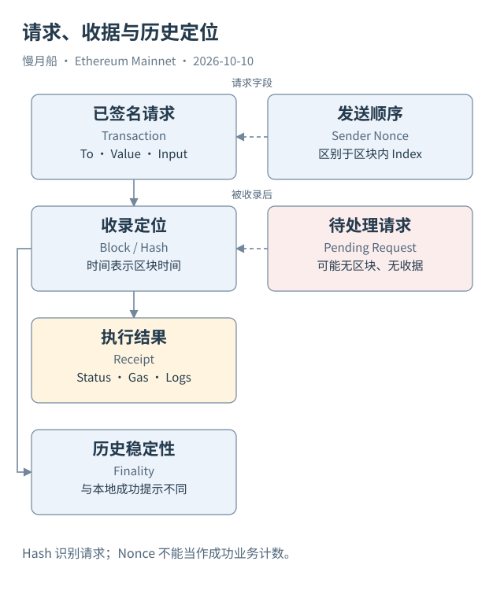

# 04｜Nonce 为什么会让一笔交易等在队列里？

连续发送两笔交易时，后一笔可能已经有哈希，却还没有出现在区块里。钱包显示“等待”，不是链上凭空少了一笔记录。对传统 EOA 来说，交易需要遵守账户的 Nonce 顺序；节点还要判断费用、余额与其他有效性条件。

Nonce 可以理解为账户使用请求序号的计数器。Case 01 的发送方 Nonce 为 0，表示这份顶层请求使用了这个账户的起始发送序号。它不是全网第零笔交易，也不是交易在区块中的位置；区块内序号另有字段。把两者混用，会破坏同一账户的历史排序。

假设账户当前下一笔有效序号是 8，你先广播了 Nonce 9。节点可以把它放入本地待处理队列，但不能先执行 9 再补 8。若 8 因费用不足一直未收录，后续请求也可能一起等待。这个例子说明顺序依赖，不代表所有节点保留相同队列或采取相同接收策略。

内存交易池（Transaction Pool 或 Mempool）存在于各节点，本书不把它描述成一个全网共享、完全一致的数据库。请求可能经过公共传播，也可能通过私有提交路径进入区块。Dune 的已收录交易表并不是所有待处理请求的完整清单，不能用查不到某个 Hash 来证明用户从未提交。

钱包所谓“加速”常常是用同一个 Nonce、调整费用后重新发出另一份请求。所谓“取消”也可能是提交同序号的替代交易。两份已签名请求通常有不同哈希，但在同一条有效历史里不能都作为同一账户同一序号的普通发送交易执行。节点对替换的费用门槛有自己的策略。

交易进入区块后即使执行 Revert，发送方的交易 Nonce 仍会被消耗，费用也按规则结算。因此，Nonce 不是“成功业务操作次数”。合约账户的计数又与合约创建有关；现代 EIP-7702 授权处理也会改变授权账户的 Nonce。这些例外使简单地用当前 Nonce 推算一个地址的所有活动越来越不可靠。

SQL 中，我们可以按发送地址和 Nonce 检查已收录历史，辅助发现缺口或理解执行顺序。若查询范围只有一天，序号不从零开始非常正常；若多个来源包含孤块、替代请求或重复索引，还需要检查区块哈希和来源状态。不能把所有不连续直接报成链上异常。

从这一章开始，读者应当习惯问“这个表记录哪一阶段”。有哈希说明请求可识别，有收据说明进入了相应区块视图，Nonce 则帮助理解账户的执行顺序。三者提供不同证据。

观察发送历史时，可以做一张两列小表：一列按区块位置排序，一列列出账户请求序号。普通已收录发送交易在适用范围内符合顺序，但查询只覆盖部分日期时，看不到之前的请求很正常。

检查“加速”则需要另一份待处理请求材料。已收录历史只会展示最终进入有效链视图的那份请求，不能还原每次广播与替换。若研究目的是钱包等待时间，就应取得本地提交时点、交易池观察与最终收录时间，不能从区块时间独自推出全部过程。

[编辑此图](../../assets/diagrams/envelope.drawio)

依据：[Geth txpool](https://geth.ethereum.org/docs/interacting-with-geth/rpc/ns-txpool)；[Ethereum Transactions](https://ethereum.org/developers/docs/transactions/)；[EIP-7702 Nonce](https://eips.ethereum.org/EIPS/eip-7702)。核验日：2026-10-10。

[上一章](../part-01/03-block-receipt.md) · [目录](../../SUMMARY.md) · [下一章](../part-02/05-account-fields.md)
