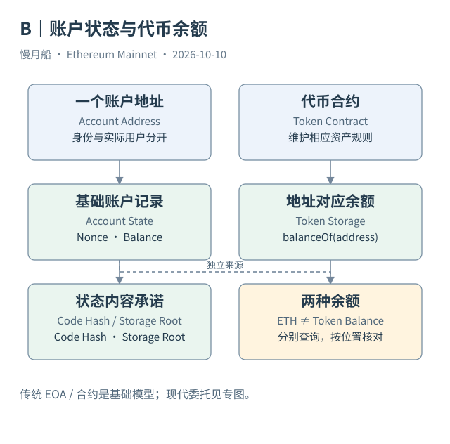

# 06｜为什么 USDT 不在我的 ETH Balance 里？

钱包同一屏展示 ETH 和 USDT，容易让人以为以太坊给每个地址准备了一张通用资产表。实际执行时，原生 ETH 与代币有不同的维护者：ETH 余额由执行层账户状态表达，USDT 余额则由对应合约的逻辑与状态表达。

把代币合约想成一本按地址查询的账簿，会比较容易入门。传统 ERC-20 实现通常在持久存储中维护地址到数量的映射。`balanceOf(address)` 提供读取接口，告诉调用者这个合约认为该地址当前持有多少最小单位。真实布局可能更复杂，代理、份额换算和特殊规则也可能参与计算，标准并没有强制每个合约使用同一槽位。

Case 02 中，顶层 To 是主网 USDT 合约 `0xdAC17F958D2ee523a2206206994597C13D831ec7`，Value 为零。请求的输入却指定了代币接收人和数量。它转移了 431,900,785 个最小单位，按这个代币的 6 位小数表达为 431.900785 USDT。顶层 Value 为零，只说明没有随这份请求附带原生 ETH，不说明没有代币移动。

执行合约后，逻辑需要检查发送者是否有足够代币，减少相应余额并增加收款余额，然后按实现产生事件。发交易的人仍要支付 ETH 费用。因而普通钱包里出现“USDT 减少，ETH 也略有减少”非常正常：两种减少分别来自代币状态更新和交易费结算。

持久存储（Storage）会在交易结束后继续存在。执行过程使用的临时 Memory 则不是下一笔交易可以直接继承的账户账簿。SQL 分析师看到过去的 Transfer Logs，也不等于直接读到了当前 Storage；日志是历史事件，读取余额是特定状态位置上的查询。

假如只把一天的转入减去转出，得到的是这一天的净流量。要推导期末余额，还必须知道期初余额，覆盖全部相关变化，并确认这个代币遵循适合这种推导的规则。遇到 Rebasing，余额可随换算因子变化，甚至没有为每个地址发出一条 Transfer。简单流水累计就可能失真。

一个地址拥有多种代币，可以理解为多个合约各自记录了与它有关的数量。合约地址才是资产识别的重要部分；两个同名代币也可能属于不同合约。同一主网地址还可能在其他链出现，资产身份应加入链的范围。

查询时先确定问题：若问 ETH，读取基础账户余额；若问 USDT，读取指定 USDT 合约；若问历史转账，查 Logs 或对应加工数据。把问题拆清楚，比把所有金额列机械相加更有用。

再想一个教学变化：收款人原来没有原生以太币，别人向它发送稳定币之后，钱包仍可能显示原生余额为零。这个结果并不矛盾，因为代币余额的记录在合约一侧。收款地址随后自己发送普通交易时，费用安排又是另一项条件。

查询多资产钱包时，先建立资产地址清单，再逐项查看余额接口或可信状态数据。名称只适合帮助阅读，不能充当资产主键。把不同合约发行的同名资产并入一个余额，会使看似合理的总数丢失最基本的身份依据。

[编辑此图](../../assets/diagrams/accounts.drawio)

[完整 SQL：03-usdt-transfer](../../examples/sql/03-usdt-transfer.sql)（STATIC_CHECKED；未在 Dune 执行）。

依据：[ERC-20](https://eips.ethereum.org/EIPS/eip-20)；[Storage 示例](https://docs.soliditylang.org/en/latest/introduction-to-smart-contracts.html)；[Case 02](https://eth.blockscout.com/tx/0x458584a9b39f8bcfc215cc5990f1776ed5cc485dc56ffb02927032ca79a537ca)。核验日：2026-10-10。

[上一章](../part-02/05-account-fields.md) · [目录](../../SUMMARY.md) · [下一章](../part-02/07-state-history.md)
