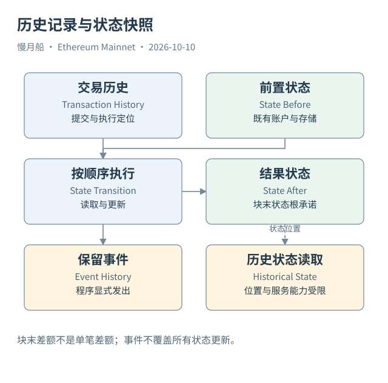

# 07｜记录交易和维护状态，是不是同一件事？

想知道“这个地址现在有多少钱”和“这个地址去年转过多少钱”，需要不同的材料。前者问状态，后者问历史。以太坊把交易历史与状态转换联系起来，但它们不是同一种数据，也不保证能从一张平台表直接替代另一种查询。

全局状态（Global State）描述执行层在某个位置保存的账户集合。一次交易以已有状态为起点，按协议和代码执行，产生结果。区块内交易有顺序，后一笔能看到前一笔成功提交的变化；区块头中的 State Root 对相应执行后的整体状态作出承诺。

状态根不是一份可以直接读懂的余额清单。当前执行状态采用 Merkle Patricia Trie 等结构组织，账户记录又通过 Storage Root 关联自己的存储。根摘要让节点校验内容一致性和验证证明，但并不会自动解释“哪个用户进行了哪项业务”。分析师仍需要请求、执行与合约语义。

历史交易记录保存提交过什么，收据保存相应结果，日志保存程序显式声明的事件。当前 Storage 则可能只留下最后值。例如一个授权额度从 100 改为 200，再改为 0，读取现在的 `allowance` 只会得到现在的规则结果，不会返回完整修改过程。

平台可以通过历史日志、状态读取或其他模型构造历史余额，但那是一个明确的加工过程。要问清楚期初值从哪里来、哪些资产被覆盖、重组怎样修正。出现一张名为“balances”的表，并不意味着其中每一行都与节点的原生历史状态读取完全等价。

历史查询还有位置精度。常见 JSON-RPC 以区块号读取块末状态，不自动给出该区块中每一笔交易前后的状态。若同一地址在一个区块内多次变动，用上一个块末与本块末相减，得到的是整个区块的净变化。需要单笔差异时，可能要借助重放、状态差异追踪或更专门的服务。

Archive Node 保留可用于历史状态访问的数据；普通节点的保存策略可能不同。近期协议与客户端还在调整历史保存方式。数据接口拒绝很久以前的状态请求，说明该服务不提供相应能力，不代表那段交易历史从未发生，也不应被写成链已“丢失账本”。

读图时，把交易历史放在时间轴上，把状态快照放在具体位置上。分析资金流，需要历史变化；验证现在能否转账，需要当前规则与状态。只有同时说明时间和来源，余额结论才有可复核的含义。

例如一天内先收到十个代币，再发送十个，日末净变化可能为零，历史仍有两次动作。只看两个期末快照，会错过周转；只看流水，又无法在缺少期初余额时判断期末拥有多少。

状态与历史的关系因而不是“哪个更真实”。它们描述同一系统的不同观察方式。研究者要选择足以回答问题的材料：核对持仓用适当位置的状态，解释过程用历史，证明中间步骤则需要更细执行证据。明确观察位置，还能避免把今天的余额写进去年的交易解释。

[编辑此图](../../assets/diagrams/state-history.drawio)

依据：[Merkle Patricia Trie](https://ethereum.org/developers/docs/data-structures-and-encoding/patricia-merkle-trie/)；[Archive Nodes](https://ethereum.org/developers/docs/nodes-and-clients/archive-nodes/)；[Execution APIs](https://ethereum.github.io/execution-apis/)。核验日：2026-10-10。

[上一章](../part-02/06-storage-token.md) · [目录](../../SUMMARY.md) · [下一章](../part-02/08-delegation-aa.md)
