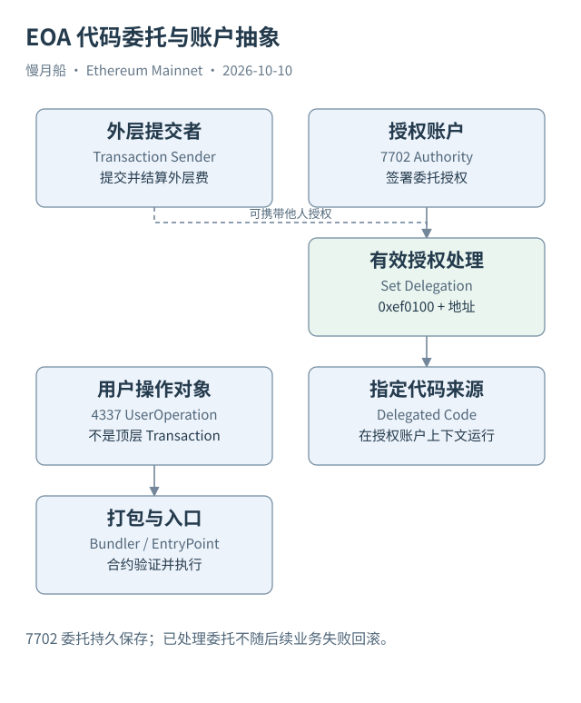

# 08｜有代码的账户还可能是 EOA 吗？

过去常见的分类办法是：代码为空就按普通 EOA 处理，代码非空就按合约处理。这个规则便于入门，却不足以分析 Pectra 之后的以太坊。EOA 可以保留私钥授权能力，同时把执行交给一份已有代码。

EIP-7702 引入类型 4 的 Set Code Transaction。请求附带授权列表（Authorization List），每个授权指定链范围、目标代码地址、Nonce 与签名等内容。有效授权被处理后，授权账户写入一个以 `0xef0100` 开头、随后带地址的委托标记。调用这个账户时，执行层按规则读取被指向的代码，并在授权账户的上下文里执行。

委托（Delegation）不是把 ETH 和代币全部搬到另一个钱包地址。代码来源与状态所在账户需要分别识别。授权人也不必等于外层交易的发送人，因此观察顶层 From，只能找到提交并结算外层费用的地址，未必找到所有参与授权的账户。

尤其要纠正“临时加代码，交易后自动恢复”这种旧描述。最终规范采用持久委托，直到以后被有效授权改变或清除。授权处理发生在业务执行之前；即使随后执行失败，已经处理的委托标记也不回滚。费用、发送者 Nonce 与授权处理，都需要与业务层回滚分开判断。

这也改变了某些传统识别方法。`tx.origin` 表示这份执行的顶层来源，`msg.sender` 表示当前调用上下文中的调用者。二者相同不能再普遍证明处于最顶层调用；检查非空 Code 也不能直接证明没有私钥授权能力。它们更不能直接证明现实中的自然人身份。

ERC-4337 走的是另一条路径：用户构造 UserOperation，由 Bundler 汇入链上交易，经 EntryPoint 与账户合约验证和执行。UserOperation 不等于一笔顶层 Transaction；同一顶层交易可能承载多位用户的操作。7702 是协议支持的代码委托，4337 是以合约与配套基础设施组织账户操作，两者可以结合使用。

Case 06B 给出一笔真实类型 4 交易。公开浏览器把其中一条授权标成无效，因此本书只用它证明现代请求带有授权列表这一结构，不把类型 4 本身当作“委托已经成功”的证据。进一步确认需要原授权内容、当时账户状态与处理规则。

分析现代账户时，分别记录顶层发送者、授权账户、委托目标和应用层操作人。先问谁签了什么、在哪个账户上下文执行，再给出用户统计。把这些角色压成一个地址，往往就是后续误算的开始。

授权列表还可能含多条记录，其中有的无效，有的有效；规范按顺序处理，不能把列表长度直接当成成功委托账户数。恢复授权者需要签名与消息域，不能把列表里出现的代码地址误称为授权人。

实际统计可以把外层交易数、授权元组数、成功处理的授权数和应用用户操作数分别命名。即使它们在一次钱包操作里同时出现，也有各自的实体与计数规则。现代机制并没有取消交易身份，而是让一份顶层请求能够承载更多种授权与执行关系。

[编辑此图](../../assets/diagrams/delegation.drawio)

依据：[EIP-7702](https://eips.ethereum.org/EIPS/eip-7702)；[ERC-4337](https://eips.ethereum.org/EIPS/eip-4337)；[Pectra](https://ethereum.org/roadmap/pectra/)。核验日：2026-10-10。

[上一章](../part-02/07-state-history.md) · [目录](../../SUMMARY.md) · [下一章](../part-03/09-evm-execution.md)
