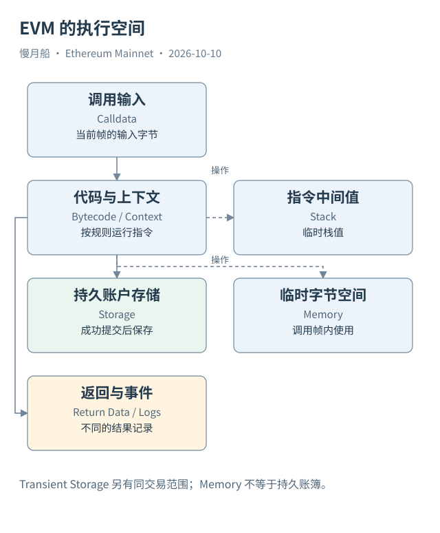

# 09｜点击 Swap，EVM 究竟在执行什么？

钱包上的“兑换”按钮，只表达人的意图。链上需要一份可执行的请求：调用哪个地址，携带哪些字节，有多少原生金额，允许消耗多少 Gas。EVM（Ethereum Virtual Machine，以太坊虚拟机）读取这些输入与已有状态，按规则运行代码。

可以把 EVM 理解成一台专门处理智能合约的计算机，但它不是某一家公司的服务器。各执行客户端实现相同的协议语义，对相同前置状态和输入应算出相同结果。共识接受的执行结果需要能够由其他节点复核，而不是相信网页宣称“兑换完成”。

链上代码通常是字节码（Bytecode）。开发者编写的 Solidity 源码经过编译生成指令，部署后由执行层保存运行时代码。浏览器展示源码属于验证与展示服务；EVM 实际运行的不是页面上的说明文字，也不是 SQL。

Case 04 的顶层请求调用 Uniswap V3 Router，携带 0.408065 ETH。输入要求以 WETH 换出另一种代币。Router 并没有独自维护所有资产余额，它要调用流动性池，池又调用代币合约，并通过回调要求 Router 支付输入资产。界面的一次兑换，展开后是多层调用。

每个调用形成自己的执行上下文：当前地址、调用者、输入、可用 Gas，以及可以访问的状态。代码读取余额、比较条件、写入存储、调用别的地址，最终返回数据或者失败。不同上下文访问的存储位置可能不同，尤其遇到 Delegatecall 时，代码来源与状态位置还会分离。

这笔真实案例的执行轨迹包含八个记录，保留日志有四条。八不是“用户发送了八笔交易”，四也不是“发生了四次兑换”。它们分别计量调用记录和事件记录。只有把调用目标、参数与资金变化连起来，才能说明这次业务主要如何完成。

执行也不总是改变状态。Pool 为核对支付，会用 Staticcall 读取 WETH 的余额。这个读取参与执行流程，却没有自行转出 WETH。若分析师把每次合约访问都当作一次资金流，会把验证步骤一起算进交易金额。

在正常成功路径上，业务写入最终提交到执行后的状态，合约显式发出的 Logs 留在结果里。失败路径则按回滚边界处理。EVM 没有一个通用的“Swap 指令”替我们理解业务；它执行的是合约安排的具体操作。Swap 这个名称来自 ABI、合约逻辑和业务解释。

读图时从顶层请求向下跟随调用，但把结果证据分开摆放：调用树说明执行过程，日志说明显式记录，状态差异说明保存的变化。三份材料彼此补充，任何一份都不应被直接改名为另一份。

理解这次执行后，可以试着把网页描述改写为几句可以被记录支持的话：用户提交了哪种输入，路由器调用哪个池，输入资金怎样支付，输出由哪个合约交付。若其中一句只能依赖界面名称，就需要继续寻找证据。

真正的业务意图也可能超出代码记录。用户想买某种资产，并不意味着这份请求保证资产安全或收益。书稿只还原执行机制与已观察结果，让读者看清网络计算了什么。把意图、程序步骤和结果分开后，复杂调用树就不再显得杂乱。

[编辑此图](../../assets/diagrams/evm.drawio)

依据：[EVM](https://ethereum.org/developers/docs/evm/)；[Solidity 合约执行](https://docs.soliditylang.org/en/latest/introduction-to-smart-contracts.html)；[Uniswap 单跳兑换](https://developers.uniswap.org/docs/protocols/v3/guides/swapping/single-hop-swapping)。核验日：2026-10-10。

[上一章](../part-02/08-delegation-aa.md) · [目录](../../SUMMARY.md) · [下一章](../part-03/10-memory-stack-storage.md)
