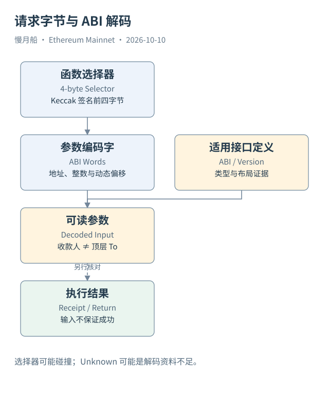

# 11｜一串十六进制怎样表达“转给谁、转多少”？

打开 USDT 转账，你会看到很长的 Input Data。它并不是随机备注，而是按约定编码的调用输入。读取这串字节，是把钱包操作与底层请求连接起来的重要一步。

ABI（Application Binary Interface，应用二进制接口）约定函数名、参数类型和编码方式。标准函数调用输入的前四个字节通常是函数选择器（Function Selector），随后是参数。选择器来自规范化函数签名的 Keccak-256 摘要前四字节；规范化签名不包含参数名，也不包含返回类型。

例如 `transfer(address,uint256)` 的选择器是 `0xa9059cbb`。Case 02 的输入以这四字节开始。后面的第一个 32 字节字表示地址，第二个字表示整数数量。地址只有 20 字节，在这个 ABI 字中按规则左侧补零；整数采用大端表达，不能当作十六进制字符长度直接解释金额。

本例解码得到接收地址 `0xC9AbCaa845d81325d578C23C9CA2B8a2C9025C29`，数量 431,900,785。这个数量没有自带“USDT”或“六位小数”的标识。我们知道它属于主网 USDT，是因为调用目标与合约资料；换算为人类单位，还需要对应资产的 Decimals。

To 与参数中的收款人不是同一个角色。顶层 To 是执行请求的 USDT 合约，参数中的地址才是这次代币发送的目标。如果只查询交易表的 To，会把所有 USDT 转账收款人都误判成 USDT 合约自己。

ABI 编码也不是每个参数都独占一个简单字。动态字符串、字节数组、数组和元组可能包含偏移与长度。Case 04 的 `exactInputSingle` 使用元组，内部包含代币地址、费率、收款人、截止时间和数量。理解布局后才能定位，不能把任意输入都按“第一个字是地址，第二个字是金额”切割。

四字节选择器还可能发生碰撞。浏览器根据签名库找到一个候选名称，不等于已经证明目标代码实现了该函数。完整解码需要可信 ABI、目标代码与版本背景。输入很短、回退函数、代理转发或非标准编码，都可能使普通解码方式不适用。

函数返回值采用 ABI 的相应返回编码，通常没有函数选择器。事件编码又有 Topics 与 Data 的划分，后面另行展开。三者都可能来自同一份 ABI，却是三个不同位置的字节记录。

验证这次转账，我们可以从原输入静态还原参数，再与保存的解码结果核对。这里证明的是“请求怎样表达”，还不能单凭输入证明执行成功；成功状态和保留的 Transfer 日志需要另查。

动手验证时，先把输入前三十二字节与参数起点区分开。函数选择器只有四字节，参数编码从后面的字节开始；事件的数据区则没有相同的选择器前缀。把两种布局混用，会让看起来像地址的切片实际偏移几个字节。

对于这里的固定转账输入，可以离线读出地址与整数，再与保存的参数逐项比较。这是一项解码核验，不会创建任何新交易，也不证明历史状态完整。等解码与执行结果都一致，才可以描述这份请求最终完成的资产操作。

[编辑此图](../../assets/diagrams/abi.drawio)

[完整 SQL：03-usdt-transfer](../../examples/sql/03-usdt-transfer.sql)（STATIC_CHECKED；未在 Dune 执行）。

依据：[Solidity ABI](https://docs.soliditylang.org/en/latest/abi-spec.html)；[ERC-20 接口](https://eips.ethereum.org/EIPS/eip-20)。核验日：2026-10-10。

[上一章](../part-03/10-memory-stack-storage.md) · [目录](../../SUMMARY.md) · [下一章](../part-03/12-contract-deployment.md)
