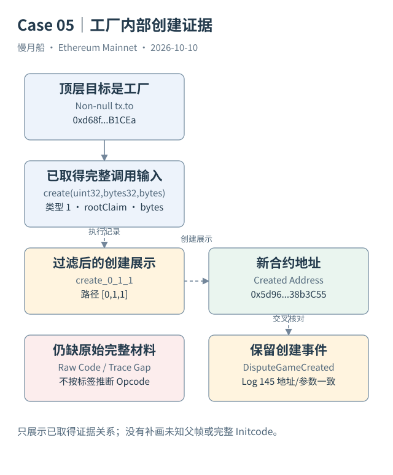
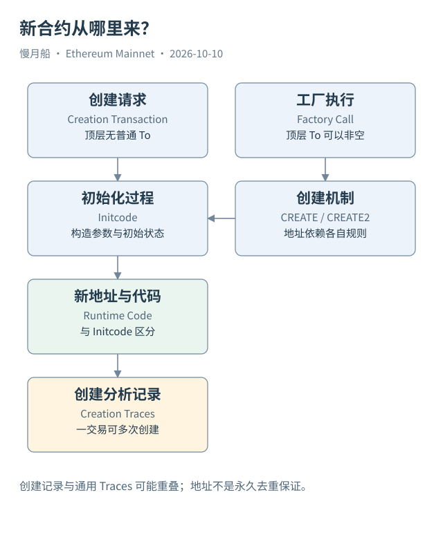

# 12｜部署合约后，链上究竟多了什么？

用户给某个已有合约发送请求，与部署一个新合约，是不同的操作。部署的目标是让链上出现一个可以被调用的地址和运行时代码。新地址以后能持有 ETH、保存 Storage，并响应其他请求。

顶层合约创建交易没有普通目标地址。它的数据包含初始化代码（Initcode）与可能的构造参数。执行初始化代码后，返回内容成为合约运行时代码。构造过程可以设置初始存储、检查条件，也可以调用其他合约；因此交易输入并不直接等于最终保存的 Runtime Bytecode。

CREATE 是创建机制之一。其地址依赖创建者与创建者当时的 Nonce；这里的创建者可能是 EOA，也可能是执行中的合约。CREATE2 则使用创建者、Salt 和 Initcode 的摘要计算地址。预测地址不意味着部署已经发生，还要满足创建规则并成功执行。

地址计算关系对分析有实际帮助。工厂（Factory）可以在一次顶层交易内创建多个子合约，每个子合约都有自己的地址。交易表里只有一条请求，创建轨迹却可以出现多条。不能把顶层 To 为空作为发现所有新合约的唯一条件。

[Case 05](../../examples/transactions/case-05-creation.md) 的顶层 To 是工厂，调用输入为 `create(uint32,bytes32,bytes)`。浏览器显示新地址 `0x5d96788b882eff9b028fdf7fd8fca757838b3c55`、创建路径 `create_0_1_1` 与相同地址的创建事件。完整顶层输入也已保存，可以核对参数和事件，但过滤后的创建展示不能替代完整 Raw Trace，也不能单靠 `create` 标签断定具体 Opcode。

Dune 的 `ethereum.creation_traces` 提供新地址、创建者、代码、交易哈希与区块时间等字段。一行表达平台记录的创建事件，而不是一个永远独立的用户交易。它与 `ethereum.traces` 中的创建信息可能重叠，合并数量前要确认定义和去重方式。

部署成功也不保证合约源代码公开。字节码是执行必需材料，源码、ABI 和标签属于可选的额外资料。没有源码时仍能看到调用、金额和原始事件，但业务解码与语义确认会有缺口。浏览器显示 Unknown 可能反映元数据不足，而不是链上没有代码。

还有一个历史边界：SELFDESTRUCT 在现代主网的行为已受到 EIP-6780 限制。不能沿用“调用一次自毁就会普遍删除代码与存储”的老解释；同交易创建等条件会影响结果。分析长期代码历史，必须按当时规则判断。

本章的数据验证从新地址出发：找到创建记录，再回到所属顶层交易，区分创建者与提交者，核对成功状态和保存代码。只有这个链条完整，才能把“发现地址”提升为具体部署过程的结论。

创建者、交易发送者和后来管理员应当分别记录。工厂创建的子合约，其创建者可以是工厂，顶层发送者则是调用工厂的地址；代码允许的管理者还可能是第三个地址。三者即使偶尔相同，也不能在模型中默认合并。

作者的创建查询保存了一个重要质量字段：每日记录数与去重地址数的差。在历史样本中这个差不是零。它提醒我们先检查重复或地址再次创建等具体情况，而不要单独用合约地址去重后，悄悄把计数单位改成另一种实体。

[编辑案例图](../../assets/diagrams/creation-case.drawio)

[编辑此图](../../assets/diagrams/deployment.drawio)

[完整 SQL：08-contract-creation](../../examples/sql/08-contract-creation.sql)（STATIC_CHECKED；未在 Dune 执行）。

依据：[CREATE2](https://eips.ethereum.org/EIPS/eip-1014)；[SELFDESTRUCT](https://eips.ethereum.org/EIPS/eip-6780)；[Creation Traces](https://docs.dune.com/data-catalog/evm/ethereum/raw/creation-traces)；[主网工厂创建案例](https://etherscan.io/tx/0xcaa01f67726fdecf671f8f6a1b0b2cd832f1e8b43571b843100b12a8e5818fca)。核验日：2026-10-10。

[上一章](../part-03/11-calldata-abi.md) · [目录](../../SUMMARY.md) · [下一章](../part-04/13-transaction-record.md)
