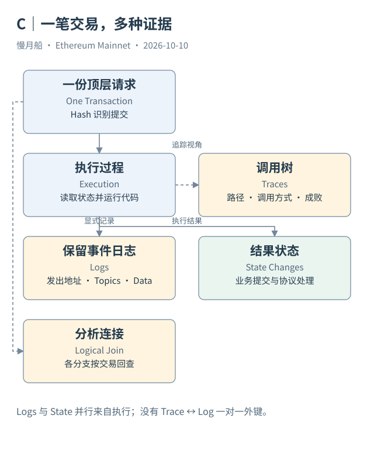

# 13｜Transactions 表的一行，究竟能说明多少？

第一次查询 `ethereum.transactions`，最容易把一行当成“一次完整业务”。在 Case 01 的普通 ETH 转账里，两者恰好比较接近；换到 Swap，一行只是顶层请求及其汇总执行结果，内部动作要到其他位置寻找。

当前核心字段已由 Dune Catalog 核实。`hash` 识别交易，`from` 与 `to` 表示顶层发送者和目标，`data` 是输入字节，`value` 是随顶层请求附带的原生金额。`nonce` 是发送序号，`index` 是区块内位置；`block_number`、`block_hash` 和 `block_time` 给出历史定位。

执行结果也被整理进这张表。`success` 表示交易执行状态，`gas_used` 表示实际 Gas 使用量，`gas_price` 与费用上限字段表达费用相关信息。因此，Dune 所谓 Raw 表已经经历采集与组织，“Raw”不应被理解成交易原始序列化字节逐项原样展开、没有任何结果字段。

`value` 的边界尤其重要。Case 02 的值为零，却转移 USDT；Case 04 的值为 0.408065 ETH，还涉及 WETH 与输出代币。如果把交易表 Value 求和命名为“全部资产转账额”，会漏掉合约内部 ETH 与代币运动，也可能在失败交易上混入未提交的请求金额。

交易类型（Transaction Type）也不是业务分类。Legacy、访问列表、动态费用、Blob 和代码委托，表达请求封装与协议处理机制。一个类型 2 请求可以是 ETH 发送、ERC-20 授权或 Swap；一个类型 4 请求也不保证所有附带授权都有效。本轮表中的 `type` 是字符串类型，示例不假设它在每个数据源都用同样字面值。

查询同一笔交易时，Hash 是主要定位条件；同时加上 UTC 日期与区块号，可以减少扫描并帮助核对范围。若查询其他链，同一哈希字段还要加网络范围。跨链主键不能靠某张 Ethereum 专用表的隐含范围替代。

一行汇总结果并不能说明所有子调用的成败。内部异常可以被捕获；业务目标也可能没有达成预期。后面要用 Traces 与 Logs 拆开执行，再依据合约语义解释。SQL 读到了零 Value，得到的是顶层附带金额这个事实，不是“这笔请求什么都没做”。

可以用作者既有 Query 8378485 观察每日交易数、去重发送地址与接收地址。它把地址指标分开命名，没有直接叫“活跃用户”。这个命名习惯值得沿用：一行代表什么，聚合结果就先按什么命名。

对于授权请求，可以先做一个简单核对：顶层目标是否为代币合约，原生金额是否为零，输入是否带授权接口参数。只有这三项还不能知道余额有没有转移，因为授权本身与后续使用是不同动作。

交易表特别适合给其他证据提供主干。保留这一行后，调用和事件都能回到同一历史请求。它不需要被扩张成承载全部业务细节的大宽表；把不同粒度分别查询，往往更容易发现缺口，也更容易解释一个空值究竟来自哪一层。

一个顶层请求也可以承载多个应用动作。交易计数保持请求粒度；应用计数需要另外定义识别规则，不能只靠顶层目标地址。

[编辑此图](../../assets/diagrams/evidence.drawio)

[完整 SQL：01-one-transaction](../../examples/sql/01-one-transaction.sql)（STATIC_CHECKED；未在 Dune 执行）。

依据：[Dune Transactions](https://docs.dune.com/data-catalog/evm/ethereum/raw/transactions)；[作者交易 Query](https://dune.com/queries/8378485)；[交易封装](https://eips.ethereum.org/EIPS/eip-2718)。核验日：2026-10-10。

[上一章](../part-03/12-contract-deployment.md) · [目录](../../SUMMARY.md) · [下一章](../part-04/14-traces-call-tree.md)
