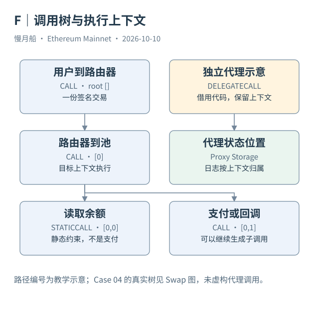

# 14｜一笔交易为什么会有八条 Trace？

Case 04 只有一个用户签名的顶层请求，执行轨迹却有八条记录。原因是合约执行期间可以继续调用其他合约。Trace 把这些执行步骤展开，使我们看到 Router、Pool 和代币合约怎样协作。

执行轨迹（Trace）不是每个区块必须携带的另一份用户签名交易。客户端或索引器按执行过程生成相应记录，可能需要重放与追踪。区块浏览器所说的 Internal Transaction，通常就是这种内部执行表达。它没有因为出现在列表里，就获得独立的顶层 Nonce 与签名。

调用树（Call Tree）保存父子关系。Dune 的 `trace_address` 是路径数组：空数组表示根，[0] 表示根的第一个子调用，[0,2] 表示这个子调用的第三个子调用。数组元素通常从零编号。路径不是合约地址，也不等于 Logs 的全局 Index。

在真实案例里，根调用是用户到 Router，[0] 是 Router 到 Pool；Pool 的子调用包括输出代币转账、读取 WETH 余额、支付回调，以及再次读取余额。回调内部又包含 WETH Deposit 与 WETH Transfer。这是一棵有分支的树，不能只按合约名字排成一条线。

CALL 常用于在目标账户上下文执行代码，可附带原生 Value。STATICCALL 为只读执行提供静态约束，不能把其出现理解为资产支付。DELEGATECALL 使用被调用地址的代码，却保持调用方上下文的状态位置、调用者和 Value 语义。不同调用类型的 `value` 因而不能一律当作新发生的 ETH 转移。

创建也可以出现在轨迹里，CREATE 与 CREATE2 的结果需要另外识别。历史 Trace 类型中还可能有销毁或奖励等记录。当前 `ethereum.traces` 同时有 `type` 和 `call_type`，前者描述大类，后者描述调用方式；不要把它们当作完全相同的一列。

调用级 Trace 并不等于逐 Opcode 轨迹。Geth 的不同 Tracer 可以输出调用、指令细节或状态差异。书稿使用的调用树适合解释参与地址与执行关系，不能声称它显示每次存储写入、每个中间变量或精确日志帧关联。

计数时保留来源习惯也很重要。Dune 的 Traces 可以包含顶层根，浏览器“内部交易”页有时只列子调用。比较数量前，先说明是否包含空路径，是否包含失败步骤，以及是否获得全部记录。本轮案例保存八条含根轨迹，作为后续复核的固定范围。

阅读路径时，先按前缀找父节点，再看同父节点下的序号。同一个代币地址可以在多个分支出现，这说明程序多次调用它，不代表出现多个同名合约。地址身份与调用位置要同时保留。

如果工具只返回扁平列表，路径仍能还原树的大部分父子结构，但精确时间与事件发出位置可能没有一起返回。研究报告应说明所用追踪器的粒度，并保存未截断的来源。把列表排序成一列截图，不等于获得了每一步指令的完整时间线。

根路径是否包含在计数中，是来源比较的第一项检查。路径相同也需先核对所属交易，不能跨交易比较序号就认定同一调用。

[编辑此图](../../assets/diagrams/call-tree.drawio)

[完整 SQL：02-traces-and-logs](../../examples/sql/02-traces-and-logs.sql)（STATIC_CHECKED；未在 Dune 执行）。

依据：[Dune Traces](https://docs.dune.com/data-catalog/evm/ethereum/raw/traces)；[Geth Tracers](https://geth.ethereum.org/docs/developers/evm-tracing/built-in-tracers)；[Solidity 调用上下文](https://docs.soliditylang.org/en/latest/introduction-to-smart-contracts.html)。核验日：2026-10-10。

[上一章](../part-04/13-transaction-record.md) · [目录](../../SUMMARY.md) · [下一章](../part-04/15-logs-events.md)
