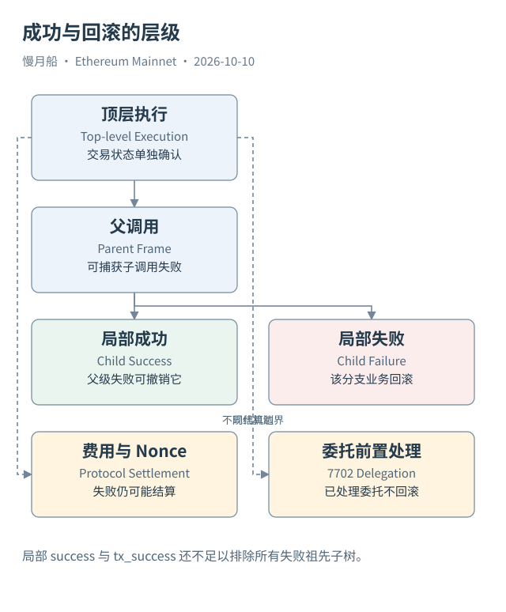

# 16｜Trace 成功，为什么还不能认定资产到账？

合约执行是有层级的。一个子调用成功返回，只能说明它在自己的局部执行中没有报错；随后父调用如果失败，之前的业务变化也可能一起回滚。因此，分析资金流必须同时看局部成败、祖先路径和顶层结果。

回滚（Revert）把相应调用及其子调用的业务写入撤销，撤销范围包括应被回滚的日志。普通失败交易仍可能有收据与 Gas 消耗，但不会保留已经回滚的业务事件。追踪工具却可以展示执行过程中尝试过的调用，所以“Trace 里看到尝试”和“最终状态保留变化”是两个结论。

假设 Router 调用 Token 成功，Token 先修改余额并发出 Transfer；Router 后来因为最低输出条件不满足而 Revert。Token 的局部 Trace 可以显示成功，整个路径的资产变化仍会被撤销。只筛选 `trace.success = true` 会把这种局部成功当成最终支付。

反过来，一个子调用失败也不一定使顶层失败。父合约可以通过低级调用的返回标记识别失败，并执行另一条路线。最终交易成功，失败分支的业务变化不保留。于是 `tx_success = true` 也不能单独证明每一个子调用都成功。

Dune 提供 `success`、`tx_success` 和 `error` 等字段，帮助我们区分层级。但当失败祖先包住成功后代时，还需要检查 `trace_address` 的前缀关系，排除位于失败子树内的转移。对精确资金流，不能仅用两个布尔字段替代所有路径判断。

Logs 属于最终保留的事件结果；如果来源是实时订阅，还可能带有重组移除等接口状态。阅读时要区分链上失败回滚、重组导致的历史移除与平台索引缺失。这些现象都可能让一条事件“不再出现”，原因与分析含义却不同。

业务原子性还有现代边界。EIP-7702 在执行之前处理有效授权，其委托写入不因后续执行失败回滚。发送者 Nonce 和手续费也不按普通业务写入一起恢复。因而不能写“失败交易绝对没有任何状态变化”。正确说法需要指出正在讨论哪一种变化。

Case 04 的保存轨迹没有 Error，顶层也成功，保留日志与主要资产动作相互支持。但本轮没有节点级完整 State Diff，不能扩张为“已经证明每个槽位的最终差额”。我们的结论止于主要调用与已取得资产证据，保留状态差异的缺口。

核验结果时，最有用的练习是为每条资金动作加一句“为什么它最终保留”。回答应落在成功路径、日志或状态证据上，不能只是因为浏览器给它涂了绿色。

若要验证某条原生支付，先把它的完整路径列出，再检查每个祖先是否失败。只查看当前行状态，会漏掉外层回滚；只查看顶层状态，会漏掉被捕获的失败子树。

对保留日志，核对来源是否为最终有效链视图下的收据记录。执行跟踪中“曾经运行到发事件的位置”与最终收据包含该事件不是同一个观察。如果研究工具明确返回尝试中的日志，必须给它单独命名，不能并入已经提交的资产事件流水。

[编辑此图](../../assets/diagrams/failure.drawio)

[完整 SQL：05-native-call-values](../../examples/sql/05-native-call-values.sql)（STATIC_CHECKED；未在 Dune 执行）。

依据：[Geth 调用追踪](https://geth.ethereum.org/docs/developers/evm-tracing/built-in-tracers)；[EVM 回滚](https://docs.soliditylang.org/en/latest/introduction-to-smart-contracts.html)；[7702 授权边界](https://eips.ethereum.org/EIPS/eip-7702)。核验日：2026-10-10。

[上一章](../part-04/15-logs-events.md) · [目录](../../SUMMARY.md) · [下一章](../part-05/17-decoding.md)
