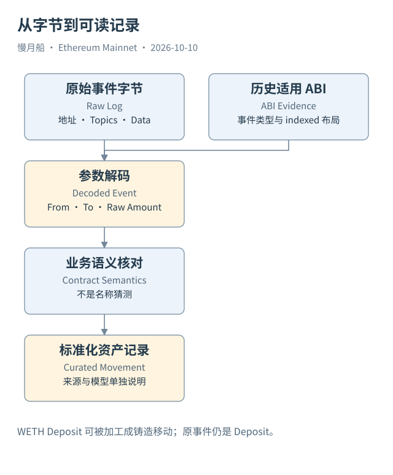

# 17｜Dune 怎样把原始字节变成 Transfer？

在原始 Logs 里，地址、Topics 与 Data 都是字节；解码表里却能直接看到 From、To、Value。中间并没有重新执行一次转账，而是索引服务按照 ABI 把已取得的记录解释成有名称、有类型的列。

解码（Decoding）先要找到适用于这个地址与历史版本的接口定义。对事件，检查签名与 indexed 布局，再按规则拆解 Topics 和 Data。对函数调用，检查选择器与参数编码；需要返回内容时，还要取得相应调用结果。解码输出提供可读名称，但它的可信度仍取决于原字节与所用定义。

一条 ERC-20 Transfer 解码后常带 `evt_tx_hash`、`evt_index`、`evt_block_number` 和 `contract_address` 等定位字段。它可以回到原始日志，在同一交易中确定是哪条事件。函数调用表则可能带调用路径与调用状态；事件表与调用表不能仅因名称相似就当作同一种记录。

例如，`transferFrom` 是一个函数操作，Transfer 是一个事件名称。一次 `transferFrom` 可产生 Transfer，但操作也可能失败、被特殊实现处理，或涉及额外事件。反过来，铸造、销毁和别的执行路径也可能发出 Transfer。事件不是函数本身。

解码覆盖还受 ABI 可用性、地址登记、索引流程和历史规则影响。某个地址没有解码表，不代表它从未被调用；某段时间缺少解码行，也不必然说明没有交易。分析覆盖率时，可以把指定地址的原始日志数量与对应解码结果比较，检查日期和候选键，而不是随便换一张名字相近的表。

浏览器出现 Unknown 也有多种原因：接口资料缺失、选择器找不到、代理版本变化、非标准数据，甚至输入本身并非普通 ABI 调用。把 Unknown 改成一个猜测的函数名，可能制造错误的业务结论。应保留原字节，让读者知道哪些参数已经得到可靠解释。

Case 02 提供一条简单验证路径。输入解码为 `transfer`，原始数量是 431,900,785；交易执行成功，平台识别的保留 Transfer 指向同一收款人。我们可以核对请求与事件，但仍应分别保存它们的来源，而不是用解码结果替代原材料。

Case 04 更能说明分层的重要性。原始 WETH Deposit 在浏览器资产展示中被归为 Token Minting，这个业务归类不是原始事件名。Data Warehouse 可以把它加工成一条规范的 WETH 增量记录，查询方便了，也更需要解释来源。

选择解码表时，先说明它解的是什么、依赖哪份 ABI、能回到哪条原记录。解码让字节变得可读；确认业务，则还要结合状态、调用路径与合约规则。

对于一张解码事件表，可以把一条记录退回原日志，比较定位字段与编码长度。再按接口定义检查哪些参数来自索引主题，哪些来自数据区。这个小样本核验有助于判断表是否适用于当前合约与时间段。

若出现名称相同却参数布局不同的版本，应保留版本边界，不能为了拼表方便强制对齐。解码失败的部分也应保留原身份并报告数量。覆盖率下降可能反映元数据或索引问题，未经核实不能全部解释成协议活动减少。

[编辑此图](../../assets/diagrams/decoding.drawio)

依据：[Dune Decoded](https://docs.dune.com/data-catalog/evm/overview)；[ABI](https://docs.soliditylang.org/en/latest/abi-spec.html)；[原始 Logs](https://docs.dune.com/data-catalog/evm/ethereum/raw/logs)。核验日：2026-10-10。

[上一章](../part-04/16-success-revert.md) · [目录](../../SUMMARY.md) · [下一章](../part-05/18-proxy-context.md)
