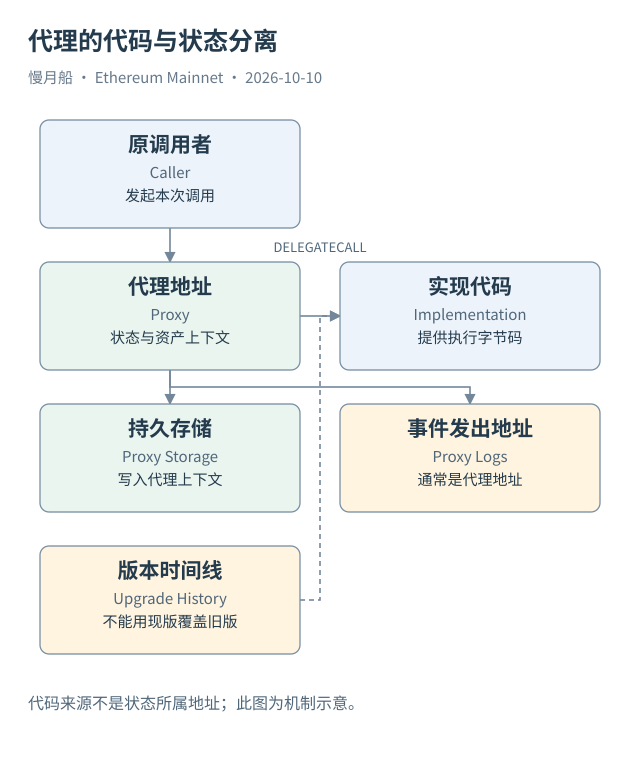

# 18｜为什么日志地址是 Proxy，代码却来自别处？

有些合约地址使用多年，功能却能升级。它们往往把地址与状态保留在代理（Proxy）一侧，把主要执行代码放在实现（Implementation）一侧。读交易时，只检查一个地址的源码可能不够。

常见代理收到调用后，通过 Delegatecall 执行实现代码。这个调用方式使代码在代理的上下文运行：持久状态位置通常属于代理，原调用者和 Value 语义被保留。实现地址提供代码，并不因此成为每次操作的资产保管地址。

日志也按当前执行上下文归属。实现代码在代理上下文中发出事件，通常会看到代理地址作为 Emitting Contract。若分析师只按实现地址过滤 Logs，就可能漏掉所有真实业务事件；若根据 Trace 的目标地址推断存储位置，也可能把代理余额错记到实现上。

代理升级会改变指向的代码。ERC-1967 约定了一组常见存储槽位与相关事件，帮助工具发现实现、管理员或 Beacon 等信息，但并非所有代理都遵循同一模式。Minimal Proxy、自定义代理和其他转发安排还需要不同的识别方式。

历史分析必须问“这一笔执行时用的是哪个实现”。今天的实现地址不能自动代表去年；当前 ABI 也可能错误解释旧日志中的字段。可以通过历史槽位、升级事件、代码与调用轨迹组合证据，并记录无法确定的时间边界。

假设某协议把 `fee` 从单个数值改成结构参数，但保持同一代理地址。按现在的 ABI 重解历史数据，可能出现名字合理、数值却没有业务意义的结果。SQL 成功执行不会提示“你的合约版本选错了”。原始字节、版本和事件布局必须一起校验。

`msg.sender` 在普通 CALL 中通常是当前直接调用者，在 Delegatecall 中则保留调用方上下文中的调用者。它与顶层 From、`tx.origin` 都有不同角色。一个路由器或 EntryPoint 参与执行时，更不能把事件里名为 Sender 的字段自动理解成钱包操作者。

本篇真实 Swap 是普通 Router、Pool 与代币调用，没有为了展示复杂性而虚构 Delegatecall。图中的代理分支是独立教学场景，明确标为示意。读者可以把相同方法用于陌生交易，但必须以真实轨迹确认该分支是否存在。

数据验证的顺序是：定位代理地址，确定历史实现，说明代码与状态上下文，再检查 ABI 与日志地址。这个顺序能让一个长期不变的合约地址，重新获得准确的历史含义。

例如研究“哪个地址保存用户资金”，可以从原生余额与代币余额所在位置判断，再结合代理调用规则。实现代码地址被大量调用，只能说明代码参与执行，不能单靠调用次数推断它持有相应用户资产。

升级事件也只是一个线索。合约可以采用其他槽位或自定义机制，事件与实际指针还要核对。没有可靠历史资料时，结论可以限定为“观察到某次代理转发”，而不是自动补出完整升级历史或控制关系。

[编辑此图](../../assets/diagrams/proxy.drawio)

依据：[ERC-1967](https://eips.ethereum.org/EIPS/eip-1967)；[Solidity Delegatecall](https://docs.soliditylang.org/en/latest/introduction-to-smart-contracts.html)；[Geth Call Tracer](https://geth.ethereum.org/docs/developers/evm-tracing/built-in-tracers)。核验日：2026-10-10。

[上一章](../part-05/17-decoding.md) · [目录](../../SUMMARY.md) · [下一章](../part-05/19-data-lineage.md)
