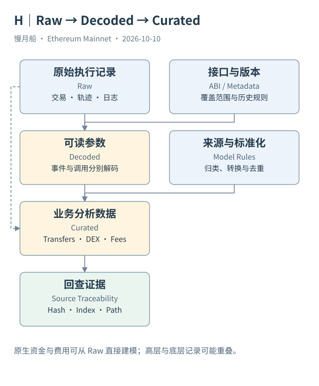

# 19｜Raw、Decoded、Curated 分别加了什么？

同一笔交易在 Dune 中可能出现于交易表、日志表、解码事件表、资产流水表和 DEX 表。它没有被执行五次；平台从不同角度组织同一段历史。知道每一层加入什么，才能避免重复计数。

原始数据（Raw Data）保留接近链与客户端接口的结构，如区块、交易、Logs 与 Traces。这里仍然有采集、规范化和索引过程。尤其 Traces 是执行追踪结果，不能说它像交易清单一样作为完整调用树原封不动地存进每个区块。

解码数据（Decoded Data）利用 ABI 把字节解释成函数与事件参数。它增加可读的名称与类型，通常保留原定位字段。解码层的“Transfer”证明程序发出了符合所用定义的日志，而不是已经由平台独立审计了资产的全部经济规则。

加工数据（Curated Data）进一步按维护规则统一口径。例如 `tokens.transfers` 可以结合 ERC-20 Transfer、WETH Deposit 与 Withdrawal、原生交易 Value、Trace Value 和费用移动等来源。它不是仅仅为 Logs 换一个表名，而是一个有来源选择与标准化规则的数据模型。

本轮官方文档还说明，某些非标准资产运动可能不在转账模型中。资产金额的 USD 估值依赖价格覆盖，缺失估值不应当被自动填成零交易额。新模型也可能增加来源或改变命名，所以研究记录要保存读取日与实际 Schema。

DEX 加工数据又回答另一类问题：哪些记录构成流动性池的成交执行段。多跳路线经过两个池，可以形成两行成交，而钱包仍只提交一次兑换意图。资产流水和 DEX 成交不是可互换的“总金额”，也不能直接相加。

作者旧 Dashboard 使用 `dex_evm.trades`；本轮 Catalog 也确认了 `dex.trades`。两者当前的时间字段类型不同：前者为带时区时间，后者为普通 Timestamp。教学示例采用已核实的 `dex_evm.trades`，不会把两张表 Union 后声称得到了更完整的 DEX 活动。

数据血缘（Data Lineage）可以理解为“这一行从哪里来、经过了什么处理”。最简单的研究做法是在结果旁保留主网哈希、日志索引或调用路径，再注明模型名、日期与资产识别字段。这样发现异常时，能从加工层退回原始证据。

选择表时，先决定问题要哪一层。问提交了什么，查 Transactions；问调用了哪里，查 Traces；问事件参数，查 Logs 或解码层；问规范口径的资产流或成交段，再用 Curated。层次越高，越应解释它的建模边界。

选择加工表之后，先挑一行检查能否回到请求与原记录。若来源是费用或包装模型，可能没有普通代币转账的事件索引；这不是理由把它删掉，而是需要说明这类行采用的身份与生成规则。

同一笔活动在不同层重复出现，是数据血缘关系，不一定是索引错误。研究者应该识别哪张表提供原材料，哪张表给出解释，哪张表实现统计口径。这样既能利用高层数据节约查询工作，也能在关键结论上保持复查能力。

[编辑此图](../../assets/diagrams/lineage.drawio)

依据：[Dune EVM 概览](https://docs.dune.com/data-catalog/evm/overview)；[Token Transfers](https://docs.dune.com/data-catalog/curated/token-transfers/evm/token-transfers)；[DEX 数据](https://docs.dune.com/data-catalog/curated/dex-trades/evm/dex-trades)。核验日：2026-10-10。

[上一章](../part-05/18-proxy-context.md) · [目录](../../SUMMARY.md) · [下一章](../part-05/20-core-data-model.md)
