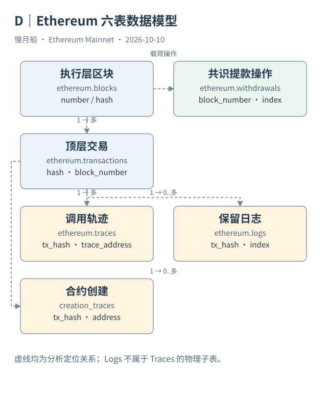

# 20｜六张核心表，应该怎样连接？

一个 SQL 分析师看到六张核心表，通常先找连接键。这个动作很自然，但更早的一步是确认每张表的一行代表什么。只有粒度确定，Join 才能帮助还原执行，而不是制造重复数据。

`ethereum.blocks` 以执行层区块为基本单位，`number` 与交易表的 `block_number` 对应。`ethereum.transactions` 以顶层交易为单位，用 Hash 识别。区块到交易是一对多关系；图里的连线表示分析路径，并不声称 Dune 声明了数据库外键约束。

`ethereum.traces` 与 `ethereum.logs` 各自通过 `tx_hash` 回到交易。前者记录执行路径，后者记录保留日志。一笔交易可以有多条 Trace、零条或多条 Log。二者不是一对一，也不能把 Logs 画成 Traces 的普通物理子表。

假如教学交易有八条 Trace、四条 Log，直接按 Hash 连接两个分支，就会得到三十二个组合。三十二是笛卡尔式放大后的连接行数，不是三十二次执行动作。Case 04 的八与四来自已保存响应，三十二只是说明错误 Join 的数学结果。

`ethereum.creation_traces` 记录创建地址与创建者等信息，仍可回到所属交易。它的当前字段没有 `trace_address`，因此不能凭这张表独自恢复创建帧的完整路径。需要精确调用位置时，要查更完整的 Trace。它的日期分区使用 `block_month`，与其他 Raw 表的 `block_date` 有区别。

`ethereum.withdrawals` 则表达共识层驱动、执行载荷包含的提款操作。一条提款通过区块定位关联历史，拥有自己的 Index 与 Validator Index，却没有普通顶层 `tx_hash`。不能把它强行按用户转账的字段格式连接到 Transactions。

候选键（Candidate Key）是分析中预期唯一的组合，不是尚未检验的保证。Logs 通常以区块与 Index 定位；Traces 在交易内按路径定位，但某些历史系统记录与空哈希需要单独处理。应先检查空值、重复与来源范围，再把它们当作连接基础。

本轮已经核实这六张表的字段与类型，完整快照保存在 [数据表索引](../appendix/data-table-index.md)。这不等于已经扫描全历史验证覆盖率、候选键唯一性或最新数据延迟。Schema 核实和数据质量验证是两项工作。

正确的连接策略通常是先把每个分支汇总到交易粒度，再连接主干。若要保留明细，就明确结果仍是调用粒度或事件粒度，不在重复行上继续求顶层 Value。图中这些界限，比任何一条快捷 SQL 都更重要。

可以先画出最终结果的一行：它究竟是一笔交易、一条调用、一条事件，还是一次提款？在纸上写出这个答案，再决定哪些明细要汇总。如果先把所有列连接起来才定义结果，往往已经很难识别重复来源。

数据模型还应记录可选关系。普通转账可以无合约日志，创建请求可以失败，某个区块也不必含提款。连接图中的一对多不意味着每个主干实体至少有一条子记录；把内连接当作默认，可能不知不觉删掉最值得解释的空分支。

[编辑此图](../../assets/diagrams/core-data.drawio)

[完整 SQL：07-safe-join](../../examples/sql/07-safe-join.sql)（STATIC_CHECKED；未在 Dune 执行）。

依据：[六表目录](https://docs.dune.com/data-catalog/evm/ethereum/overview)；[创建字段](https://docs.dune.com/data-catalog/evm/ethereum/raw/creation-traces)；[提款字段](https://docs.dune.com/data-catalog/evm/ethereum/raw/withdrawals)。核验日：2026-10-10。

[上一章](../part-05/19-data-lineage.md) · [目录](../../SUMMARY.md) · [下一章](../part-06/21-eth-weth.md)
