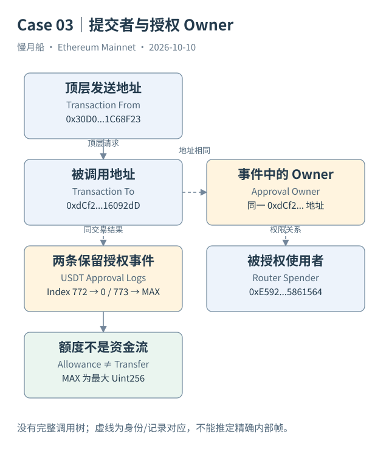
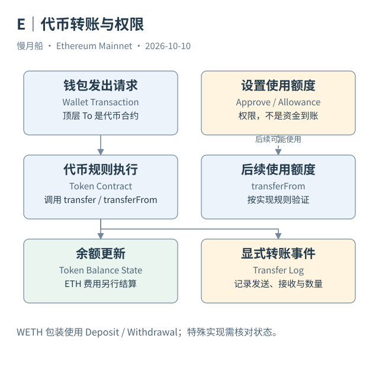

# 22｜授权额度为什么不是已经转走的金额？

DEX 经常要求你先“授权”，再“兑换”。两次钱包操作都可能消耗 Gas，但它们改变的内容不同。授权允许某个地址在规则范围内使用代币；真正转移则在后续执行中减少余额。

ERC-20 的 `approve(spender, amount)` 通常设置 Owner 与 Spender 之间的额度，`allowance(owner, spender)` 提供读取接口。`transferFrom` 在适用规则下使用额度转移代币。Owner、Spender 与最终 Recipient 是三个角色，不能仅因都出现在一笔交易里就合并为一个收款人。

Approval Event 表达授权相关记录。[Case 03](../../examples/transactions/case-03-approval.md) 的顶层请求调用一个地址的 `approveTokens`，USDT 在同交易保留两条 Approval：Index 772 将 Router 额度设为零，Index 773 声明最大 Uint256。事件 Owner 是被调用地址，顶层 From 是另一个提交地址。[直接授权补充案例](../../examples/transactions/case-03b-direct-approval.md) 则取得了把额度设为 11 USDT 的完整请求输入。两份不同交易的证据不混为同一执行。

即使取得一条额度为一百万的 Approval，也只能说明该执行留下相应授权事件，不能声称一百万代币已经离开账户。实际余额有没有变化，需要看后续 Transfer、合约规则或历史余额。把 Approval 与 Transfer 一起汇总为“总转账额”，会把权限与资金混在一起。

“无限授权”通常使用一个很大的整数额度，而不是一个数学上的无限符号。它不改变 Decimals，也不代表给对方转出全部现有余额。后续是否消耗额度、是否保留最大值、是否发出新的 Approval，需要看实现规则。

授权历史也不是把所有 Approval 数字累加。有些操作设置新额度，有些接口增加或减少额度；部分转移可能消费 Allowance。若要回答某个历史时刻“还能花多少”，需要读取那个位置的状态，或建立覆盖完整、实现适配正确的重建模型。

USDT 等实际代币还存在标准接口之外的行为差异。调用返回值、重设非零额度的限制，以及上层封装怎样处理失败，都可能影响操作。仅因函数名符合 ERC-20 就假设所有合约细节相同，会使数据解释与实际执行脱节。

现代 Permit 类授权可能先由用户离链签名，再在另一笔交易中使用；EIP-7702 或账户抽象又能把多步操作批处理。于是“用户看到授权一次”未必对应一笔单独顶层交易，“没有单独 approve 交易”也不等于从未授权。

分析一次授权，先列出授权账户、代币合约、使用者与时间位置，再检查事件和当前或历史额度。分析资金离开，则另外追踪真正的余额与转移证据。两件事相关，但必须分别回答。

分析风险暴露时，可以把当前可用额度与持有余额并排查看，但二者仍不能简单相乘形成实际损失。额度表达合约允许的使用范围，余额表达当前可用资产；后续能否使用，还取决于实现、状态与执行条件。

历史授权事件也可能对应额度清零或重新设定。需要解释一个具体时点时，应寻找那个位置的有效状态，而非只挑额度最大的日志。权限研究与资金流研究可以共享交易索引，却各自需要明确的问题与证据集合。

[编辑案例图](../../assets/diagrams/approval-case.drawio)

[编辑此图](../../assets/diagrams/assets.drawio)

[完整 SQL：04-usdt-approval](../../examples/sql/04-usdt-approval.sql)（STATIC_CHECKED；未在 Dune 执行）。

依据：[ERC-20 Approval](https://eips.ethereum.org/EIPS/eip-20)；[Permit](https://eips.ethereum.org/EIPS/eip-2612)；[USDT 合约资料](https://etherscan.io/address/0xdac17f958d2ee523a2206206994597c13d831ec7#code)；[双Approval真实案例](https://etherscan.io/tx/0xcb961e7be2376292335004a134aa87cb775e624e3db5883c5ac1babdf70ff1ad)；[直接授权输入](https://etherscan.io/tx/0x542673aa94a70f32fdc8031087bc6934ac2413675ca4a4074345379f8acac732)。核验日：2026-10-10。

[上一章](../part-06/21-eth-weth.md) · [目录](../../SUMMARY.md) · [下一章](../part-06/23-nft-identities.md)
