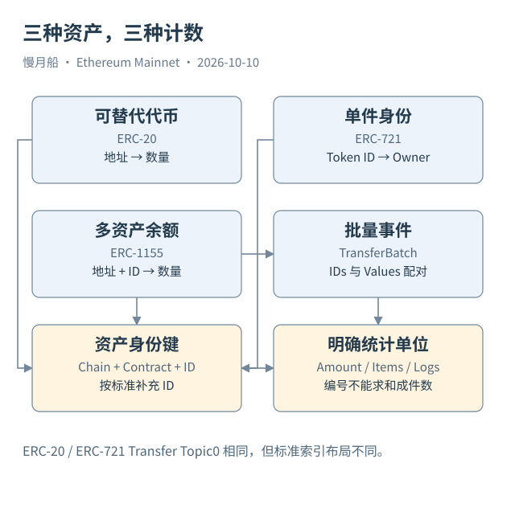

# 24｜批量转移和特殊代币怎样打破流水直觉？

一个游戏合约可能同时发行装备、材料和可叠加道具。ERC-1155 让同一合约维护多种 Token ID，每个 ID 再按地址记录余额。这样，一件独特装备与一百份材料可以使用相同接口，但仍有不同数量和身份语义。

ERC-1155 的基本资产键至少包含链、合约地址和 Token ID。`balanceOf(account, id)` 返回某地址对某个 ID 的数量。一个地址在同一合约里可以持有多个 ID，不能把合约地址单独当成全部资产的唯一身份。

单项转移使用 TransferSingle，批量转移使用 TransferBatch。Batch 事件中的 IDs 与 Values 是配对数组：第一个 ID 对应第一个数量，第二个对应第二个。SQL 展开时要保持位置关系；分别 Unnest 后直接连接，可能把两个长度为三的数组变成九个组合。

一条 Log 可以表达多项资产运动。因此“日志数量”等于“资产条目数量”也不是普遍成立的。反过来，同一 ID 在同一交易中多次转移，又会形成多条记录。结果应该说明粒度是原始事件、展开后的资产条目，还是按交易汇总的净变化。

特殊 ERC-20 同样会挑战直觉。Fee-on-transfer Token 可以在发送时额外扣费；Rebasing Token 的显示余额可能随比例改变；份额型资产可以通过兑换率表达价值。日志金额、请求金额与接收方实际增量不一定相等。

面对这些实现，不能在发现差异后随便给所有 Transfer 打折，也不能把缺少事件写成“余额不可能变化”。需要核对代码规则、当时状态与覆盖范围。平台的 Curated 表可以处理部分常见模式，却没有保证涵盖所有自定义资产行为。

代理升级会再增加一个时间维度。今天合约符合某种标准，不保证旧版本的日志与余额规则完全一致。资产名称可能被更新，Decimals 也不能仅凭符号从另一份元数据复制。研究时要保存具体地址与读取位置。

把事件解释为业务，还要检查 Operator、From、To 与当前执行上下文。批量转移的操作者不一定是所有者；零地址路径要按铸造或销毁规则解释。统计地址时，不能把 Operator、Owner 和 Recipient 都称为同一种“用户”。

一个实用的数据检验是：先不求金额，只核对事件数量、展开条目数量和数组长度；再按资产键保留原始整数。等这些关系正确，才换算人类单位或加入价格。这样可以把结构错误与估值错误分开处理。

批量事件适合做一个结构练习：把两个数组写成并列表格，检查每个编号只与同位置数量配对。展开后的结果应保留原始事件定位和数组序号，才能区分同一事件内部的不同资产条目。

对于特殊代币，先选一笔明确的转移，把请求数量、事件数量与前后余额分别列出。若三者不同，寻找实现规则而不是立刻修正数字。差异可能是手续费、比例换算或非标准逻辑，它需要被解释；没有解释的自动清洗反而会移除真实业务信息。

[编辑此图](../../assets/diagrams/nft.drawio)

依据：[ERC-1155](https://eips.ethereum.org/EIPS/eip-1155)；[Dune 类型](https://docs.dune.com/query-engine/datatypes)；[非标准转账覆盖](https://docs.dune.com/data-catalog/curated/token-transfers/evm/token-transfers)。核验日：2026-10-10。

[上一章](../part-06/23-nft-identities.md) · [目录](../../SUMMARY.md) · [下一章](../part-07/25-gas-work.md)
