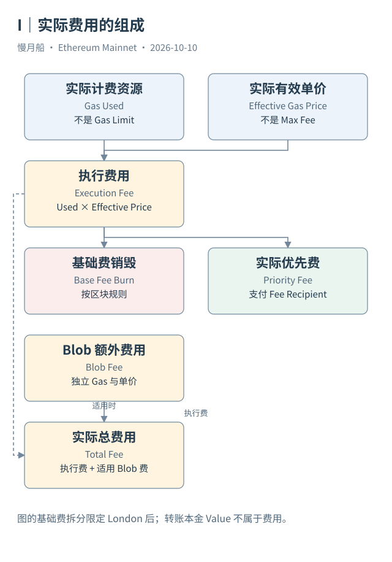

# 26｜Max Fee 是上限，实际手续费怎样算？

钱包有时列出 Max Fee、Priority Fee 和估算手续费。它们并不是三个需要机械相加的最终金额。动态费用交易允许发送者设定上限，协议按区块环境与执行结果确定实际结算。

EIP-1559 引入区块 Base Fee，每单位基础费被销毁（Burn）。发送者还提供最高优先费上限；实际优先费受最高总费与当前基础费之间的空间限制。对适用的动态费用交易，有效单价可由基础费加实际优先费表达，且不能超过发送者的总费上限。

如果当前基础费是教学假设的 10 Gwei，总费上限 30 Gwei，优先费上限 2 Gwei，在这组条件下有效单价为 12 Gwei，而不是 32 Gwei，也不是一律支付 30 Gwei。假设真实计费量是 50,000 Gas，执行费则为 0.0006 ETH。这组数字仅说明计算关系，不是本书案例的观测值。

Case 01 提供可核对的实数：21,000 Gas 乘以 326,278,188 Wei 每 Gas，得到 6,851,841,948,000 Wei，即 0.000006851841948 ETH。基础费与优先费应按当时区块参数分别计算，转出的 1 ETH 另外计入本金，不属于手续费。

Legacy 与访问列表交易使用不同的请求字段。London 之后，它们也受当前基础费规则影响；London 之前没有同样的基础费销毁机制。因此，计算历史 Burn 不能拿今天的定义覆盖所有年份。表里没有上限字段，也不说明那笔历史交易没有收费。

优先费通常归执行载荷指定的 Fee Recipient，而不是由浏览器标签直接识别一个现实验证者的钱包。构建者支付、MEV 收入与共识奖励还有其他路径，不能把优先费称作验证者全部收益。区块表历史名为 `miner` 的列，也需要按时代解释。

Blob 交易还有单独 Blob 费用。执行费的 `gas_used × effectiveGasPrice` 可以在其适用范围内成立，却不能作为这类交易的完整总费。Blob Gas 与执行 Gas 是两个市场；总费用分析需要另取实际 Blob Gas 使用量与单价。

本篇 SQL 示例为选定普通非 Blob 案例计算执行费，使用高精度整数或 Decimal 保留 Wei。Gas Price 是否为实际有效单价，应以相应数据源定义及收据交叉核对；仅有 `max_fee_per_gas` 不能替代实际价格。

作者 Query 8378487 使用 `gas.fees` 汇总费用，适合学习平台统一口径。复用时仍要说明费用构成、币种和模型版本。准确的费用答案始终包含范围、单位和实际结算证据。

为了检验公式，可以在本地用整数重复计算案例的计费量与单价乘积，再与浏览器实际费用比较。这能发现数量级和小数位错误，却不能替代所有时期、所有交易类型的费用验证。

汇总网络费用时，还应说明是否包含失败请求、是否计算数据发布费用、如何处理费用币种与价格。费用模型可以提供统一字段，但模型字段的名称不是完整定义。把适用范围写清楚以后，单笔公式和平台汇总才有可比较的意义。

手续费展示中的法币价值又来自价格换算。精确费用对账应先以原生最小单位核对，另行说明使用何时的价格与精度。

下面的固定范围示例与外链文件一致，供逐行阅读；运行状态为静态审查，未执行。

```sql
SELECT hash, gas_used, gas_price,
       CAST(gas_used AS DECIMAL(20,0))*CAST(gas_price AS DECIMAL(20,0)) AS execution_fee_wei,
       CAST(gas_used AS DOUBLE)*CAST(gas_price AS DOUBLE)/1e18 AS execution_fee_eth_display
FROM ethereum.transactions
WHERE block_date=DATE '2026-06-29' AND hash=0xdd757281a1bb25e5d54f660cd418b41a6c1d1634896908454de7b025975c13bb
  AND COALESCE(cardinality(blob_versioned_hashes),0)=0;
```



[编辑此图](../../assets/diagrams/gas.drawio)

[完整 SQL：06-execution-fee](../../examples/sql/06-execution-fee.sql)（STATIC_CHECKED；未在 Dune 执行）。

依据：[EIP-1559](https://eips.ethereum.org/EIPS/eip-1559)；[EIP-4844](https://eips.ethereum.org/EIPS/eip-4844)；[作者费用 Query](https://dune.com/queries/8378487)。核验日：2026-10-10。

[上一章](../part-07/25-gas-work.md) · [目录](../../SUMMARY.md) · [下一章](../part-07/27-failed-cost.md)
