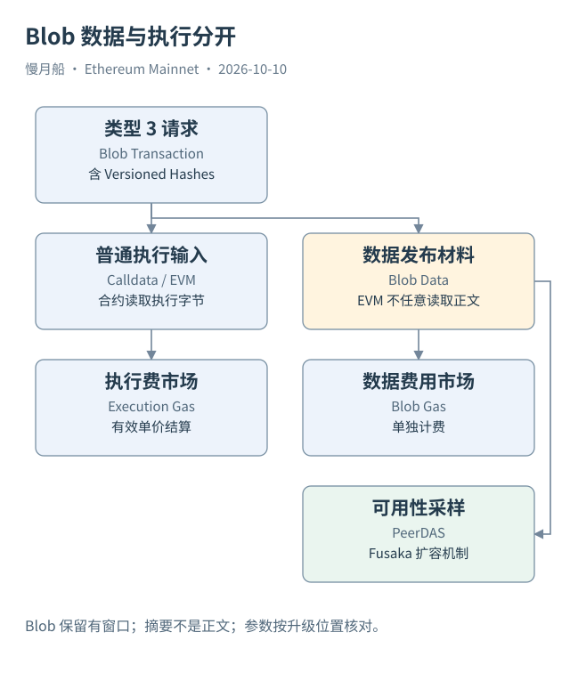

# 28｜Blob 为什么不是普通 Calldata？

一条 L2 批次提交交易看起来也有 From、To 和 Gas，但它还可能携带 Blob。理解这种记录，需要把“执行代码的输入”和“为数据可用性发布的材料”分开。它们服务于不同任务，也使用不同费用安排。

EIP-4844 引入类型 3 的 Blob 交易。交易包含 Blob Versioned Hashes 等引用，完整 Blob 内容通过相应数据传播机制处理。EVM 可以访问规定的摘要引用，但不能把整份 Blob 当作普通 Calldata 任意读取。把交易表里的 Data 解码完，不等于读完了所发布的 L2 批次内容。

Calldata 属于执行请求中的字节，可以被合约读取。Blob 面向数据可用性（Data Availability），让外部参与者在要求的保留窗口中取得并验证材料。执行层状态根、Blob 引用和完整数据各有职责，不能都叫作“把文件永久写进 Storage”。

Blob 数据并不承诺由每个普通节点永久保存。历史分析若需要很久以前的完整批次内容，可能依赖归档服务。找不到旧 Blob 正文，应记录服务能力与保存范围，不能直接当成那笔交易不存在，也不能仅凭摘要推导批次里的所有用户操作。

Blob Gas 有独立的供需定价，与执行 Gas 分开。实际 Blob 费用需要实际 Blob Gas 使用量乘实际 Blob 单价；`max_fee_per_blob_gas` 是上限。传统执行费公式少了这一部分，就不能宣称覆盖完整总费。

Case 06A 是一笔可核验类型 3 主网交易，浏览器列出一个 Blob、顶层 Value 为零和执行 Gas 使用量。它能说明交易结构与普通 ETH 转账不同。本轮没有下载 Blob 正文或取得原收据的完整 Blob 费字段。根据浏览器确认的总费口径，150,203 Gas 乘有效单价得到执行费 189,145,568,248,344 Wei，总费与之相差 1,627,833,761,792 Wei。一个 Blob 对应 131,072 Blob Gas，这个差额可整除为 12,419,386 Wei 每 Blob Gas；它是费用拆分推导，不冒充原字段实读。

Pectra 曾提高 Blob 参数；随后 2025 年 12 月上线的 Fusaka 引入 PeerDAS，通过数据可用性采样支持进一步扩容。Blob Parameter Only 分叉还可以调整参数。因此，介绍 2026 年主网时不能把早期“目标三、最多六”写成永恒常量。

本篇只在读者理解交易和费用后引入这些机制。对 SQL，先查交易引用、区块 Blob 字段和可靠收费来源；对 L2 业务，则需要解析对应批次与该链执行数据。主网一条 Blob 交易不等于一条 L2 用户交易。

读图时把数据发布支线与 EVM 执行主线并排观察。我们能从主网证明某次发布的定位与引用，至于里面有哪些用户、哪次兑换成功，还必须走到对应的数据与执行层。

观察一笔数据发布请求时，把执行输入、摘要列表、数据正文与费用分成四份材料。工具可能只返回前两项，也可能另有正文归档。材料不全时，可以准确说明已确认的结构，不需要猜测整个批次内容。

数据可用性保证与永久保存也要分开。协议要求参与者在相应范围内能够检查材料，历史研究者多年以后取得正文则依赖保存能力。描述“链上有引用”不等于证明你已经下载、解析并核对那份引用对应的数据。

[编辑此图](../../assets/diagrams/blob.drawio)

依据：[EIP-4844](https://eips.ethereum.org/EIPS/eip-4844)；[PeerDAS](https://eips.ethereum.org/EIPS/eip-7594)；[Fusaka](https://ethereum.org/roadmap/fusaka/)；[浏览器Blob费用口径](https://info.etherscan.com/what-is-a-blob/)。核验日：2026-10-10。

[上一章](../part-07/27-failed-cost.md) · [目录](../../SUMMARY.md) · [下一章](../part-08/29-two-layers.md)
