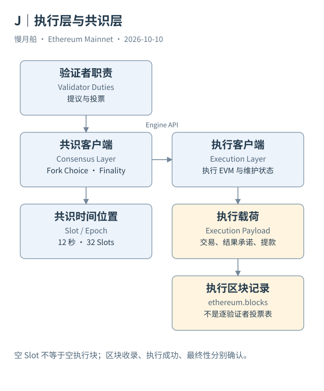

# 29｜执行层与共识层分别在忙什么？

如果 EVM 能确定地执行交易，为什么还需要验证者投票？因为“按规则算出结果”和“网络接受哪段历史”是不同问题。现代 Ethereum 节点用执行层与共识层协作完成两项工作。

执行层（Execution Layer，EL）检查交易，运行 EVM，维护执行状态，并提供常见账户与交易接口。Geth、Nethermind 等执行客户端实现相关规范。共识层（Consensus Layer，CL）组织 PoS 网络的区块提议、投票、分叉选择与最终性；验证者客户端还承担相应签名职责。

两层通过 Engine API 等接口协作。共识客户端可以要求执行客户端构建或验证执行载荷（Execution Payload），执行客户端返回执行有效性等结果。它们不应被画成“共识投票代替 EVM 执行”，也不应被画成两个互不相关的链上系统。

执行载荷包含执行层区块相关数据，如交易、执行结果承诺与提款等字段。Beacon 区块还组织共识层信息。Dune 的 `ethereum.blocks` 是执行层分析入口，不是一张逐验证者投票表。只查询它，不能统计全部 Attestation 或逐验证者奖励。

Case 01 所在的执行区块已经有明确高度与时间；要进一步定位相应 Beacon Slot，需要对应层的数据映射。两层编号不能凭数值相近自动视作同一编号。Slot 计量时间机会，执行块号计量实际组织的执行历史，空 Slot 会使两者的关系更需谨慎。

提议区块也不一定意味着提议者亲自按简单公开队列构建全部交易。构建者与提议者分离等现实流程会影响排序与收益来源。本篇不展开 MEV 策略，只提醒读者：Fee Recipient、提交地址和现实运营实体可能是不同角色。

本轮官方资料确认 Fusaka 已在主网上线。Glamsterdam 的最新协议公告仍列测试网安排与未确定的主网日期。研究报告不会因为早先目标为 2026 年上半年，就写成主网已经采用其全部机制。规范文件状态、测试网部署和主网上线必须分别核对。

两层分工还决定分析资料的范围。若问用户交易成功率，优先执行记录；若问最终性延迟或验证者行为，需要共识数据；若问提款如何增加某地址 ETH，则把共识驱动与执行载荷里的提款结果连起来。

图的价值在于标出职责与接口。看见某份执行结果，不代表已经验证共识活动；看见验证者投票，也不能省掉执行有效性。把这条边界守住，才不会用一张表回答超出它范围的问题。

节点软件组成还不等于现实运营者数量。同一机构可以运行多个客户端，多个验证者也可以使用同一服务。客户端类型、节点实例、验证者身份与运营实体是四种不同计数对象。

研究数据完整性时，记录所取的是执行接口还是共识接口。接口返回成功仅说明取得相应材料，不能证明本地部署跨层配置正确。书稿解释的是职责与证据路径，不把公开文档中的设计要求冒充某个具体运营环境已经通过验证。

[编辑此图](../../assets/diagrams/layers.drawio)

依据：[Node Architecture](https://ethereum.org/developers/docs/nodes-and-clients/node-architecture/)；[Execution APIs](https://ethereum.github.io/execution-apis/)；[升级公告](https://blog.ethereum.org/category/protocol)。核验日：2026-10-10。

[上一章](../part-07/28-blob-data.md) · [目录](../../SUMMARY.md) · [下一章](../part-08/30-slots-finality.md)
