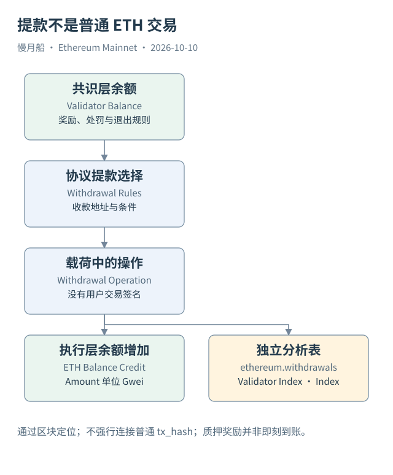

# 31｜质押提款为什么没有普通交易哈希？

一个地址的 ETH 余额增加，不一定是另一个钱包签了转账交易。PoS 验证者提款就有不同的路径：共识层按规则处理提款条件，执行载荷携带提款操作，执行层据此增加收款地址余额。

验证者（Validator）是共识参与者，身份常用 Validator Index 等信息定位。提款地址与验证者签名密钥是不同角色；不能把提款地址当成验证者本人的现实身份，也不能把一个提款地址只对应一个验证者当作默认事实。

EIP-4895 将提款作为执行载荷中的操作引入。它不使用普通用户顶层 Transaction 的签名、Nonce 与执行 Gas 流程。因此，`ethereum.withdrawals` 中没有普通 `tx_hash` 并不说明索引坏了，而是记录实体本来不同。

当前表提供 `index`、`validator_index`、`address`、`amount` 与区块定位。Amount 按 Gwei 表达，与交易 Value 的 Wei 不同。把提款原始整数直接除以一千万或直接与 Wei 相加，都会混淆单位。换成 ETH 时，应按十的九次方处理提款 Amount。

提款可涉及超过适用有效余额阈值的部分提款，或退出后的余额结算，规则还受提款凭证与验证者状态影响。Pectra 增加了新的验证者功能与更高有效余额上限。因此，不能继续把所有余额超过 32 ETH 的变化用同一条旧规则机械解释。

Deposit 与 Withdrawal 也不是对称的两笔普通交易。存入质押涉及执行层合约或现代请求路径，资金与验证者状态在共识层处理；提款则由相应协议路径进入执行载荷。分析全过程，需要两层资料，不宜只在钱包转账表里找两条相反金额。

质押奖励与处罚先影响共识层余额，不一定当时就形成执行层普通地址到账。Slashing 是对特定违规行为的惩罚机制，不能把任何余额减少都叫 Slashing。正常费用、共识处罚、退出与提款有各自的证据和时间位置。

若问某天某地址收到多少协议提款，应该按 Withdrawals 的地址和 UTC 日期筛选，汇总 Gwei 并换算单位。若问为什么收到这些款项，则进一步追溯验证者状态与提款条件。若问总 ETH 增发，还要纳入共识奖励和其他时期的供给规则。

图把提款画成执行载荷的独立输入，未接在普通交易下。这个布局提醒我们：账户余额变化的来源多于 Transactions 与 ERC-20 Logs，数据分析必须尊重协议实体的区别。

对一条提款记录，可以先核对协议索引、验证者索引、收款地址与原始数量，再在相应区块查看执行层到账。这里的金额换算是单位转换，不是价格估计，也不需要把一个不存在的普通交易哈希补出来。

汇总提款地址时，多个验证者可能使用同一地址，地址数与验证者数因此不同。提款额也不直接等于该时段新发行奖励，余额可能包含更早积累或退出结算。要研究新增供给，需要另取奖励与处罚规则及对应层的数据。

[编辑此图](../../assets/diagrams/withdrawals.drawio)

[完整 SQL：09-withdrawals](../../examples/sql/09-withdrawals.sql)（STATIC_CHECKED；未在 Dune 执行）。

依据：[EIP-4895](https://eips.ethereum.org/EIPS/eip-4895)；[Dune Withdrawals](https://docs.dune.com/data-catalog/evm/ethereum/raw/withdrawals)；[Pectra 验证者机制](https://ethereum.org/roadmap/pectra/)。核验日：2026-10-10。

[上一章](../part-08/30-slots-finality.md) · [目录](../../SUMMARY.md) · [下一章](../part-08/32-l2-boundary.md)
