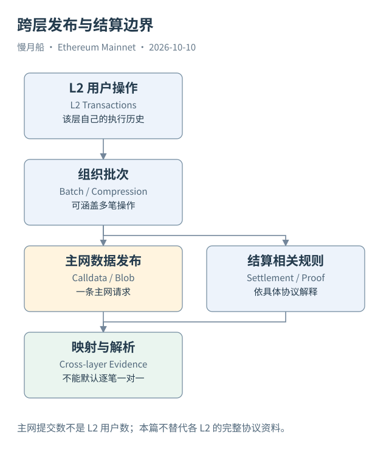

# 32｜一条主网批次提交，是不是一条 L2 用户交易？

用户在 L2 兑换一次代币，主网后来出现批次提交。两者相关，却不是同一层的一笔交易。主网记录发布、结算或证明相关操作，L2 自己执行并组织用户历史。本篇以主网为中心，只建立这条必要边界。

Rollup 把多项 L2 活动组织成可以发布和验证的材料。批次可以通过 Calldata 或 Blob 等方式向主网发布数据，具体采用哪种机制、怎样压缩与编码，由相应协议决定。主网顶层请求数不能直接当作 L2 用户操作数。

一份批次材料可能覆盖多笔 L2 交易；一笔 L2 业务又可能在跨层消息中关联后续操作。因此，没有解析与映射证据，不能把主网的一个 Hash 与 L2 的一个 Hash 简单一对一连接。它们各自都在自己的链范围内有身份。

主网提供的结算与数据可用性，也不是所有 L2 风险的完整保证。排序、证明流程、升级控制和取款条件等因素，可能属于 L2 的协议与运营安排。观察到主网发布成功，不足以证明所有用户操作都按应用预期成功。

跨链桥资产展示又容易制造重复。用户在主网锁定资产，在另一层获得对应表示；两边的事件属于不同账本。统计“总资产流入”时，如果把锁定和发行都按独立现实资金相加，就可能重复表达同一跨层过程。

取款消息也不等于某个地址立刻收到原生 ETH。不同协议可能有等待、证明、领取和执行步骤。必须查明当前研究的记录处于哪一步，成功标签来自哪条链，后续是否需要另一笔执行请求。本书不在没有资料的情况下给所有 Rollup 套同一时间常数。

Case 06A 只确认一笔主网 Blob 交易的公开结构。它不能单独证明具体批次覆盖了多少真实用户，也不能从 Value 为零推出“没有支付 L2 数据成本”。完整 Blob 费与批次内容需要相应证据，主网执行费只是其中一部分。

SQL 可以分别统计主网发布交易、Blob 数量或明确来源的费用。名称应对应观察对象，例如“主网批次提交数”，而不是“L2 成交数”。如果今后另写 L2 篇，可以在本篇建立的交易、Trace、Log 与 State 区分上继续展开。

这张跨层图的连线表示发布与结算关系，不是通用数据库外键，也不是本轮已取得的逐笔映射。保留边界，使主网分析能够准确说明自己证明了什么。

跨层分析最好建立两份定位：主网发布请求的身份，以及目标层用户记录的身份。只有解析批次或可靠映射资料支持，才把它们连接成具体关系。一个桥名称标签或相同地址字符串，都不足以替代这个步骤。

范围明确后，主网分析仍然能回答有价值的问题，例如某类发布活动的次数、数据引用数量或明确费用口径。它不需要假装覆盖每一条目标层业务。将结论限定在实际材料能够证明的层级，反而使后续各层研究更容易衔接。

[编辑此图](../../assets/diagrams/l2.drawio)

依据：[Rollups](https://ethereum.org/developers/docs/scaling/)；[Data Availability](https://ethereum.org/developers/docs/data-availability/)；[EIP-4844](https://eips.ethereum.org/EIPS/eip-4844)。核验日：2026-10-10。

[上一章](../part-08/31-staking-withdrawals.md) · [目录](../../SUMMARY.md) · [下一章](../part-09/33-sql-types.md)
