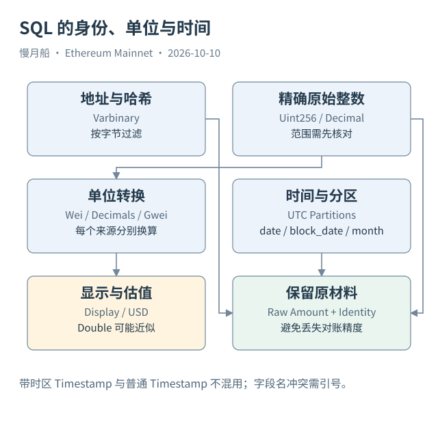

# 33｜地址、Wei 和 Uint256，SQL 应该怎样处理？

理解记录含义后，SQL 还需要尊重字段类型。相同的数字或十六进制串，在不同列中可能采用不同类型。本篇示例先保留原始值，再为展示做转换，避免让格式处理改变经济含义。

Dune 的 Ethereum 地址和 Hash 多为 Varbinary，表示字节。过滤地址时使用 `0x` 开头的二进制字面值，不在外面加普通字符串引号；如果从文本参数转换，应明确解析方式。字符串大小写变化与字节身份是不同问题，不需要把字节地址转换成字符串后才能比较。

Wei 是 ETH 的最小单位，一 ETH 对应十的十八次方 Wei。当前交易 Value 为 `decimal(38,0)`，Trace Value 却是 `uint256`。本轮六表字段快照已经核实这个差别。不能看到两个列都叫 Value，就假设它们拥有相同精度与转换边界。

Uint256 是大范围无符号整数；Decimal 的可表示范围受总位数限制。把任意 Uint256 强制转为 Decimal(38,0) 可能溢出。Double 能表示很大数，却会失去精确低位，适合近似展示与估值，不适合作为原始资产对账的唯一依据。

Decimals 负责把代币最小单位换成显示单位。Case 02 的原始 431,900,785 配合六位小数，显示为 431.900785。若误用 ETH 的十八位小数，就会得到一个完全不同的数量。资产精度应来自对应合约资料，不能由 Token Symbol 推断。

本篇 SQL 保留 `amount_raw` 或解码的原始 Uint256，同时将 Double 换算列明确用于显示。对财务式精确核对，应选择足够范围与小数位的 Decimal，并检查边界；多种代币还不能在原始整数层面直接相加，因为计量单位不同。

时间也有类型边界。Raw 表的时间常是普通 Timestamp，当前 `dex_evm.trades`、`tokens.transfers` 与 `gas.fees` 的时间是带时区类型。示例用已核实的 UTC 日期分区与固定交易定位，避免悄悄依赖会话时区。若统计上海自然日，要明确转换并覆盖相邻 UTC 分区。

字段名 `from`、`to`、`index` 等容易与 SQL 语法或习惯冲突，示例使用双引号保护必要字段。二进制切片按字节编号，Varbinary 函数的起点从一开始，地址在标准 Topic 中从第十三字节取二十字节，不能按字符串字符位置照搬。

静态审查可以确认类型、字段与语法结构，却不能证明真实扫描结果正确。本篇所有新增示例都注明 STATIC_CHECKED，保留未运行状态；作者历史 Query 的执行证据另外列出，不替新 SQL 背书。

写查询前，可以给每一列加一个简短说明：身份、数量、单位、时间或状态。转换发生时再注明原类型与目标类型。很多看似复杂的异常，实际上只是把原始整数、显示小数和美元估值当成了同一个数量。

对需要精确对账的结果，保留原字节和整数是一种低成本保护。后续可以改变展示格式与价格模型，原材料仍可核对。若最初只导出四舍五入的小数，后来出现差额，就可能无法判断差额究竟发生在链上还是转换过程中。

[编辑此图](../../assets/diagrams/sql-types.drawio)

依据：[Dune Datatypes](https://docs.dune.com/query-engine/datatypes)；[Varbinary Functions](https://docs.dune.com/query-engine/Functions-and-operators/varbinary)；[六表 Schema](https://docs.dune.com/data-catalog/evm/ethereum/raw/transactions)。核验日：2026-10-10。

[上一章](../part-08/32-l2-boundary.md) · [目录](../../SUMMARY.md) · [下一章](../part-09/34-safe-sql-joins.md)
