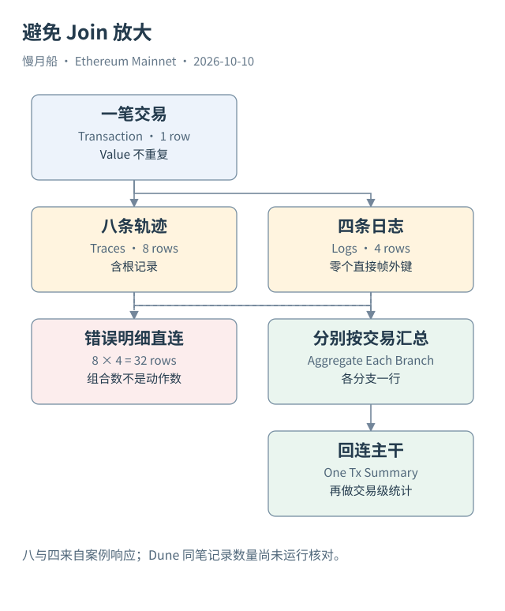

# 34｜怎样同时看调用与日志，又不把交易数放大？

我们现在要回答一个具体问题：Case 04 对应多少条调用轨迹、多少条保留日志，以及顶层附带多少 ETH？这三项都能查询，但不能先把所有明细连起来再机械汇总。

应该分别读取 Transactions、Traces 和 Logs。交易表给顶层请求，Trace 表给调用路径，Log 表给事件记录。三个分支先各自形成交易粒度的结果，再按 Hash 连接，最终保持一行代表一笔顶层交易。

完整示例见本章的 SQL 链接。它固定 UTC 日期与真实 Hash，分别在两个子查询中计算 Trace Count 和 Log Count，然后左连接交易主干。左连接保留“没有相关事件”这一情况；计数字段可按研究目的将缺失解释为零，但要先确认缺失不是采集问题。

对已保存的 Blockscout 响应，Case 04 有八条含根轨迹与四条 Logs。Dune 查询尚未运行，所以本书不预先填上“Dune 也一定返回八和四”。两个来源可能在根记录、覆盖、索引时点或规范化上有差异，真实结果应在执行后核对。

如果直接 `Transactions JOIN Traces JOIN Logs`，八与四会形成三十二个组合，每一行都复制顶层 Value。此时 SUM(Value) 将 0.408065 ETH 重复三十二次。加上 DISTINCT Value 也不是通用修复：若两笔交易恰好金额相同，去重金额会把真实第二笔也删掉。

若问题变成“每条日志由哪条调用帧发出”，按同一个 Hash 连接还远远不够。Raw Logs 通常没有与 Dune Trace Path 精确对应的普通外键。需要更丰富的追踪上下文才能定位发出帧；地址一致也不充分，因为一个合约可能在同一交易里被调用多次。

若确实要保留明细，可以输出两份独立列表，或者使用标注记录类型的联合视图。它们共享交易身份，但不被强行配对。结果中的一行此时是某类证据记录，需要保留类型，不能再用 COUNT(*) 叫交易数。

候选键检查也应提前做。区块号可能需要结合 Hash，Log Index 需要结合区块或交易，Trace Path 需要结合交易与来源。重复行既可能来自索引异常，也可能来自错误连接；先检查分支本身，再诊断 Join 才清楚。

本章的可复核结果不是一个漂亮总数，而是一条固定方法：先声明粒度，分支分别汇总，主干保持唯一，再说明来源差异。这个方法可以直接复用于授权、资产与 DEX 分析。

连接后还可以核对主干行数是否保持预期。如果原问题只涉及一笔交易，而输出突然出现几十行，先检查是否保留了明细粒度，再判断是不是数据重复。行数变化本身不是错误，未经说明地改了计数对象才是问题。

对于日志定位，区块内索引是一个历史位置，不是永久全局编号。同样的索引值会在后续区块再次使用；路径数组也只在相应交易与来源中有意义。给连接键加入足够范围，可以避免跨日期或跨交易的偶然数值相同造成误配。

需要字段明细时，可以先输出独立列表。保持各列表的实体粒度，比把所有字段塞进一行更能避免不受控制的组合。

下面的固定范围示例与外链文件一致，供逐行阅读；运行状态为静态审查，未执行。

```sql
WITH tx AS (
 SELECT hash, value, success FROM ethereum.transactions
 WHERE block_date=DATE '2026-10-08' AND hash=0x7ca3d8182d16bf406ba0780df78748bd6ee01d33df012ff0e359e081e6d69537
), trace_summary AS (
 SELECT tx_hash,COUNT(*) AS trace_records FROM ethereum.traces
 WHERE block_date=DATE '2026-10-08' AND tx_hash=0x7ca3d8182d16bf406ba0780df78748bd6ee01d33df012ff0e359e081e6d69537 GROUP BY 1
), log_summary AS (
 SELECT tx_hash,COUNT(*) AS log_records FROM ethereum.logs
 WHERE block_date=DATE '2026-10-08' AND tx_hash=0x7ca3d8182d16bf406ba0780df78748bd6ee01d33df012ff0e359e081e6d69537 GROUP BY 1
)
SELECT t.hash,t.value,t.success,COALESCE(r.trace_records,0) AS trace_records,
       COALESCE(l.log_records,0) AS log_records
FROM tx t LEFT JOIN trace_summary r ON t.hash=r.tx_hash
LEFT JOIN log_summary l ON t.hash=l.tx_hash;
```



[编辑此图](../../assets/diagrams/joins.drawio)

[完整 SQL：07-safe-join](../../examples/sql/07-safe-join.sql)（STATIC_CHECKED；未在 Dune 执行）。

依据：[Dune Transactions](https://docs.dune.com/data-catalog/evm/ethereum/raw/transactions)；[Dune Traces](https://docs.dune.com/data-catalog/evm/ethereum/raw/traces)；[Dune Logs](https://docs.dune.com/data-catalog/evm/ethereum/raw/logs)。核验日：2026-10-10。

[上一章](../part-09/33-sql-types.md) · [目录](../../SUMMARY.md) · [下一章](../part-09/35-raw-log-sql.md)
