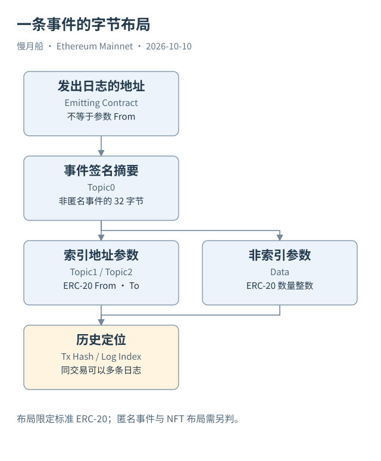

# 35｜不用解码表，也能看懂 Transfer 和 Approval 吗？

如果一个合约尚未建立解码表，但我们有可靠 ABI，仍然可以在原始 Logs 中读取事件。这里用主网 USDT 的标准事件布局说明方法，避免把字节处理写成只能复制的黑盒。

我们想确认 Case 02 的保留 Transfer：谁发送、谁接收、原始数量是多少。应该查 `ethereum.logs`，限定具体 UTC 日期、Transaction Hash、USDT Contract Address 和 Transfer Topic0。四项范围共同避免混入同交易其他资产与同签名的其他标准事件。

标准 ERC-20 Transfer 的 From 在 Topic1，To 在 Topic2，数量在 Data。SQL 用 Varbinary Substring 取地址字最后二十字节，用 Varbinary To Uint256 读取数量，并检查相应字段长度。显示换算单独做，原始整数保留下来。

保存的浏览器解析结果指向收款地址 `0xC9AbCaa845d81325d578C23C9CA2B8a2C9025C29`，数量 431,900,785。这是输入与取得的转移证据之间的核对目标，不是本轮新 Dune SQL 的已运行输出。原始日志查询跑完后，还应逐项检查 Log Index 与记录数量。

Approval 的布局类似：Owner 与 Spender 进入 Topics，额度进入 Data。但它代表授权，不能与转移金额相加。Case 03 已取得两条事件的 Owner、Router Spender 与额度：先为零，后为最大 Uint256；新增 SQL 将读取同一真实 Hash。网页没有提供全部原主题和第二条原数据字节，保存的空字段仍为空，不把解码值重新编码后冒充现场原字节。

事件签名可以由规范化签名计算，而不是手写一个不完整摘要。匿名事件、动态 indexed 参数或非标准布局不适用这份简化切片方法。ERC-721 的标准 Transfer 虽与 ERC-20 共享 Topic0，却把 Token ID 放在另一个 Topic；因此资产合约与布局检查不能省略。

合约地址在这里是事件发出者。它不等于顶层发送者，也不一定等于实际代币发送地址。Proxy 场景还要使用当时执行上下文与 ABI。为防止错误读取，查询保留原 Topics 与 Data，读者能回到原材料核对。

SQL 的结果一行代表一条保留事件。若同一交易出现两条 Transfer，它们不能因金额相同就去重；应按事件定位字段识别。若查询为空，也要检查日期、合约、签名和索引覆盖，不能立刻写成“没有资产变化”。

当你能说明每个字节位置为什么这样取，就已经掌握从原始数据走向业务解释的第一步。接下来再使用解码表或 Curated 表，便能判断它们做了哪些工作、保留了哪些限制。

从原字节解码事件，还可以检查长度是否符合该布局。地址主题应该是一字，数量数据应该满足预期编码；额外主题或长度差异需要解释。这类检查并不审计代币经济规则，却能发现切片方法用错标准的情况。

保留原字段之后，读者可以不用依赖某个网站的名称标签，独立确认自己取的是哪段字节。若解出的数字与页面不同，先比较单位、事件身份与接口版本，而不是把较大的数字直接认定为更真实。解码方法正确与业务结论完整仍是两项验证。

这一切片示例刻意固定合约与事件布局。将它推广到其他资产之前，应重新检查标准、参数索引与历史版本，而不是只改名称。

下面的固定范围示例与外链文件一致，供逐行阅读；运行状态为静态审查，未执行。

```sql
WITH event_rows AS (
 SELECT tx_hash, "index" AS log_index, contract_address, topic1, topic2, data,
        varbinary_substring(topic1,13,20) AS token_sender,
        varbinary_substring(topic2,13,20) AS token_recipient,
        varbinary_to_uint256(data) AS amount_raw
 FROM ethereum.logs
 WHERE block_date = DATE '2026-10-08' AND tx_hash = 0x458584a9b39f8bcfc215cc5990f1776ed5cc485dc56ffb02927032ca79a537ca
   AND contract_address = 0xdac17f958d2ee523a2206206994597c13d831ec7
   AND topic0 = keccak(to_utf8('Transfer(address,address,uint256)'))
   AND varbinary_length(topic1)=32 AND varbinary_length(topic2)=32
   AND varbinary_length(data)=32 AND topic3 IS NULL
)
SELECT *, CAST(amount_raw AS DOUBLE)/1e6 AS amount_display_approx FROM event_rows;
```



[编辑此图](../../assets/diagrams/logs.drawio)

[完整 SQL：03-usdt-transfer](../../examples/sql/03-usdt-transfer.sql)（STATIC_CHECKED；未在 Dune 执行）。

依据：[Varbinary](https://docs.dune.com/query-engine/Functions-and-operators/varbinary)；[ERC-20 事件](https://eips.ethereum.org/EIPS/eip-20)；[ABI 布局](https://docs.soliditylang.org/en/latest/abi-spec.html)；[双Approval真实案例](https://etherscan.io/tx/0xcb961e7be2376292335004a134aa87cb775e624e3db5883c5ac1babdf70ff1ad)。核验日：2026-10-10。

[上一章](../part-09/34-safe-sql-joins.md) · [目录](../../SUMMARY.md) · [下一章](../part-09/36-curated-sql.md)
