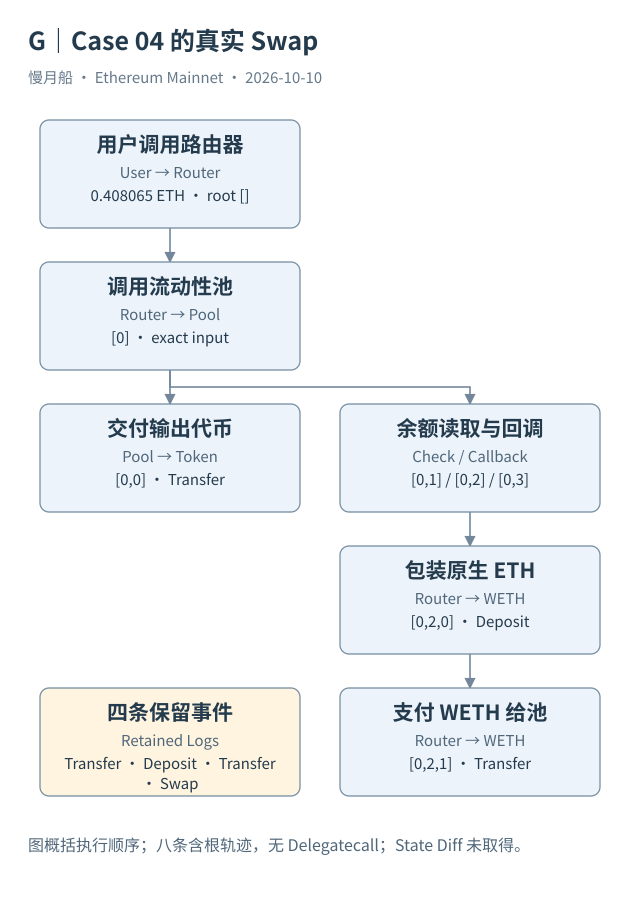

# 37｜把一笔真实 Swap 从头还原

现在把前面的概念放进同一笔主网交易。Case 04 的完整 Hash 为 `0x7ca3d8182d16bf406ba0780df78748bd6ee01d33df012ff0e359e081e6d69537`，位于区块 26151122，时间为 2026-10-08 23:59:59 UTC。我们已有顶层元数据、完整调用轨迹与四条原始 Logs。

用户调用 Router 的 `exactInputSingle`，输入资产为主网 WETH9，输出资产合约为 `0xC552B5706bAa14c1f0104e95380ea3DC102a481f`，接收人为用户地址，原始输入数量 408,065,000,000,000,000。顶层附带同额 ETH，说明支付来源与接口中的 WETH 资产需要在执行中连接。

Router 调用 Pool `0x807D8084fd2A0e204590514286454DACCE902B65`。Pool 先通过输出代币合约向用户转移 335,316,067,803,035,700,341,650 个最小单位，然后读取自己的 WETH 余额。这不是执行倒置，而是 V3 回调支付安排的一部分。

接着 Pool 回调 Router。Router 调用 WETH Deposit，把附带资金包装成 WETH，再把 0.408065 WETH 转给 Pool。Pool 再读余额，核对支付，最终发出 Swap。这些步骤在同一笔交易的调用树中，没有新增七份独立用户签名。

日志顺序为输出 Transfer、Deposit、输入 WETH Transfer、Swap。Swap 的 `amount0` 为正的 408,065,000,000,000,000，`amount1` 为负的 335,316,067,803,035,700,341,650。这里的正负按 Pool 的资产差额语义解释；币种排序与地址及合约规则必须核对，不能把负数叫作失败。

原始轨迹还包含两次 Staticcall，都是 WETH `balanceOf` 读取。它们帮助核对支付，却没有自行发生第二份同额转账。八条含根调用记录加四条事件，说明不同证据如何表达同一兑换，而不是十二次业务。

交易实际消耗 141,995 Gas，有效单价为 126,291,845 Wei，每笔执行费为 17,932,810,530,775 Wei。输出代币人类数量若采用取得的十八位小数元数据，约为 335,316.0678030357；原始整数必须保留，当前价格不能被拿来冒充当时成交价值。

证据也有边界。元数据工具的原输入被标为截断，但保存的 Raw Trace 根输入提供了完整调用字节。我们未取得完整 State Diff，也未运行 Dune 的新案例 SQL；因此只确认主要调用、保留日志与取得的资产线索，不声称已审计代币全部槽位或所有经济风险。

最终复核要能从每项结论回到文件。调用路径、事件索引、资产地址与单位都保存在案例页；图只是帮助理解这份固定证据。换一笔 Swap，可以沿同样顺序重新取得材料，不能直接把这条路线复制成所有兑换的必然过程。

这个案例还能核对回调前后两次余额读取。根输入与内部支付都指向同额包装资金，池收到支付后继续完成验证。读取记录参与证明执行路径，却不能再被累加为另一份成交金额。

若要进一步核验输出代币实际最终余额差异，需要该代币实现与更完整状态材料。取得的转移日志和成功路径支持主要交付解释，但不能自动排除特殊余额规则。一个可靠案例应该留下这个边界，让复核者知道下一层结论需要哪份证据，而不是让图表的完整外观掩盖材料缺口。

输入与输出的符号采用池视角。切换到用户视角时需要重新标注方向；同一结算数量的符号变化，并不意味着链上发生了第二次转移。

[编辑此图](../../assets/diagrams/swap.drawio)

[完整 SQL：02-traces-and-logs](../../examples/sql/02-traces-and-logs.sql)（STATIC_CHECKED；未在 Dune 执行）。

依据：[Uniswap V3 Swap](https://developers.uniswap.org/docs/protocols/v3/guides/swapping/single-hop-swapping)；[真实交易](https://eth.blockscout.com/tx/0x7ca3d8182d16bf406ba0780df78748bd6ee01d33df012ff0e359e081e6d69537)；[V3 Pool 接口](https://github.com/Uniswap/v3-core/blob/main/contracts/interfaces/pool/IUniswapV3PoolEvents.sol)。核验日：2026-10-10。

[上一章](../part-09/36-curated-sql.md) · [目录](../../SUMMARY.md) · [下一章](../part-10/38-wallet-flow.md)
