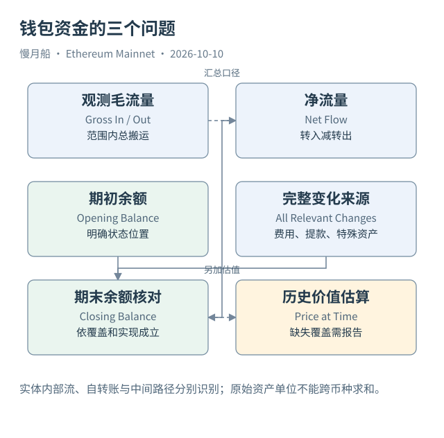

# 38｜钱包净流量，为什么不等于交易金额之和？

分析钱包资金时，需要先回答“哪种资产、哪个时间段、哪种变化”。一个地址在一笔交易里可以多次发送和接收同一种资产，最终净变化与所有中间搬运的总额不同。

Case 04 中，用户支付 0.408065 ETH 并另付执行费，接收输出代币。Router 中转原生 ETH 并包装 WETH；Pool 收到 WETH 并交付另一种代币。若把这些地址放在一起统计，资金路径的每一段都能出现，却不能全部当作用户独立支出。

毛流量（Gross Flow）统计观察范围内转入与转出的总规模，净流量（Net Flow）取二者差额，余额（Balance）是某个状态位置的存量。三种指标回答不同问题。净流量要与期初余额结合，才可能解释期末余额；还需确认覆盖了所有适用变化。

原生 ETH 需要考虑顶层 Value、内部支付、手续费、共识提款以及相应历史机制。代币则要考虑合约规则与非标准变化。只用一条 Transfer 流水模型回答全部钱包余额，可能漏掉 Rebasing 或其他没有标准事件的动作。

同一实体的多个地址也会影响口径。假如把交易所热钱包与冷钱包都纳入同一个研究集合，它们之间搬运是集合内部流，不应与外部净流混淆。但实体标签需要证据和版本，不能因为两地址经常互转就直接归为同一公司。

自转账是另一种易错情况。从与到属于同一个地址时，资金本金可能净额为零，执行费用仍会减少原生余额。若分别计算发送与接收地址活动，它可以在两侧出现；若统计现实用户人数，更不能因此推导两个用户。

平台 Curated Transfers 可以帮助统一资产流水，但先要阅读来源和去重键。某些记录以费用移动或包装动作生成，不全部对应原始 Transfer Event。示例查询保留 `unique_key`、`evt_index`、`trace_address` 与资产身份，帮助回查来源。

估值要再加一层边界。不同资产最小单位不可直接相加；人类数量也不能跨资产求和就叫总价值。需要适当时点的价格、覆盖率与稳定的估值口径。缺失价格不代表那项资产数量为零。

核对钱包时，先逐资产计算，再解释路径和费用，最后才形成价值汇总。若无法覆盖完整变化，应把结果命名为“观测到的净流量”，并指出余额重建所缺的材料。这种表达比一个没有范围的总金额更能支持后续研究。

可以先固定一个地址与一种资产，列出所有观测转入、转出，再单独列费用或其他协议变化。每一项都保留历史定位，便于检查同一记录是否被重复收入。这比先计算所有资产的总美元变化更容易发现来源遗漏。

净流量为零也不说明没有活动：资金可能多次周转后回到原位。毛流量很大也不说明新增财富很大：同一资金可以经过多层路径。报告同时展示存量与过程时，应让读者知道两个数字分别观察哪一种现象。

[编辑此图](../../assets/diagrams/wallet-flow.drawio)

[完整 SQL：11-token-movements](../../examples/sql/11-token-movements.sql)（STATIC_CHECKED；未在 Dune 执行）。

依据：[Token Transfers](https://docs.dune.com/data-catalog/curated/token-transfers/evm/token-transfers)；[共识提款](https://eips.ethereum.org/EIPS/eip-4895)；[作者转账 Query](https://dune.com/queries/8378490)。核验日：2026-10-10。

[上一章](../part-10/37-swap-reconstruction.md) · [目录](../../SUMMARY.md) · [下一章](../part-10/39-metrics-users-volume.md)
