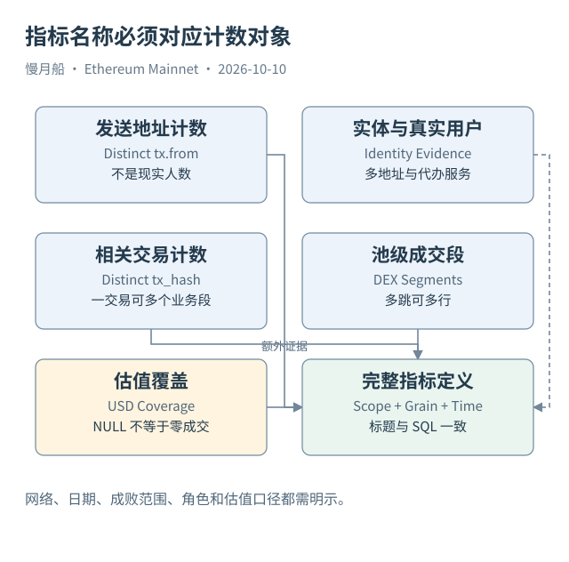

# 39｜活跃地址、真实用户与成交量，该怎样命名？

很多指标错误从一个过大的名称开始。SQL 计算了去重发送地址，却把结果写成用户数；累加了池级执行段价值，却叫最终用户支付金额。数字可能算得完全正确，标题却改变了它的含义。

一个现实实体可以管理多个地址，一个地址也可能服务多位用户。交易所汇总钱包、合约账户、Bundler 与代理服务都能打破“一地址一用户”。从顶层 `from` 去重，得到的是观察范围内不同发送地址的数量，不是现实人数。

合约参与还会改变角色。Router 可以是多笔交易的 To，却没有因为每天被调用十万次就变成十万名用户。Trace 的调用者可能是 Pool，Event 中 Sender 可能是 Router，Curated 的 `tx_from` 则是顶层来源。分析表越多，越需要保持角色命名一致。

作者的每日交易 Query 将发送与接收地址分别输出；DEX Query 将去重 `tx_from` 说明为发起者代理指标。这些原注释保存在研究目录。复用正文时，可以说“活跃发送地址”，但若要进一步叫用户，需要额外身份模型与适当的不确定性表达。

成交量同样要标口径。Pool 吞吐量可以按池级执行段估值汇总；Aggregator 路由意图通常代表另一粒度；钱包最终换入换出金额又是另一层。多跳路线下，池级总量可能大于最终用户支付，并不因此必然是错误，而是计量对象不同。

当前价格不能直接用于所有历史成交。代币身份、时点、缺失与异常价格会影响估值。作者历史 DEX 样本存在空 USD 行；NULL 不能被称为“没有成交”，也不能在没有解释时填零掩盖覆盖缺口。

失败交易也需要明确处理。如果统计提交后被收录的网络活动，失败交易可以属于分母；若统计成功兑换，则应依据业务证据排除未完成操作。不能在图表标题只写“交易数”，让读者猜分母究竟是什么。

指标定义可以写成一句完整的话：“Ethereum 主网，按 UTC 自然日，去重已收录交易的顶层发送地址，包含成功与失败，不等同于现实用户。”这句话包含范围、时间、粒度与限制，足以让另一位分析师复现同一口径。

每次发布数字前，把标题与 SQL 中真正被计数的一行对照。若二者不一致，先改定义或改查询。SQL 的任务是准确实现一个明确问题，不能替缺少定义的业务词汇自动补全含义。

指标可以再附一项质量数，例如空身份、重复候选键或缺失价格的记录数量。这不是装饰性注释，而是帮助读者判断覆盖范围。一个没有估值的真实成交，应被计入适当的次数指标，同时在价值汇总旁解释缺口。

不同报告若使用不同口径，不宜只比较最终总数判断谁错了。先比较链范围、自然日边界、粒度、失败过滤与价格来源。很多明显差距来自计量对象不同；将定义写清楚，才能开始检查真正的数据或计算问题。

[编辑此图](../../assets/diagrams/metrics.drawio)

[完整 SQL：12-daily-addresses](../../examples/sql/12-daily-addresses.sql)（STATIC_CHECKED；未在 Dune 执行）。

依据：[作者地址指标](https://dune.com/queries/8378485)；[作者 DEX 口径](https://dune.com/queries/8378491)；[DEX 粒度](https://docs.dune.com/data-catalog/curated/dex-trades/evm/dex-trades)。核验日：2026-10-10。

[上一章](../part-10/38-wallet-flow.md) · [目录](../../SUMMARY.md) · [下一章](../part-10/40-unknown-transaction.md)
