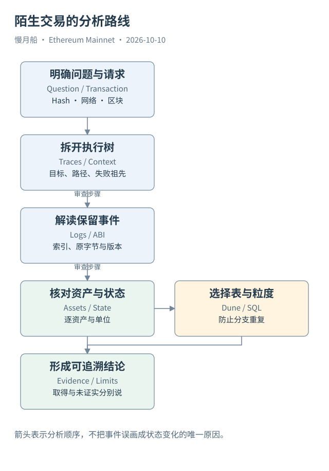

# 40｜打开一笔陌生交易，怎样形成可信结论？

面对陌生主网交易，先别急着搜索 Token 名称或计算总金额。给分析设定一个问题，例如“这次操作是否把指定资产从地址 A 交付给地址 B”。有了问题，才能知道要收集哪些证据。

从顶层请求开始，记录网络、完整 Hash、区块号与哈希、UTC 时间、From、To、Value、Input、类型和成功状态。分清提交地址与业务参与者，不把当前浏览器标签当成当时链上实名信息。原请求与执行结果分别保存。

再看调用树。识别目标代码、内部调用、调用方式、创建与失败分支。路径帮助判断哪些动作属于同一事务，祖先回滚帮助判断局部成功是否最终保留。需要代理或委托时，把代码来源与状态上下文分开。

接着看保留日志。按发出地址与历史 ABI 解码，标记事件索引、原始字节和参数类型。名称为 Transfer 的记录还要检查资产标准；Swap 参数要按对应协议语义解释；Approval 仍属于权限线索。

资产与状态核对放在下一步。逐资产说明数量、单位、发送接收关系和费用。若有 State Diff，可以进一步核验特定变化；若只有调用与日志，就保留这项局限。没有观察完整 Storage，不应把主要流程还原写成全面合约审计。

进入 Dune 后，把链上实体映射到相应表。先查 Raw，必要时用 Decoded 读取参数，再用 Curated 形成明确口径的流水或成交。不同层可能重复表达同一动作，不能把它们直接 Union 成“完整资产变化”。

SQL 保留时间与交易定位，先检查粒度和候选键，再计算指标。结果空、字段空或来源不同都需要解释。版本差异、延迟、覆盖不足和真实无事件，是四种不同可能，不能用一次空查询把它们混为结论。

最后写出可追溯的叙述：“观察到什么、由哪些记录支持、哪些仍未证实”。Case 04 正是这种方法的完整演示：一笔请求、八条含根调用、四条日志，解释 ETH 包装成 WETH 再支付池的主要流程，同时保留 State Diff 与 Dune 新查询未运行的限制。

本篇的学习终点不是背出六张表，而是学会正确地组合证据。Transaction 表达提交的操作，Trace 展开执行调用，Log 保存程序显式记录，State 表达实际保存的状态；Dune 在这些层次上建立可查询模型。知道它们各自回答什么，你就能继续研究其他 EVM 网络而不丢失基本边界。

完成分析后，可以请另一位读者沿哈希、路径与索引复查其中一项结论。如果他无法找到原记录，说明交付还缺少定位或来源，而不只是说明文字不够长。研究文件与正文引用应让这个动作尽量简单。

本篇把来源日期、真实案例、字段快照与运行状态都保存到本地。以后协议或模型改变，复核者可以知道哪些解释仍成立、哪些需要重新读取。能恢复研究与能复现结论，也是链上数据知识的一部分；它们让一本技术书在阅读之后继续有用。

[编辑此图](../../assets/diagrams/analysis-route.drawio)

依据：[Execution API](https://ethereum.github.io/execution-apis/)；[Geth Tracing](https://geth.ethereum.org/docs/developers/evm-tracing)；[Dune 数据分层](https://docs.dune.com/data-catalog/evm/overview)。核验日：2026-10-10。

[上一章](../part-10/39-metrics-users-volume.md) · [目录](../../SUMMARY.md)
