# 《慢月船：链上数据之路》｜Hyperliquid 篇

slowmoonship: Gateway to Onchain Data

基准日2026-10-13 · [短章目录](SUMMARY.md) · [验收报告](reports/final-acceptance.md)

# 前言｜交易所内部的数据，怎样成为链上状态

你在交易页面点击买入，几乎立即看见成交。价格、数量、持仓和余额都变了。这个熟悉的过程，在 Hyperliquid 上同时也是一条区块链的执行过程。理解它，需要将交易界面的动作拆开，再把金融行为与数据记录接起来。

本篇沿着 Actions → Order Book → Matching → Fills → Positions → Margin → Funding / Liquidation → State 展开；随后连接 HyperCore 与 HyperEVM，并进入 Node、API 和 Dune 数据。先解释系统做了什么，再解释记录在哪里，最后讨论怎样分析。

本书基准日为2026-10-13，时间序列分析统一使用UTC，接口获取时间另行保存。正文中的 Alice、Bob 及小型订单簿数字均为教学模拟；编号案例来自实际只读响应，保留原始JSON、请求、获取时间与关联检查。当前状态、历史事件、重建结果和研究解释分别标注。公开地址在本篇只是账户标识，不据此识别现实身份。

证据分五层：直接协议事件、API状态快照、索引或整理数据、重建状态、研究解释。公开API事件也经过服务端呈现，并不代表作者已独立重放共识。各层可以互相核对，不能互相替代。一本书能讲清清算机制，并不意味着已经取得某个账户清算时全部风险输入。

正文中的SQL均有本地静态审查，新增SQL没有在Dune服务端执行。已有Query与旧Result另列来源和历史窗口。Catalog能看见字段，不代表本账户能读取数据。没有实际返回的接口示例使用`DOCUMENTED_NOT_EXECUTED`，不附造出的响应。

协议更新会使不同官方页面出现时间差。本篇特别核对账户抽象、HIP-3全仓、HIP-4主网观察、CoreWriter和Dune口径，保留冲突及无法证明的边界。附录集中收录术语、身份规则、表索引和来源；正文只在会改变结论的地方说明具体限制。

读者无需先懂金融工程。读完前四Part，你应能解释为什么Order不等于Fill、买入不一定开多、成交量不等于OI。继续读下去，你将知道余额如何受到资金费、费用与账务事件影响，并能够为一条金融指标建立可检查的数据链条。

---

# Part 01｜订单为何需要共识

# 01｜点击买入之后，链上发生了什么

你准备买入一小笔BTC永续合约。页面上有价格、数量和买入按钮，操作看起来与中心化交易所差不多。但按钮不是成交事实，它首先表达一项意图：你愿意在什么条件下买入多少。网络还需要检查权限、决定处理顺序、寻找对手方，才可能改变你的持仓。

在传统交易所里，这些步骤由交易所服务器和内部数据库完成。用户通常只能看见交易所愿意提供的账户记录。Hyperliquid将订单簿和金融账户的核心状态放进自己的Layer 1。验证者就这些状态的演变达成一致；某台前端服务器的显示结果，不能独自替代协议已经接受的执行结果。

入口是一项Action，即用户签名的操作。下单是一种Action，撤单、调整账户设置或转移资产也有各自的类型。签名让系统验证操作权限，不能保证业务上必然成功。价格格式不合法、余额不足或其他约束不满足时，一项通过身份检查的请求仍然可能被拒绝。

系统接受订单后，HyperCore执行撮合。假设你提交限价买单，而卖盘已有符合价格条件的挂单，订单可能立即吃掉这些数量。如果价格还没有遇到对手方，允许继续挂单的订单可以留在簿上等待。把“请求被接受”解释成“已经买到”，会把意图、等待状态与成交混成一件事。

发生撮合时，系统记录成交价格与数量，并更新买卖双方的金融状态。永续合约还需要检查持仓和保证金，扣收手续费或给予返佣。你没有收到现货BTC，而是取得或减少与BTC价格相关的合约敞口。账户变化需要比一次代币转账更丰富的状态表示。

链上共识解决的是这些操作及状态变化如何形成一致的历史。订单簿回答谁愿意以什么价格交易；撮合规则回答哪两项意图能够相遇；Clearinghouse负责持仓和风险账户。这些职责相互联系，却不应画成一个叫“交易”的黑箱。后面每章会逐个打开其中一层。

本篇真实案例03提供了一个很有帮助的观察：同一笔BTC撮合，买方Fill写着Close Short，卖方Fill写着Close Long。双方都在减少原有敞口。页面上的买和卖，是成交方向；开仓和平仓，是对各自原有状态的改变。这两套语言从第一笔交易开始就应该分开。

数据分析可以按同样顺序追问：取得了Action还是订单状态？取得了一个经济成交还是某个用户的Fill？状态是成交前、成交后，还是更晚查询得到的快照？只有回答这些问题，价格、数量和余额才能组成一段有证据的交易过程。

因此，本篇的起点并不是代币价格，也不是如何选择杠杆。它是一条简单的因果链：用户表达意图，网络排列操作，执行环境改变状态，数据接口呈现不同侧面的记录。点击按钮只是入口；把这条链条连接起来，才是理解链上交易系统的开始。

<!-- BOOK RESOURCES -->

[编辑此图](assets/diagrams/click.drawio)

证据：[案例03](examples/cases/case-03.md)。

依据：[about-hyperliquid](https://hyperliquid.gitbook.io/hyperliquid-docs/about-hyperliquid.md)；[hypercore__overview](https://hyperliquid.gitbook.io/hyperliquid-docs/hypercore/overview.md)。

[来源目录](research/source_catalog.md) · [目录](SUMMARY.md) · [下一章](book/part-01/02-consensus.md)

---

# 02｜订单先后顺序为何需要共识

一张卖单只剩一个单位，两个人同时想买。先处理谁，可能决定谁拿到成交，谁留下未成交订单。在行情快速变化时，这个差别具有真实经济价值。区块链共识在这里不只是防止重复转账，也负责让不同节点对金融操作的处理历史保持一致。

Hyperliquid使用HyperBFT。官方将它描述为受HotStuff及其后续设计启发的共识算法。验证者提出和确认轮次，诚实节点应同意已经提交的轮次顺序。共识与执行是不同职责：前者确定一致的提交历史，后者根据规则计算订单簿、持仓和账户的新状态。

这里的顺序不是“谁先在自己电脑上点击，谁就必然先成交”。网络传播、提议者和协议内部排序都会影响最终位置。官方订单簿规范还规定，在每个共识批次内，不向簿发送GTC或IOC的操作、撤单、包含GTC或IOC的操作按类别处理；类别内部再遵循提议顺序。

这项规则与订单簿的价格时间优先也不同。前者安排一个批次里的Action处理次序，后者选择已经挂在簿上的订单如何与来单撮合。分析者如果只比较两个客户端发送时间，既没有看见完整传播过程，也没有检查批次分类，无法精确宣布某个用户被抢先。

验证者的共识权重与委托的HYPE质押有关。官方质押文档把超过总质押三分之二的集合称为quorum。安全性依赖相应的诚实权重条件，不是节点数量越多就自动安全。一个验证者背后可能有许多委托者；计数地址与计算共识权重是不同问题。

轮次Round与执行区块高度Height也不能互换。官方说明，高度只在包含交易的共识轮次推进时增加；验证者集合按质押epoch调整。统计区块间隔时，要先确定数据中的“区块”是L1执行区块还是HyperEVM区块。后者有自己的编号，不能拿来直接代替共识轮次。

官方性能介绍给出约每秒二十万订单的支持能力，并展示地理位置接近节点的客户端延迟。这些数字具有指定测量环境和“订单”单位。它们不是本篇测得的长期网络表现，也不能直接改称每秒二十万笔成交。一张订单可能没有成交，也可能拆成多次成交。

最终性表示协议提交结果在其安全假设下不再被正常共识过程改写。它不保证前端永远正确显示，也不保证金融产品没有风险。账户可以在已最终确认之后，因下一次价格更新或下一笔操作继续变化。确定的历史与不断变化的当前状态并不矛盾。

理解共识后，可以给数据中的时间增加一层含义：发送时间、事件时间、提交位置与查询时间分别属于不同环节。研究成交先后，应寻找协议排序和业务规则；研究延迟，应明确从哪个时点量到哪个时点。顺序之所以需要共识，是因为所有账户最终必须接受同一套状态演变。

<!-- BOOK RESOURCES -->

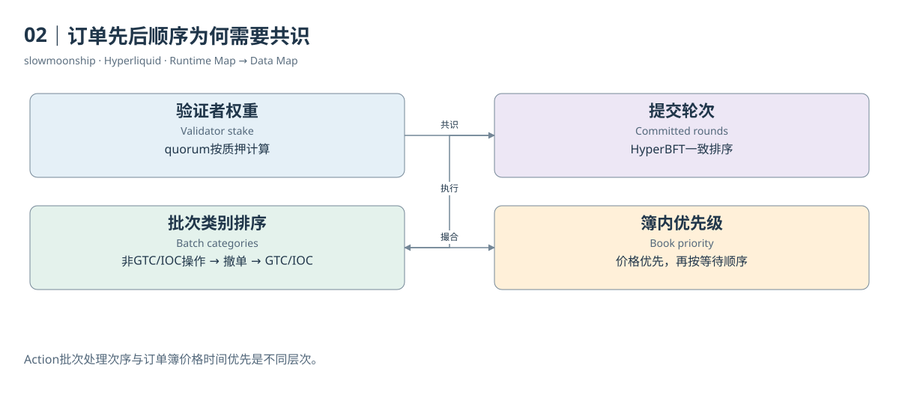

[编辑此图](assets/diagrams/consensus.drawio)

依据：[hypercore__order-book](https://hyperliquid.gitbook.io/hyperliquid-docs/hypercore/order-book.md)；[hypercore__staking](https://hyperliquid.gitbook.io/hyperliquid-docs/hypercore/staking.md)。

[来源目录](research/source_catalog.md) · [目录](SUMMARY.md) · [上一章](book/part-01/01-click.md) · [下一章](book/part-01/03-runtime.md)

---

# 03｜同一条L1的两种执行环境

Hyperliquid页面可以交易永续合约，也可以连接运行智能合约的应用。看见两套入口，很容易以为背后是两条链。正确的结构是：同一条Hyperliquid L1由HyperBFT保护，状态执行包含HyperCore与HyperEVM两大部分，两者承担不同工作。

HyperCore专门处理订单簿、撮合、持仓和保证金等金融原语。用户下单时，无须先找到一个普通EVM交易所合约，再调用合约里的撮合函数。核心交易状态是协议自身执行的一部分。这也是为什么分析HyperCore不能只从ERC-20 Transfer事件入手。

HyperEVM提供通用EVM合约环境。开发者熟悉的账户、字节码、交易收据和日志仍然有用，Gas使用HYPE支付。它让借贷或其他应用与Core中的金融状态组合，但不能因此把HyperCore改画成EVM内部的一个合约。专用执行与通用执行的边界始终存在。

两种环境之间的连接有明确接口。读取预编译允许合约查询特定Core状态；CoreWriter系统合约允许EVM侧表达随后由Core处理的操作。原生资产还可以按系统地址规则在两边移动。这些路径共享L1排序，却具有不同的处理时点和可观察结果。

例如，合约读到BTC预言机价格，只能说明指定读取在相应EVM执行状态下得到这个值。合约向CoreWriter提交操作，则需要继续核对Core是否执行成功。EVM收据中的成功，不能自动替代最终订单状态。共享底层共识没有消除跨执行职责的业务检查。

资产交互也不是普通两条L1之间的外部桥模型。HYPE对应EVM原生余额；某些Core现货资产与具体ERC-20关联。关联规则、精度转换和合约实现决定如何记账。把所有资产都画成同一种锁定与铸造流程，会掩盖原生HYPE与关联代币的差异。

数据入口因此分成两套。Core Info API呈现市场、账户、订单和成交等业务数据；EVM RPC呈现区块、交易和收据。节点输出和索引服务可以把二者进一步整理。Dune中的`hyperevm.transactions`与`hyperliquid.perp_trades`描述不同事件，行数没有直接相等的理由。

官方页面还存在更新节奏差异：介绍页仍保留部分功能尚未主网上线的早期文字，而交互规范列出了扩展后的CoreWriter操作。本篇实际取得主网读取预编译返回与CoreWriter代码；已有Dune结果也保留接口调用观察。它们支撑指定接口的存在，不能证明所有列出的操作都已逐项验证。

阅读后面的运行时总图时，可以先沿上半部分理解共同的L1和共识，再分别进入Core与EVM的执行职责，最后沿下半部分寻找数据接口。分析金融行为时选Core记录，分析合约执行时选EVM记录，分析交互时连接两边证据。这就是两张数据地图共享同一底层状态的含义。

共享L1还意味着，研究者不应把两套接口返回的高度直接当作相同编号。需要先查明高度属于共识、Core执行还是EVM区块，再寻找正式关联。

<!-- BOOK RESOURCES -->

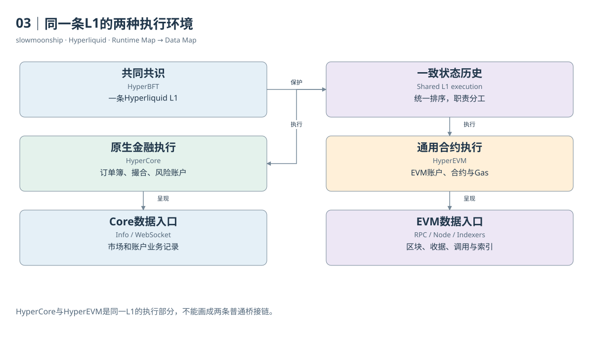

[编辑此图](assets/diagrams/runtime.drawio)

证据：[案例08](examples/cases/case-08.md)。

依据：[hyperevm](https://hyperliquid.gitbook.io/hyperliquid-docs/hyperevm.md)；[for-developers__hyperevm__interacting-with-hypercore](https://hyperliquid.gitbook.io/hyperliquid-docs/for-developers/hyperevm/interacting-with-hypercore.md)；[for-developers__hyperevm__interaction-timings](https://hyperliquid.gitbook.io/hyperliquid-docs/for-developers/hyperevm/interaction-timings.md)。

[来源目录](research/source_catalog.md) · [目录](SUMMARY.md) · [上一章](book/part-01/02-consensus.md) · [下一章](book/part-01/04-records.md)

---

# 04｜把一次金融行为拆成不同记录

一位分析师拿到一张表，发现每行都有价格、数量和时间，于是把行数叫作交易次数。问题在于，这张表可能是一侧用户的Fill，也可能是一笔撮合，也可能是订单更新。看起来相似的字段，不能替代行粒度的定义。先问一行代表什么，比先写SUM更重要。

Action是进入系统的操作。Order是交易意图及其业务身份。一个批量下单Action可以包含多张订单；一张订单也会经历接受、挂单、部分成交和终止等变化。订单更新是这些变化的记录，不是每次更新都发生了一笔经济成交。

Trade通常指一次撮合形成的经济成交。Fill从某个参与账户的角度记录成交结果。因此，一笔Trade可以对应买卖两侧的Fill。这两行有各自的订单编号、手续费和持仓变化。把两行数量与价格乘积相加，会把同一市场成交的名义金额放大。

本篇案例03中，一笔BTC成交数量为0.00012，价格为83592。经济名义金额是10.03104个报价单位。买侧和卖侧各有一条相同价格、数量、时间与Trade ID的Fill，双侧直接相加会得到20.06208。两个参与账户各自交易了10.03104，与市场只撮合一次并不冲突。

Position是持仓状态。它记录账户在一个市场当前有多少净敞口，而不是已经交易过多少。Balance或Ledger Update描述资金和资产状态及其变化。资金费、转移资产和费用都可能改变账户，但不一定产生一笔普通交易。不同记录解决不同的业务问题。

标识符也各有范围。订单编号oid识别订单，客户端编号cloid用于用户自行追踪，tid关联成交。官方WebSocket规范说明，tid来自买卖订单编号的五十位哈希，建议用事件时间、coin与tid组合形成全局成交键。仅凭tid或毫秒时间，不应假定跨全部市场绝对唯一。

哈希字段尤其容易被误读。API Fill的hash与EVM交易哈希属于不同记录体系；某些返回还使用全零哈希。案例资金费记录就出现这种值。不能把全零哈希当成有效交易的唯一身份，也不能拿Core Fill hash直接连接EVM交易表，期待找到一一对应的收据。

当一项查询同时涉及多张表时，应该先画出连接关系。订单到Fill通常是一对多；Trade到双侧Fill也是一对多；小时市场指标到该小时所有成交则是一对多。先连接再汇总，如果忘记右侧有多行，左侧的OI或资金费就会被重复复制。

一份清楚的研究说明，应给每张输入表写一句粒度定义，并为指标指定统计对象：市场成交、账户参与、订单、持仓快照还是资金流。这样即使字段名都叫size或amount，读者仍能知道它们在说什么。金融行为复杂，可靠的数据建模从保存这些区别开始。

保留原始记录身份，也让后续汇总可以回到每一行。一个无法追溯到输入范围的总数，即使计算没有语法错误，也很难审查。

<!-- BOOK RESOURCES -->

[编辑此图](assets/diagrams/records.drawio)

证据：[案例03](examples/cases/case-03.md) · [案例13](examples/cases/case-13.md)。

依据：[for-developers__nodes__l1-data-schemas](https://hyperliquid.gitbook.io/hyperliquid-docs/for-developers/nodes/l1-data-schemas.md)；[for-developers__api__websocket__subscriptions](https://hyperliquid.gitbook.io/hyperliquid-docs/for-developers/api/websocket/subscriptions.md)；[dune-perp-trades](https://docs.dune.com/data-catalog/curated/perpetuals/hyperliquid/perp-trades.md)。

[来源目录](research/source_catalog.md) · [目录](SUMMARY.md) · [上一章](book/part-01/03-runtime.md) · [下一章](book/part-02/05-accounts.md)

---

# Part 02｜账户与金融状态

# 05｜一个地址为何有多种余额

你看到Spot余额里有HYPE，永续页面显示USDC账户价值，质押页面还有一笔等待退出的HYPE。把三个数字加起来，似乎就得到了钱包资产。但一个地址连接的状态包含不同资产、不同账户模式和不同限制。金额只有在单位与经济含义相同的条件下才能相加。

HyperCore用户通常由一个地址识别。地址像一把索引钥匙，可以找到现货、永续和质押相关状态。它并不意味着所有资产放在一个可随意提款的余额栏里。Spot持有的是代币数量；Perps持仓记录合约敞口；Staking记录参与共识的HYPE及退出队列。

永续账户价值Equity包含风险账户的资金与未实现盈亏。它不等于持仓名义价值，也不一定等于可提取金额。一个账户可以控制相当大的名义仓位，却只有较少保证金。如果把Position Value看成现货资产价值，整个资产负债表就会被严重夸大。

现货余额还可能有hold，即被挂单或其他机制占用的部分。总余额与当前可用余额需要分开。卖出挂单尚未成交时，资产并没有必然转给买方，但可能已经被系统保留用于履约。看到可用余额减少，不能仅据此宣布完成了一次转账或成交。

资产移动还要区分账户内部分类转移与外部地址之间的转移。在Standard模式下，Spot与Perps的同类抵押资产可以分开记账，转移会改变各分区余额。统一账户模式则使用另一套共享规则。只有先知道账户抽象模式，才知道一个分类转移请求对当前账户意味着什么。

本篇取得的案例账户返回`userAbstraction = disabled`，对应手动或Standard体系。它的永续状态包含BTC空仓与USDC风险账户摘要。因此可以按该模式解释这份快照，不能把同样读取方式直接推广给所有采用统一账户或组合保证金的用户。

质押中的HYPE更不能因为地址相同就视为可立即交易的现货。委托、解除委托和从Staking退回Spot属于不同步骤，退出还可能进入等待期。一个正在退出的数量，既不是交易盈利，也不是已经到账的现货。状态字段负责解释数量现在处于哪个阶段。

HyperEVM还维护原生HYPE余额和合约代币余额。与Core使用相同地址格式有利于交互，却不让两份余额自动成为同一条可用余额记录。资产关联、系统地址和执行时点决定两边如何衔接。研究总资产时，要防止把转移途中或系统持有的数量重复计入用户财富。

一个稳妥的账户视图可以先保存网络、用户地址、账户模式、资产身份、分区、观察时间和余额种类，再决定如何汇总。把余额逐项写清楚，页面上看似分散的Spot、Perps和Staking就有了可理解的结构；反过来先追求一个总数，会隐藏最重要的金融区别。

<!-- BOOK RESOURCES -->

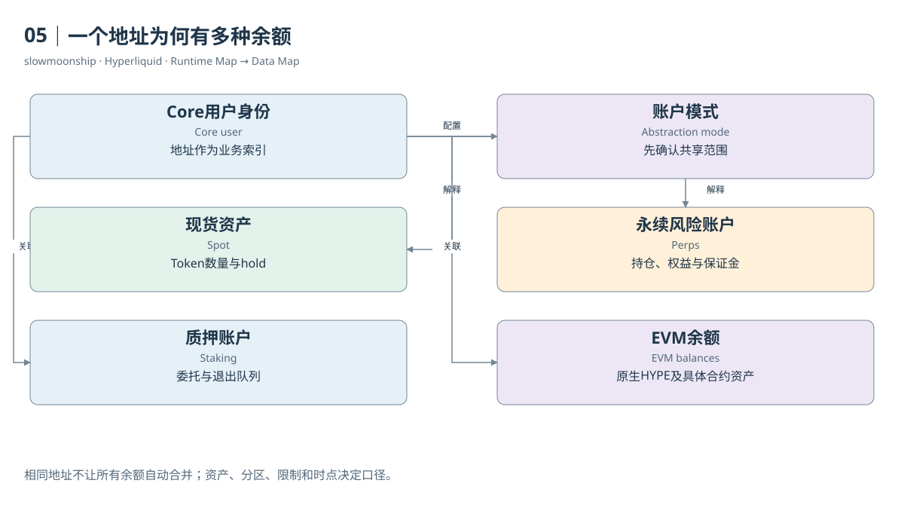

[编辑此图](assets/diagrams/accounts.drawio)

实际状态：[账户模式](examples/api/22-abstraction.json)、[永续账户](examples/api/18-account.json)、[现货账户](examples/api/19-spot-account.json)、[BTC市场上下文](examples/api/01-meta-context.json)。字段含义见[教学卡](research/api-field-guide.md)。

依据：[trading__account-abstraction-modes](https://hyperliquid.gitbook.io/hyperliquid-docs/trading/account-abstraction-modes.md)；[for-developers__api__info-endpoint__spot](https://hyperliquid.gitbook.io/hyperliquid-docs/for-developers/api/info-endpoint/spot.md)；[hypercore__staking](https://hyperliquid.gitbook.io/hyperliquid-docs/hypercore/staking.md)。

[来源目录](research/source_catalog.md) · [目录](SUMMARY.md) · [上一章](book/part-01/04-records.md) · [下一章](book/part-02/06-abstraction.md)

---

# 06｜账户模式决定保证金怎样共享

同一个人，在两个Perp DEX都有USDC计价仓位。这两笔仓位能否共享保证金？答案不能只看抵押品同名。Hyperliquid的账户抽象模式决定Spot与Perps如何连接、不同DEX之间怎样使用资金。旧版本中“每个DEX永远独立”的说法，不能覆盖当前全部账户模式。

Standard或Manual模式保留现货与永续分类余额，也保留不同DEX的余额。Cross Margin在各自DEX内部作用。好处是状态边界清楚，适合需要显式控制资金分配的账户；分析时也必须分别读取各DEX，不能把一个DEX的余额直接当作另一个DEX的可用抵押。

Unified Account按资产统一余额。同一抵押资产支持的全仓仓位可以共享这一资产的保证金，同时与该资产Spot余额连接。官方以USDC支持第一方与XYZ等市场、USDT支持相应USDT市场为例。共享基于抵押资产及模式规则，不是所有不同代币都能按一比一互换。

Portfolio Margin进一步将符合资格的资产纳入组合。用户的Spot资产、永续盈亏和借入资产共同参与风险计算。文档目前列出HYPE、BTC、USDC、USDT等适用资产，并规定准入、供给和借款上限。它既扩大抵押能力，也引入借款利息与额外清算维度。

可以用教学模拟理解差别：账户有一单位BTC现货和一单位BTC永续空仓。价格变化让现货价值与空仓盈亏方向相反。在组合规则允许的范围内，这种关系可以影响风险计算。它并不消除资金费、借款成本、价差、额度限制或基础资产变动带来的风险。

账户模式会改变API的解释方式。官方说明，Unified与Portfolio模式的余额和占用在Spot Clearinghouse State呈现，单独DEX用户余额状态不能按Standard方式理解。研究者应先读取`userAbstraction`，再选择账户汇总路径。拿到JSON结构相似的响应，并不意味着业务语义相同。

市场层的Margin Mode则是另一维度。一个HIP-3资产可能允许全仓、仅逐仓，或采用严格逐仓规则。用户选择了统一账户，也不能无条件绕过市场自身限制。判断保证金共享，应同时保存用户模式、DEX抵押资产和每个市场的保证金能力，而不是只保存一个cross布尔值。

清算监控也随模式变化。普通全仓检查某个保证金集合；统一账户还需要按抵押代币组织维持保证金需求；组合保证金要处理借款与资产折算。组合文档甚至说明，永续与现货借款的清算先后可能受价格更新顺序影响。将所有模式塞进单一杠杆公式，无法得到可靠风险值。

本篇不将复杂模式压缩成一句“更省钱”。对于数据分析，真正重要的是状态范围发生了变化：哪些余额可以担保哪些仓位，哪些借款加入负债，哪些账户仍然分离。先确定这一范围，再谈账户价值、可用保证金和清算，计算才有明确的对象。

<!-- BOOK RESOURCES -->

[编辑此图](assets/diagrams/abstraction.drawio)

实际状态：[账户模式](examples/api/22-abstraction.json)、[永续账户](examples/api/18-account.json)、[现货账户](examples/api/19-spot-account.json)、[BTC市场上下文](examples/api/01-meta-context.json)。字段含义见[教学卡](research/api-field-guide.md)。

依据：[trading__account-abstraction-modes](https://hyperliquid.gitbook.io/hyperliquid-docs/trading/account-abstraction-modes.md)；[trading__margining](https://hyperliquid.gitbook.io/hyperliquid-docs/trading/margining.md)；[trading__portfolio-margin](https://hyperliquid.gitbook.io/hyperliquid-docs/trading/portfolio-margin.md)。

[来源目录](research/source_catalog.md) · [目录](SUMMARY.md) · [上一章](book/part-02/05-accounts.md) · [下一章](book/part-02/07-identities.md)

---

# 07｜主账户、子账户和代理钱包

你发现两组地址经常在相同时间交易，还互相转移USDC。它们可能是同一主账户的子账户，也可能只是两个有业务关系的账户。地址关联是一项研究结论，不能靠同时交易就直接认定。Hyperliquid提供多种账户角色，先理解角色，才能决定怎样统计用户。

主账户Master Account可以管理子账户Subaccount。子账户具有独立的交易身份和状态，适合分隔策略或账户管理。把主账户与所有子账户的交易量汇总，得到的是某个管理范围的活动；只统计其中一个地址，得到的是该交易账户活动。两个结果都可以有用，但名称应不同。

案例13中的实际Ledger Update标记为`subAccountTransfer`，给出了转出与目的地址。这比单纯看见两条金额相似的转账更有力，因为接口直接提供了账户关系相关的操作类型。不过，它仍然没有告诉我们现实中的受益所有人。技术管理关系与现实身份归属不是同一个问题。

Agent或API Wallet主要承担授权操作的签名角色。官方API说明，查询用户状态应使用实际用户地址，而不是误把代理地址当成持仓账户。授权者可以允许代理进行某些操作，资产和仓位仍按相应用户或子账户记账。签名者地址不一定就是被查询资金状态的地址。

客户端订单编号cloid又是更细的一层身份。它帮助自动化系统追踪订单，不是账户地址，也不是全网独立用户编号。不同账户可以采用相似命名习惯。仅凭cloid前缀相同，不能将账户自动归入同一个实体，更不能把一张订单的编号当作一笔成交的唯一键。

Vault也有自己的地址和金融状态。出资人通过份额参与其盈亏，Vault本身执行交易。若把出资人与Vault交易同时算作独立个人交易行为，可能重复解释了同一经济关系。计算地址数可以保留两者；估计实际交易者人数则需要更明确的范围和归属假设。

质押与交易地址还可能使用官方支持的关联机制，用于费用层的资格判断。关联不会使所有余额自动合并，也不能证明任何外部地址都是同一人。模式、授权、管理和经济受益分别构成不同关系。一个简单的“地址去重表”通常装不下这些差异。

分析时可以维护两张表：一张记录原始账户身份和角色，另一张记录有依据的关系及有效期间。来源可能是官方账户查询、明确Ledger操作或人工研究；关系类型应写清。没有证据的地址保持独立，不因同名、同时间或相似行为被强行合并。

这样一来，“活跃地址”“交易账户”“主账户集合”“Vault出资人”就能分别计算。它们没有一种天然最正确的用户数。正确性来自指标名与统计对象一致，以及读者能够看见关系证据和未覆盖部分。身份清楚以后，持仓与资金流的汇总边界才会清楚。

<!-- BOOK RESOURCES -->

[编辑此图](assets/diagrams/identities.drawio)

证据：[案例13](examples/cases/case-13.md)。

依据：[trading__sub-accounts](https://hyperliquid.gitbook.io/hyperliquid-docs/trading/sub-accounts.md)；[for-developers__api__nonces-and-api-wallets](https://hyperliquid.gitbook.io/hyperliquid-docs/for-developers/api/nonces-and-api-wallets.md)；[hypercore__vaults](https://hyperliquid.gitbook.io/hyperliquid-docs/hypercore/vaults.md)。

[来源目录](research/source_catalog.md) · [目录](SUMMARY.md) · [上一章](book/part-02/06-abstraction.md) · [下一章](book/part-02/08-account-state.md)

---

# 08｜怎样读懂一份账户状态

一份`clearinghouseState`响应看起来像许多数字组成的财务报表。最容易犯的错，是挑一个最大的数字叫作余额。读懂它可以分三步：先确认账户及DEX范围，再看摘要，最后逐个阅读仓位，并保留响应中的观察时间。摘要和明细应互相解释。

案例账户的实际快照包含BTC仓位`szi = -7.59872`。负号表示净空头，数量单位是BTC基础单位，不是USDC。`positionValue`约为635298.58，表示持仓名义价值，不能当作账户持有的现金。`entryPx`是持仓会计入场价格，`unrealizedPnl`是按当前估值产生的未实现盈亏。

同一响应中的`marginSummary.accountValue`约25882.07，`totalMarginUsed`约24434.56。前者是账户价值，后者描述已使用的保证金。`crossMaintenanceMarginUsed`约7941.23表示全仓维持保证金需求。这些字段共同解释风险账户，却没有一个可以无条件替代`withdrawable`。

该快照的可提款字段为零。账户价值为正却不能立即提取，并不矛盾：持仓、初始保证金与转出规则会占用资金。拿账户价值减去维持保证金，也不能自动得到可提款金额，因为转出限制与清算底线属于不同检查。状态字段的业务含义需要逐项核对。

`leverage`同时记录模式与用户设置值。设置为26倍不意味着当下实际杠杆永远是26。价格、账户资金和盈亏变化，会使名义仓位与权益的比率变化。当前风险要结合状态和市场规则；只看开仓时的用户设置，不能复原已经变化的账户。

`cumFunding`提供不同范围的累计资金费相关状态，例如全部历史、当前持仓或最近变化以来的累计值。它们不同于逐小时Ledger记录。进行期间费用分析时，优先使用带时间与金额的结算事件；简单相减累计字段，需要先确认仓位重置和累计范围如何变化。

当前快照也不能直接充当某笔历史成交后的状态。案例成交先被观察，随后才查询账户，中间可能还有其他Fill。用最新`szi`倒推几分钟前的全部仓位，会混入未枚举的变化。单笔Fill里的`startPosition`更接近该笔事件的前态，但仍只覆盖这个账户与市场。

Spot Clearinghouse State则按Token提供余额、hold及其他字段。两个接口不是同一表的不同排版。账户采用Unified或Portfolio时，还要按其规则理解Spot侧的统一资金状态。因此，保留`userAbstraction`和请求的DEX参数，是这份财务快照能够被正确使用的前提。

最后做一个简单核对：将有符号数量、名义价值、估值价格和摘要范围连接起来，检查单位是否一致，允许价格与时间差导致的小偏差。把原始十进制字符串保存下来，计算时采用明确精度。我们要解释的是某一时刻的金融状态，而不是从一张JSON猜出整个历史账户。

接口中的time应与作者获取响应的时间同时保存。前者定位业务状态，后者定位这次观察；缓存和网络传输可能让两者不完全相同。

<!-- BOOK RESOURCES -->

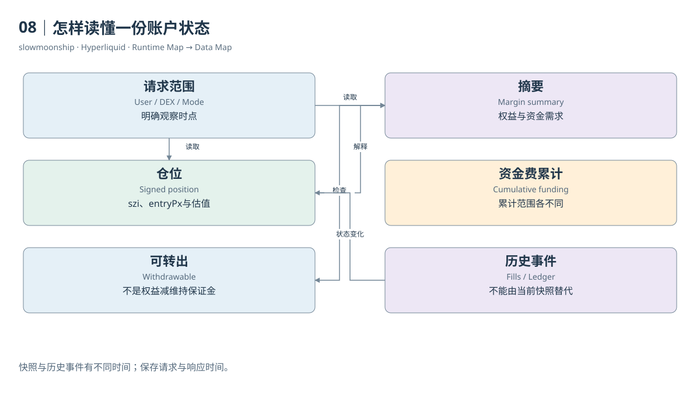

[编辑此图](assets/diagrams/account-state.drawio)

实际状态：[账户模式](examples/api/22-abstraction.json)、[永续账户](examples/api/18-account.json)、[现货账户](examples/api/19-spot-account.json)、[BTC市场上下文](examples/api/01-meta-context.json)。字段含义见[教学卡](research/api-field-guide.md)。

依据：[for-developers__api__info-endpoint__perpetuals](https://hyperliquid.gitbook.io/hyperliquid-docs/for-developers/api/info-endpoint/perpetuals.md)；[for-developers__api__info-endpoint__spot](https://hyperliquid.gitbook.io/hyperliquid-docs/for-developers/api/info-endpoint/spot.md)；[trading__account-abstraction-modes](https://hyperliquid.gitbook.io/hyperliquid-docs/trading/account-abstraction-modes.md)。

[来源目录](research/source_catalog.md) · [目录](SUMMARY.md) · [上一章](book/part-02/07-identities.md) · [下一章](book/part-03/09-book.md)

---

# Part 03｜订单簿与成交

# 09｜读懂订单簿的两边

交易页面中间不断跳动的价格，不是一张订单簿的全部。订单簿记录正在等待成交的买卖意图：Bid是买盘，Ask是卖盘，每个价格档位有相应数量。它告诉你当前愿意成交的条件，而成交历史告诉你已经发生的事情。两张列表描述不同的时间方向。

先看一份教学模拟。卖盘100有3单位、101有2单位；买盘99有4单位、98有5单位。最优卖价是100，最优买价是99，两者之间的Spread为1。价格越接近成交边界，越容易与新订单相遇。显示中价99.5，只是两个最优价的平均，并不是已有订单承诺以99.5成交。

Depth是一定价格范围内的挂单数量或名义金额。如果买入4单位，最优卖档的3单位不够，还需要走到101档。最后一个单位价格更高，平均成交价为100.25。这个简单例子说明，最优价适合描述很小的立即交易条件，大额交易需要看多档深度。

L2订单簿把同一价格的订单汇总。实际Info响应中的每档包含`px`、`sz`和`n`，分别表示价格、总数量与聚合订单数。一个档位有3单位，不代表只有一位卖家或一张订单。L3若保留每张订单，就有更细的身份与排队信息；不能从聚合数量直接还原它们。

本篇实际取得BTC的`l2Book`响应和一次WebSocket簿消息。两者都带有市场与时间；数据中的`levels`分为买档和卖档。它们可以支持获取时点的点差与深度计算。取样时间不同，档位变化完全正常，不能要求两个相隔数分钟的快照逐项相等。

价格与数量还有合法精度。数量遵循市场的`szDecimals`；价格同时受到最多五位有效数字和小数位规则约束，整数价格有例外。Perps与Spot的最大精度基准不同。不要把Tick Size理解成全市场永远固定的小数步长，尤其在价格量级改变时。

订单簿还会被撤单、改单和新挂单改变，而不产生成交。看到某档数量减少，原因可能是被买走，也可能是卖方撤回。只靠两张快照的差额，不能精确区分原因。若要解释每一次变化，需要对应订单事件或Book Diff，而不是补造一笔成交。

与AMM比较时，重点也在状态。常见AMM通过储备和定价规则表达流动性；CLOB通过离散价格上的挂单及撮合规则表达流动性。两者都有价格影响和流动性风险，但数据入口不同。不能把订单簿的总挂单金额当成某个流动性池的锁仓价值。

读完这张小簿，你可以依次问四个问题：最便宜的卖方在哪里，最高价买方在哪里，两边隔多远，我的数量会碰到几档？将它们对应到Bid、Ask、Spread和Depth，就能从页面直觉进入可计算的数据结构。更细的排队和成交规则，将在下一章解释。

<!-- BOOK RESOURCES -->

[编辑此图](assets/diagrams/book.drawio)

依据：[hypercore__order-book](https://hyperliquid.gitbook.io/hyperliquid-docs/hypercore/order-book.md)；[for-developers__api__tick-and-lot-size](https://hyperliquid.gitbook.io/hyperliquid-docs/for-developers/api/tick-and-lot-size.md)；[for-developers__api__info-endpoint](https://hyperliquid.gitbook.io/hyperliquid-docs/for-developers/api/info-endpoint.md)。

[来源目录](research/source_catalog.md) · [目录](SUMMARY.md) · [上一章](book/part-02/08-account-state.md) · [下一章](book/part-03/10-matching.md)

---

# 10｜撮合怎样选择交易对手

教学订单簿里，卖价100有3单位，卖价101有2单位。现在来了一张限价101、买入4单位的订单。限价101表示愿意支付的最高价格，而不是要求所有单位都以101成交。只要协议允许，撮合首先寻找更有利的现有卖价，再继续处理剩余数量。

因此，这张买单先在100成交3单位，再在101成交1单位，共花401个报价单位。它跨越两个价档，形成两次成交。市场中的“限价单”并不必然是Maker。限价足以跨过当前卖盘时，它也可以立即吃掉已有订单，成为这些成交的Taker。

Maker是提供等待流动性的一侧，Taker是主动与现有流动性相遇的一侧。这两个角色与买卖方向独立。买方可以是Maker，也可以是Taker；卖方同样如此。只有知道哪张订单原先在簿上等待，才能解释角色。不能用Buy或Sell字段直接替代Maker分类。

HyperCore普通订单簿遵循价格时间优先。对于来买单，更低的可成交卖价优先；同价挂单再按时间排列。两位卖方各挂100时，较早进入相应队列的订单通常先被撮合。这是簿内排队规则，与上一Part介绍的Action批次排序属于不同层次。

永续撮合还要访问Clearinghouse。新订单提交时有保证金检查，等待订单被撮合时也可能再次检查。价格或账户状态在挂单后变化，使一张曾经合法的挂单不再符合约束。因此，一份过时簿截图不能保证未来来单一定得到截图中展示的全部数量。

实际案例03中，买方Fill的`crossed`为false，卖方为true。买方在簿上提供流动性，卖方主动成交。两条记录共享价格、数量、事件时间与tid，但各自有oid和费用。这里Taker卖出并不是新开空仓，而是减少原有多仓，角色与开平仓又是两组不同概念。

手续费也依据角色及账户规则计算。案例Maker收到负值fee，代表这条Fill里的返佣；Taker支付正值费用。返佣不意味着整个交易盈利，账户可能同时承担持仓亏损。费用是一项现金流，撮合角色是一项业务角色，交易盈亏则依赖持仓会计。

用户与自己控制的其他订单相遇，还涉及自成交防护。官方普通自成交规则会取消相应等待订单，而不是无条件制造一笔可统计的成交。分析刷量或重复交易时，必须先看协议允许的事件路径，不能只根据相似地址或对向订单推断已经发生自成交。

撮合引擎像一位严格执行规则的配对者：先检查可以成交的条件，再按优先级选择等待订单，随后将结果交给金融账户更新。理解这三个步骤，才知道一笔Trade为何同时需要订单簿证据与账户证据，以及为什么“最早发来”不是一条完整的成交保证。

<!-- BOOK RESOURCES -->

[编辑此图](assets/diagrams/matching.drawio)

证据：[案例03](examples/cases/case-03.md)。

依据：[hypercore__order-book](https://hyperliquid.gitbook.io/hyperliquid-docs/hypercore/order-book.md)；[trading__self-trade-prevention](https://hyperliquid.gitbook.io/hyperliquid-docs/trading/self-trade-prevention.md)；[trading__fees](https://hyperliquid.gitbook.io/hyperliquid-docs/trading/fees.md)。

[来源目录](research/source_catalog.md) · [目录](SUMMARY.md) · [上一章](book/part-03/09-book.md) · [下一章](book/part-03/11-partial.md)

---

# 11｜一张订单怎样分成多个成交

一张BTC卖单在实际取得的Fill中出现两次：第一笔0.16122，第二笔0.03776，合计0.19898 BTC。它们不是重复数据，而是同一张订单在撮合中分成两份。这正是本篇案例02实际取得的记录，订单编号为572798292348。

两条Fill的价格都为83727，且事件时间相同，但tid不同。它们共享同一个oid与cloid，表示来自同一订单；两个成交标识表示两次撮合。单纯按时间、价格、用户和数量形态去重，会错误删除真实事件。识别重复与识别拆分，需要不同的键。

用十进制精确相加，0.16122加0.03776等于0.19898。随后调用`orderStatus`，实际返回`unknownOid`，没有取得原始数量、余量与终止状态。因此，目前只能证明已取样Fill共享订单，不能宣布完整成交比例或最终状态，也没有取得原始签名Action。

“部分成交”有两个不同场景。一张订单此刻只成交一部分，余量仍在簿上；或者一张最终全部成交的订单，执行过程包含多次部分Fill。案例02直接观察到多笔Fill，但缺少终态，不能进一步判断属于哪一种结束场景。没有中间快照时，不应进一步编造它曾经等待了多少秒，或剩余数量在某时点怎样显示。

数量核对还要留意接口聚合。`userFillsByTime`支持`aggregateByTime`，开启后会按官方规则合并某些部分成交。本篇明确使用false，保留未聚合的用户Fill。拿聚合接口与原始逐笔表比较行数，如果没有先保存这个参数，会把呈现差异误认为数据遗漏。

一张订单产生多个Fill，也意味着费用与盈亏可能分行计算。每行有自己的size、fee与closedPnl。想计算订单层总费用，可以按确认过的账户、市场与oid汇总；想算平均成交价，应按数量加权。简单平均每行价格，会让很小的一笔成交与大笔成交拥有同样权重。

订单层分析还有无法从Fill看见的部分。完全没有成交的订单，不会凭空出现在成交表里；撤回余量，也未必产生Fill。于是，`COUNT(DISTINCT oid)`在Fill表中数到的是“至少成交过一次的订单”，不能直接称作全部下单次数，更不能得到真实撤单率。

同一oid的多条Fill可以跨不同时间和价档。教学模拟中买入4单位，在100与101成交，均价100.25；真实案例则同价拆分。两种情况都满足一对多关系，但原因和价格影响不同。把它们画成“订单节点连接多个成交节点”，比把行数统称交易数更准确。

分析订单执行质量时，完整问题通常包含原始意图、实际Fill、未成交余量与结束原因。本篇取得其中可观察部分，并把缺失Action单独记录。这样既能用真实拆分理解订单与成交的关系，也能避免把局部证据扩大成一份完整执行轨迹。

真正的余量还必须由原始数量与已执行数量共同确定。仅观察到两个Fill时，能够证明它们共享订单，却不能保证没有未取得的第三笔成交。

<!-- BOOK RESOURCES -->

[编辑此图](assets/diagrams/partial.drawio)

证据：[案例02](examples/cases/case-02.md)。

依据：[for-developers__api__info-endpoint](https://hyperliquid.gitbook.io/hyperliquid-docs/for-developers/api/info-endpoint.md)；[for-developers__api__websocket__subscriptions](https://hyperliquid.gitbook.io/hyperliquid-docs/for-developers/api/websocket/subscriptions.md)。

[来源目录](research/source_catalog.md) · [目录](SUMMARY.md) · [上一章](book/part-03/10-matching.md) · [下一章](book/part-03/12-orders.md)

---

# 12｜挂单、撤单和条件订单的生命周期

订单可能被接受，却始终没有成交；也可能成交一部分之后取消。生命周期解释的是交易意图如何从进入系统走向终止。New、Resting、Partial Fill、Filled、Canceled和Rejected是教学上的状态节点，实际API还细分许多拒绝与取消原因，不能将它们简单压成成功或失败。

GTC表示未立即成交的合规余量可以继续挂在簿上。IOC只允许立即成交的部分，剩余数量随后取消。ALO即只挂单规则，意图是成为等待流动性的一侧；如果提交时会立即跨簿成交，就受到相应拒绝规则约束。订单期限与价格条件一起决定余量去向。

教学模拟中，限价101的买单需要4单位，如果只遇到2单位卖量，GTC余下2单位可以继续等待；IOC余下2单位终止；ALO若会吃到卖盘，则不能按普通Taker路径成交。因此，一张订单有没有Fill，取决于簿状态，也取决于TIF，而不是只看限价与数量。

取消是一项新的Action，并不是回溯删除历史。已经成交的部分仍然属于历史事件；可取消的只是尚未执行的意图。在取消与来单同时竞争时，最终共识及批次规则决定哪一步先被执行。客户端发送了撤单请求，不意味着余量在那一瞬间必然消失。

修改订单也会影响后续意图与排队。研究时应读取修改行为及实际订单更新，不把它当作旧订单字段被随意覆盖。只保留最终快照，会丢掉期间价格、数量和优先级变化。订单生命周期历史需要事件来源，不能靠当前Open Orders倒推过去所有修改。

Trigger Order在触发条件满足后才进入相应执行路径。TP/SL可以采用市场式或限价式处理，触发参考使用官方规定的价格。触发成功与最终成交不同：限价不一定遇到对手方，市场式执行也可能受流动性和风险约束影响。图里的“触发”必须保留后续撮合步骤。

Reduce-only限制订单不得按规则增加原有敞口。它表达一种业务约束，不是自动盈利指令。原有仓位已经变化时，订单的可执行数量或状态也可能改变。分析Close Long等字段时，应结合实际前仓位与执行结果，而不是只依据用户提交时的reduceOnly标签。

TWAP将较大的执行意图分成随时间处理的子订单。父级计划、子订单和Fill是三层粒度。统计执行计划时可用TWAP身份，统计成交时仍要使用Fill或Trade。取消TWAP也不能抹去此前已执行的切片。许多小Fill不必然表示许多独立的用户决策。

订单状态表由此比成交表更广：它包含等待、取消、拒绝以及没有成交的订单。案例01取得一张ALO订单的filled状态，说明指定意图最终完成；其他状态需要自己的证据。若研究下单频率、撤单行为或成交率，必须取得生命周期记录，不能只在Fill表里寻找答案。

<!-- BOOK RESOURCES -->

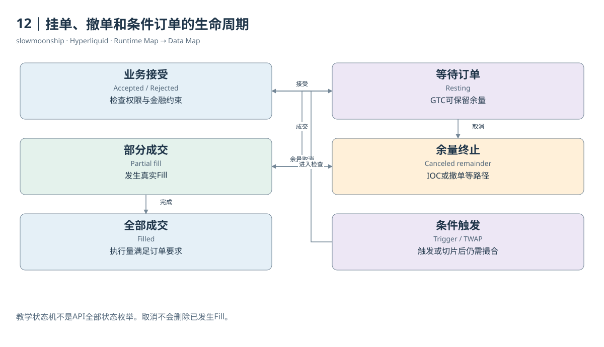

[编辑此图](assets/diagrams/orders.drawio)

证据：[案例01](examples/cases/case-01.md)。

依据：[trading__order-types](https://hyperliquid.gitbook.io/hyperliquid-docs/trading/order-types.md)；[for-developers__api__exchange-endpoint](https://hyperliquid.gitbook.io/hyperliquid-docs/for-developers/api/exchange-endpoint.md)；[hypercore__order-book](https://hyperliquid.gitbook.io/hyperliquid-docs/hypercore/order-book.md)。

[来源目录](research/source_catalog.md) · [目录](SUMMARY.md) · [上一章](book/part-03/11-partial.md) · [下一章](book/part-04/13-perpetual.md)

---

# Part 04｜永续合约与持仓

# 13｜买入BTC永续为何没有收到BTC

Alice买入一单位BTC永续合约，Bob在对应撮合中卖出。如果双方此前都没有仓位，Alice形成多头，Bob形成空头。Alice的账户不会因此出现一单位可提取的现货BTC。永续合约是一种与基础资产价格相关的衍生品，记录的是价格敞口及结算关系。

Underlying是参考的基础资产或价格对象，Contract是具体金融产品。BTC作为基础资产，与BTC永续合约不是同一资产。Spot交易改变代币所有数量；Perp交易改变合约仓位与保证金账户。两者可以有相似价格，却不因此拥有同样的交付权利和现金流。

Long表示价格上升时通常受益的方向，Short表示价格下降时通常受益的方向。用教学模拟，双方在100建立一单位仓位，估值上升到110，多头未实现盈亏为正10，空头为负10。这里没有一笔每跳动一个价格就立即发生的普通用户转账，系统先更新金融估值。

合约数量与名义价值也不同。持仓一单位BTC，价格100时名义价值100，价格110时变成110；数量没有变化。保证金只是支持这份敞口的资金，不是合约名义价值全额。杠杆描述敞口相对于资金的关系，不能把它解释成系统送给用户一笔可随意提走的BTC借款。

主要第一方合约采用USDC保证金。当前官方规格还说明，许多基础价格以USDT表示，盈亏不进行USDC/USDT实时汇率换算，具有quanto特征。教学中将报价单位简化为稳定币单位有助于理解，但跨抵押资产做真实财务比较时，必须恢复具体单位与产品规则。

永续Perpetual的名称表示没有普通到期日。它依靠资金费率机制帮助价格与参考价格保持联系。没有到期不意味着可以永久无成本持仓，也不意味着产品永远不会被停止或结算。费用、资金费、清算与市场管理动作仍然会改变持仓经济结果。

系统之所以需要Clearinghouse，是因为仅记一条买卖金额不够。它还要保存方向、数量、入场会计、保证金使用和风险要求，并在价格变化后重新判断账户。一个订单簿为双方找到成交条件，一个金融状态机负责让这些成交可以持续承担未来价格变动。

案例03展示的双方并不是Alice和Bob从零开仓的情形。买方原先为空，买入用于平空；卖方原先为多，卖出用于平多。相同的成交价格和数量，可以在不同前态下产生完全不同的持仓效果。因此，教学的开仓例子不能自动成为真实Fill的分类模板。

理解永续，最关键的是把四件事分开：参考什么价格，持有多少有符号合约敞口，用什么资产担保，怎样结算盈亏和费用。回答这四个问题，就能解释为什么买入BTC永续没有收到BTC，也能为接下来的持仓变化与风险计算找到正确的数据对象。

<!-- BOOK RESOURCES -->

[编辑此图](assets/diagrams/perpetual.drawio)

证据：[案例03](examples/cases/case-03.md)。

依据：[trading__contract-specifications](https://hyperliquid.gitbook.io/hyperliquid-docs/trading/contract-specifications.md)；[hypercore__clearinghouse](https://hyperliquid.gitbook.io/hyperliquid-docs/hypercore/clearinghouse.md)。

[来源目录](research/source_catalog.md) · [目录](SUMMARY.md) · [上一章](book/part-03/12-orders.md) · [下一章](book/part-04/14-position.md)

---

# 14｜成交方向怎样改变持仓

看到一条Buy Fill，能否说用户开了多仓？不能。成交方向只告诉你这一笔买入了多少合约，持仓效果还取决于成交前状态。一个原本做空的人买入，可以减少空仓；买得足够多，还可以先平空再转为多头。金融分类需要前态与事件共同参与。

最简单的表达是有符号仓位。多头数量为正，空头为负；普通买入增加有符号数量，普通卖出减少它。教学模拟中，前仓位为负2，买入0.5后变为负1.5，这是Reduce Short。前仓位为正2，再买入0.5变为正2.5，这是Increase Long。

如果前仓位为负2，一次买入3，结果变为正1。前2单位关闭空头，余下1单位打开多头，这叫Position Flip。该笔Fill的开平仓语义同时跨过零点。只用Buy、Sell两类统计新增多空，会把关闭与反手的经济含义丢掉。

普通Fill中的`startPosition`给出此笔成交前的有符号数量，`dir`提供官方呈现的持仓变化类别。本篇实际买侧记录前仓位为负7.53687，买入0.00012，`dir`为Close Short；卖侧前仓位为正0.00307，卖出0.00012，`dir`为Close Long。两侧各自减少原有仓位。

对这笔事件做局部计算，买侧后仓位为负7.53675，卖侧为正0.00295。这是依据Fill前态与普通成交数量得到的事件后态，不是后来`clearinghouseState`查询时的当前仓位。中间还有后续成交，所以两个时点的结果不同，并不表示接口自相矛盾。

持仓数量变化不等于盈亏。减少空头时，需要用该账户的入场会计与平仓价格计算已实现结果；新增多头时，尚未平掉的部分主要进入未实现估值。案例两侧的`closedPnl`都为负，说明一次双方减少仓位的成交，也可以同时实现各自的亏损。

从Fill重建一段持仓变化，需要一个可信的起始状态与完整事件序列。按市场和账户排序后，检查下一笔`startPosition`能否与前一笔推导结果接上。缺少一笔成交、接管或其他状态变化，都会打断链条。不能把缺口默认为零变化，再称结果为精确仓位历史。

逐小时Position表采用另一种方式：它保存资金费结算轮次的站立持仓。小时里发生开仓又平仓，到了快照时可能没有仓位行。没有行并不表示整个小时没有交易。事件表适合观察动作，快照表适合观察指定时点敞口，二者互相补充。

因此，买卖统计与开平仓统计应分别命名。买入量适合描述订单流；多头新增量必须考虑前后仓位；平仓量还要处理穿越零点的Fill。只要将前态、带方向的数量变化与后态画在同一条线上，复杂的Open、Reduce、Close和Flip就成为可逐笔核对的状态变化。

如果同一毫秒发生多个Fill，还需要可靠的事件顺序。按时间排序但没有处理并列顺序，可能让反手分类出现矛盾；检查连续前态可以暴露这类问题。

<!-- BOOK RESOURCES -->

[编辑此图](assets/diagrams/position.drawio)

证据：[案例03](examples/cases/case-03.md)。

依据：[trading__entry-price-and-pnl](https://hyperliquid.gitbook.io/hyperliquid-docs/trading/entry-price-and-pnl.md)；[for-developers__api__info-endpoint](https://hyperliquid.gitbook.io/hyperliquid-docs/for-developers/api/info-endpoint.md)。

[来源目录](research/source_catalog.md) · [目录](SUMMARY.md) · [上一章](book/part-04/13-perpetual.md) · [下一章](book/part-04/15-pnl.md)

---

# 15｜盈利为何不等于账户余额增加

你在交易历史看见一笔正数Closed PnL，却发现账户价值没有同样增加。可能是手续费、资金费、其他仓位亏损或资产转移同时发生。已实现盈亏只是账户变化的一部分，不能把某个成交字段直接当成整段期间的总收益，更不能把余额差额全部叫作交易盈利。

教学模拟中，一单位多仓入场价100，在110平仓，忽略费用时已实现盈亏为10。平仓之前，估值来到110产生的是未实现盈亏Unrealized PnL；平仓使对应数量的结果转为Realized PnL。两个字段描述不同会计阶段，不应在同一时点重复计入同一份盈利。

增加同向仓位时，系统需要更新入场会计。分批以不同价格买入，持仓的Entry Price通常按相应数量形成加权结果。部分平仓不会简单把剩余仓位重置成最近一次成交价。反手则将关闭部分与新方向部分分开处理。理解这些规则，才能解释相同成交价为何产生不同Closed PnL。

未实现盈亏采用估值参考价格，与簿上能够立即成交的价格不一定相等。一个账户显示正收益，实际平仓会受到Spread、Depth和执行价格影响。估值收益不是现金交付承诺；把Mark估值直接当作任意数量都能兑现的价格，会忽略真实订单簿。

费用还要看符号和资产。案例Maker的fee为负，表示该条记录返佣；它的closedPnl同样可以为负。二者属于不同现金流。若用“净成交结果等于已实现盈亏减费用”的简化公式，必须保留负费用对结果的增加作用，并明确不包含其他资金费或账户事件。

Funding是持仓期间产生的结算现金流，可能在没有Fill时改变账户。普通转入与转出改变资金，却不是收益。子账户转移与Vault出入还可能属于同一管理范围内部移动。分析净资金流入之前，先定义你是在观察地址、交易账户还是整个账户集合。

一份期间账户对账可以从期初价值出发，加上外部净入金、已实现盈亏、资金费用和其他明确事件，再考虑未实现盈亏变动与费用。公式形式并不难，难点是记录是否完整、各字段是否重叠，以及开始与结束时采用的估值和账户模式是否一致。

当前Position API的`returnOnEquity`也不能直接拿来比较不同账户的全年收益。它属于指定仓位与保证金会计口径，可能随杠杆或仓位调整改变。研究投资回报还需要期间资本投入和现金流处理；一个界面百分比，不是天然可比较的策略业绩。

可靠的盈亏分析通常保留三张相邻但独立的表：成交实现结果、持仓估值、资金与费用事件。先解释各自的业务含义，再在一致账户范围和时间边界内对账。这样可以说明一笔交易赚了多少，也能诚实地区分这与整个账户赚了多少之间的证据距离。

<!-- BOOK RESOURCES -->

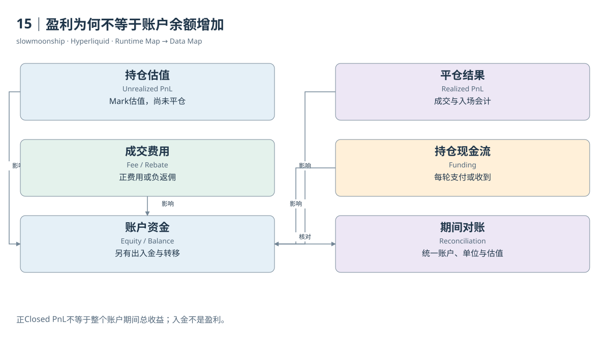

[编辑此图](assets/diagrams/pnl.drawio)

证据：[案例03](examples/cases/case-03.md)。

依据：[trading__entry-price-and-pnl](https://hyperliquid.gitbook.io/hyperliquid-docs/trading/entry-price-and-pnl.md)；[trading__margining](https://hyperliquid.gitbook.io/hyperliquid-docs/trading/margining.md)；[trading__fees](https://hyperliquid.gitbook.io/hyperliquid-docs/trading/fees.md)。

[来源目录](research/source_catalog.md) · [目录](SUMMARY.md) · [上一章](book/part-04/14-position.md) · [下一章](book/part-04/16-oi.md)

---

# 16｜成交量与未平仓量分别数什么

一个市场一天成交十亿，未平仓量只有几亿，这正常吗？正常。成交量Volume记录期间发生的交易流量；Open Interest记录某一时点仍然存在的合约敞口。一个仓位可以一天内多次换手，因此大量成交并不要求市场始终保留同样大的站立仓位。

教学模拟中，Alice和Bob从零建立一单位多空对应仓位，经典单边OI增加一单位。Alice随后把多仓卖给另一位新多头，Bob继续持有空仓，这笔成交增加交易量，却不增加单边OI。如果多空两侧同时平掉对应仓位，成交量仍增加，而OI减少。

本篇案例03恰好提供双方平仓的真实局部证据。买方平空、卖方平多，一次0.00012 BTC撮合不会被正确解释成新增0.00012 BTC多头。局部配对能够解释持仓变化；若要计算全市场OI，还必须包括所有站立账户和协议适用口径，不能只看这两个人。

这里有一项关键来源差异。Dune当前官方小时指标文档将`open_interest_units`定义为多头加空头，并称其对应Hyperliquid UI/API的双边数量；经典单边OI是其一半。本篇采用“来源双边OI”标示原字段，另列“按该文档换算的单边OI”，不把两者混成同一个无定义数字。

这项换算来自文档语义，并非作者下载全部账户后独立核算的结果。实际Info返回了当前`openInterest`，但没有在同一时点取得全市场全部站立持仓。比较第三方报告时，必须问它统计哪一边、使用什么估值价格、取什么时点；不能因为列名相同就直接比大小。

Dune的`open_interest_usd`还使用小时边界之前最近成交价估值，文档说明UI采用Mark估值。因此，即使基础数量相同，美元列也可能不同。名义价值的差别可能来自价格参考，而不是新增资金或数据错误。单位和估值规则应随指标一起保存。

OI属于存量，不能把每天OI相加称作月度OI。一月最后时点、日均OI和月内最大OI分别回答不同问题。成交量则可以按不重叠期间相加。将小时成交量与小时OI放在同一张图，需要说明一个是期间流量，另一个是结算轮次的站立状态。

全市场用户Fill名义金额也不直接等于Volume。本篇案例双侧Fill相加会翻倍，Dune成交表同样保留两腿。市场口径可按Taker侧计数或使用已汇总指标；账户参与口径则保留自己的每条Fill。OI的单双边问题与成交的双侧记录问题相似，但计算对象完全不同。

研究可以同时展示期间成交、边界OI与成交量除以OI的周转指标，只要分母时点和来源清楚。高周转说明相对站立敞口有较多交易，不能单凭它证明净资金流入、真实用户增长或市场健康。最好的指标名称，会把流量、存量和口径同时告诉读者。

<!-- BOOK RESOURCES -->

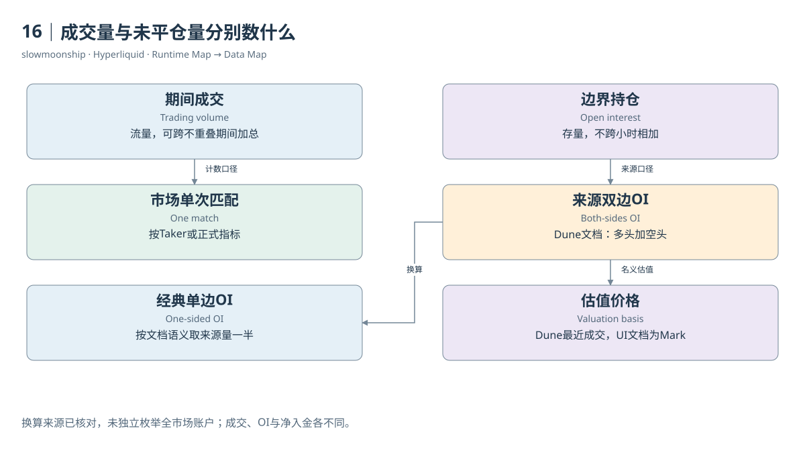

[编辑此图](assets/diagrams/oi.drawio)

证据：[案例03](examples/cases/case-03.md)。

数据练习：[SQL05](examples/sql/05-open-interest.sql) · [SQL06](examples/sql/06-flow-stock.sql)（静态审查，未执行）。

依据：[dune-perp-market-metrics-hourly](https://docs.dune.com/data-catalog/curated/perpetuals/hyperliquid/perp-market-metrics-hourly.md)；[dune-perp-positions-hourly](https://docs.dune.com/data-catalog/curated/perpetuals/hyperliquid/perp-positions-hourly.md)；[dune-perp-trades](https://docs.dune.com/data-catalog/curated/perpetuals/hyperliquid/perp-trades.md)。

[来源目录](research/source_catalog.md) · [目录](SUMMARY.md) · [上一章](book/part-04/15-pnl.md) · [下一章](book/part-05/17-prices.md)

---

# Part 05｜价格、保证金与清算

# 17｜成交价、标记价与预言机价

同一时刻，页面上可能同时出现最新成交价、Mark Price、Oracle Price和Mid Price。它们不相等并不稀奇。每种价格服务不同的任务：成交价描述刚才实际交易，簿价格表达等待意图，Mark用于风险估值，Oracle提供参考价格。研究者首先需要说明正在使用哪一种。

Trade Price是一笔成交的价格。它有真实执行数量，但可能只是很小的一笔。Best Bid和Best Ask来自订单簿，中价Mid是两者的平均。中价没有天然成交保证，大额交易更不能只用中价计算可兑现收入。订单簿深度会决定成交跨越多少价档。

Oracle Price由协议规定的外部或适用市场参考源形成。第一方市场的官方说明使用多个来源的加权中位数；某些资产有不同参考机制。HIP-3则由市场部署者负责预言机定义与更新。不能把第一方BTC的数据源规则不加核对地套给每个股票价格关联永续。

Mark Price承担保证金、清算、未实现盈亏及特定触发条件的估值任务。第一方稳健价格规范综合Oracle调整值、本地簿与成交信息、外部永续参考等输入，包含平滑与中位数处理。它不是任意一次最后成交，也不是整个时段简单平均价。

本篇真实BTC市场上下文中，Oracle为83620，Mark为83581，Mid为83580.5。三个数字来自同一份API响应，却代表不同计算路径。若用Oracle给未实现盈亏估值，再用Mark解释界面数字，差额不能自动被称为错误或隐藏手续费。

Funding支付的名义价值使用Oracle，而不是Mark。这项选择与清算使用Mark形成重要区别。把资金费公式和风险公式中的price统一替换成最新成交价，会同时改变两种计算。字段名保留业务角色，比将所有价格标准化成一列close更可靠。

历史价格表也有采样规则。Dune的Oracle表文档描述分钟内最后更新，并区分第一方asset-contexts来源和HIP-3部署者setOracle来源。一分钟一行不代表这一分钟每毫秒都保持该价；价格更新时间与成交时间之间有偏差，需要在Join中明确容忍窗口。

如果要研究清算前后的市场状况，可以并列清算标记价、最近参考价、实际Fill价与订单簿。它们共同解释风险触发和执行质量，但不能互相取代。仅凭一条Fill价格，无法判断触发时Mark是多少；仅凭Mark，也不能精确推出大额市价清算成交的全部价格。

在数据工程里，最好把price_type、source_time、observed_time、market_identity和unit作为价格的伴随信息。缺失价格保持缺失，插值或向前填充必须写出前提。只有让每个数字保留“用来做什么、什么时候形成”，价格差异才会成为可以研究的结构，而不是混乱的噪声。

价差指标也应使用明确分母。例如相对点差可用中价归一化，Mark与Oracle偏离可用Oracle归一化。两种基点数不能因为都叫spread就放在同一序列中。

<!-- BOOK RESOURCES -->

[编辑此图](assets/diagrams/prices.drawio)

实际状态：[账户模式](examples/api/22-abstraction.json)、[永续账户](examples/api/18-account.json)、[现货账户](examples/api/19-spot-account.json)、[BTC市场上下文](examples/api/01-meta-context.json)。字段含义见[教学卡](research/api-field-guide.md)。

依据：[trading__robust-price-indices](https://hyperliquid.gitbook.io/hyperliquid-docs/trading/robust-price-indices.md)；[hypercore__oracle](https://hyperliquid.gitbook.io/hyperliquid-docs/hypercore/oracle.md)；[dune-perp-oracle-prices](https://docs.dune.com/data-catalog/curated/perpetuals/hyperliquid/perp-oracle-prices.md)。

[来源目录](research/source_catalog.md) · [目录](SUMMARY.md) · [上一章](book/part-04/16-oi.md) · [下一章](book/part-05/18-margin.md)

---

# 18｜保证金是怎样一层层检查的

保证金像一份履行未来盈亏责任的资金缓冲，但不同检查使用不同底线。开仓所需的Initial Margin、继续持仓所需的Maintenance Margin、能够转出的金额，是三项相互关联的规则。通过开仓检查，不意味着以后永远安全；满足维持保证金，也不意味着剩余价值都可提走。

教学模拟中，名义仓位1000，用户设置十倍杠杆，简化初始保证金为100。公式是绝对持仓数量乘Mark价格，再除以用户杠杆。它帮助理解资金需求，实际系统还检查市场最大杠杆、风险档位、已有仓位与挂单，以及账户模式。不能用一条式子覆盖所有边界。

维持保证金以市场适用规则和规模档位计算，普通规范描述为最大杠杆下初始保证金比例的一半。用户选择较低杠杆，不会自动把市场的维持保证金率改成用户初始保证金率的一半。市场上限、用户设置与当前实际杠杆应分成三个字段。

Cross Margin让规定范围内的全仓仓位共享权益。一个仓位的盈利可以影响另一个仓位的风险缓冲，亏损也会消耗共同资金。Standard模式的范围通常是同一DEX；Unified或Portfolio模式的范围更广。研究全仓清算时，必须知道共享集合中还有哪些仓位和负债。

Isolated Margin把指定持仓的抵押与其他风险账户隔离。按官方普通规则，该隔离仓位被清算，不应直接取走其他逐仓或全仓资金。Strict Isolated还限制移除保证金。隔离控制的是风险资金范围，不保证基础价格、流动性或仓位自身没有损失。

转出保证金需要满足另一项规则。普通Margin文档规定，剩余资金至少满足初始保证金需求与总名义价值百分之十两者中的较大值。这个约束解释了为什么一个账户尚未触发清算，却可能没有可提款金额。提款能力和清算健康度不是同一个比率。

案例账户价值约25882，维持保证金约7941，已用保证金约24435，可提款为零。它是一份当前状态观察，不是精确风险预测。BTC价格变化、后续Fill、资金费和转移都会改变结果。把这些快照数值固定下来推算未来所有清算时点，会忽略持续变化的状态机。

风险档位使计算进一步分段。规模较大时，适用最大杠杆或维护要求可能变化，档位规则还涉及累进与扣减结构。分析者需要读取相应Margin Table，而不是给所有仓位使用固定百分比。HIP-3不同产品的参数也应按完整市场身份查找。

保证金分析因此从“资金能担保什么”开始，再检查开仓、维持和转出三层要求。组合保证金还要加入借入资产、折算与额度规则。把这些层次画清楚，就能解释杠杆怎样建立敞口、权益怎样吸收盈亏，以及为什么风险不会被一个开仓时的杠杆按钮永久决定。

<!-- BOOK RESOURCES -->

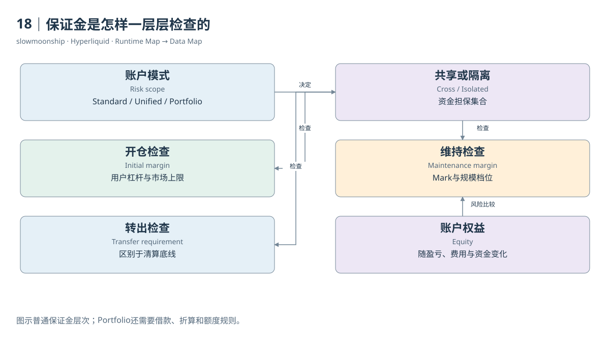

[编辑此图](assets/diagrams/margin.drawio)

实际状态：[账户模式](examples/api/22-abstraction.json)、[永续账户](examples/api/18-account.json)、[现货账户](examples/api/19-spot-account.json)、[BTC市场上下文](examples/api/01-meta-context.json)。字段含义见[教学卡](research/api-field-guide.md)。

依据：[trading__margining](https://hyperliquid.gitbook.io/hyperliquid-docs/trading/margining.md)；[trading__margin-tiers](https://hyperliquid.gitbook.io/hyperliquid-docs/trading/margin-tiers.md)；[trading__portfolio-margin](https://hyperliquid.gitbook.io/hyperliquid-docs/trading/portfolio-margin.md)。

[来源目录](research/source_catalog.md) · [目录](SUMMARY.md) · [上一章](book/part-05/17-prices.md) · [下一章](book/part-05/19-liquidation.md)

---

# 19｜清算为何不是一次普通卖出

一个用户的交易历史显示Close Long，可以宣布他被清算吗？不能。主动平仓也会关闭多仓。清算是账户不再满足风险要求时，由协议触发的处置过程；成交只是其中一种执行结果。判断清算，需要明确的清算角色、状态或原始事件证据，而不是猜测成交方向。

普通永续规则在账户权益低于维持保证金要求时触发清算。风险估值采用Mark，而不是用户随手看到的最后成交价。全仓关注适用账户集合，逐仓关注隔离仓位。资金费、其他仓位盈亏和保证金转移都能改变权益，因此触发条件不是一条永远不动的价格线。

第一阶段通常尝试通过订单簿关闭仓位。系统发送清算订单，结果可能是全部成交，也可能只执行部分。若账户重新达到要求，剩余抵押仍属于用户。这里有市场成交价格、订单流和账户风险结果三类证据，仅有一条成交记录，无法完整解释整个处置过程。

官方普通清算文档还规定，大于十万USDC的可清算仓位先以百分之二十数量进入部分清算路径，并设置相应冷却规则。这里的门槛与Testnet不同，适用范围是该规范描述的普通永续机制。Portfolio Margin的现货借款处置另有路径，不应照抄这一流程。

当权益进一步下降且订单簿处置没有成功恢复条件时，普通规范描述后备清算。后备机制可以接管仓位与保证金，而不只是再发一张用户卖单。它可能改变账户拥有的金融状态范围，不能仅通过“清算成交额”一列充分表示，下一章会继续解释接管与ADL。

Dune成交表也需要区分“该撮合涉及清算”与“这一腿是被清算账户”。官方表说明，`liquidation_method`和`liquidated_trader`可能标在两腿；`fill_type = liquidation`才用于辨认相应被处置腿。直接数有method的行，会把同一事件两侧重复计数。

普通市场清算中，被清算者通常是主动处置侧；对手方可能只是原先挂单的Maker。他参与清算撮合，不等于他也被清算。某些后备或自动减仓数据的角色还会反转。研究清算账户数、处置量和对手方流量时，需要分别选择角色与去重键。

本篇两个公开账户Fill没有清算标记；又核对了HLP Liquidator的公开子Vault身份，但其30分钟Fill窗口返回空，因此仍没有取得真实清算案例。清算章节依据官方机制和表结构解释，案例05保留取证缺口。没有查到标记，只说明这段取样不包含相应证据，不能推断当天或全市场没有清算。

精确复原历史清算价格，需要当时的权益、仓位、模式、风险档位与参考价格过程。单一当前快照或静态杠杆只能支持简化情景分析。好的清算研究会连接风险触发、执行路径与最终状态，并让每个结论停在它实际取得的证据范围内。

<!-- BOOK RESOURCES -->

[编辑此图](assets/diagrams/liquidation.drawio)

证据：[案例05](examples/cases/case-05.md)。

数据练习：[SQL09](examples/sql/09-liquidation.sql)（静态审查，未执行）。

依据：[trading__liquidations](https://hyperliquid.gitbook.io/hyperliquid-docs/trading/liquidations.md)；[dune-perp-trades](https://docs.dune.com/data-catalog/curated/perpetuals/hyperliquid/perp-trades.md)。

[来源目录](research/source_catalog.md) · [目录](SUMMARY.md) · [上一章](book/part-05/18-margin.md) · [下一章](book/part-05/20-backstop.md)

---

# 20｜后备接管与自动减仓的区别

清算订单并不保证及时找到足够的对手方。极端波动下，账户可能在簿上完成平仓之前已经失去足够权益。这时，系统需要处理的不只是卖出速度，还包括谁承担剩余仓位与负债。Backstop与ADL分别描述不同的风险处置环节，不能统称为一笔普通清算卖单。

普通官方清算规范将后备触发描述为权益低于维持保证金的三分之二，且簿上处置未能恢复要求。Liquidator Vault接管相应仓位与抵押，成为后续风险承担者。阈值属于指定机制，不是所有HIP-3、Portfolio或其他未来产品都共用的一条通用公式。

全仓后备接管会影响对应全仓仓位和资金集合；逐仓接管限于相应隔离仓位及保证金。被接管数量从用户状态迁移到另一个承担者，并不必然以一笔公开市价Fill表达完整过程。要解释账户最终为何归零或留下其他资金，需要读取适用范围和账务证据。

第一方Liquidator Vault是HLP的一项策略，HLP同时还有其他做市和资金运用活动。它可能从接管中取得收益，也可能承担不利价格和后续执行风险。因此，HLP收益不能全部归因为“收走用户保证金”，更不能被解释成每次后备接管都无风险盈利。

当前HIP-3规范还为每个DEX描述独立的链上后备清算者，其系统地址按DEX编号派生，只接收符合全仓条件的资产。每个后备账户具有独立状态，必要时回落到ADL保障DEX偿付结构。这与“所有市场都由同一个HLP统一兜底”的简单说法不同。

ADL即Auto-deleveraging。在适用机制下，系统可以强制减少对面的盈利仓位，以处理破产风险。被自动减仓的盈利账户没有主动发出普通平仓订单，也未必因为自己保证金不足而被清算。它承担的是系统风险分配结果，金融角色与原本破产账户不同。

Dune的规范化字段保留这种角色区别：普通清算腿、ADL腿和行政结算腿不能混合。其表说明某些标为backstop的强制配对中，破产账户与被自动减仓账户位于不同腿。数据标签属于索引模型的表达，不能把一行名称当成整个Vault接管历史的完整证据。

Portfolio Margin的借款清算又有独立规则。当前文档描述资产和负债由特定后备机制接管，现货借款路径没有普通永续的先走订单簿阶段。以为所有清算都会先产生同一种市场卖单，将无法解释组合账户状态。产品范围需要始终跟在流程图旁边。

判断一项风险处置，可以按三个问题展开：谁失去权益，谁接走仓位，谁被强制减少敞口？再找对应Fill、Ledger与状态。接管、后备账户执行和ADL可能相连，却不是同一个记录粒度。保留它们的区别，才能理解金融系统如何把风险从一个账户转移到另一个账户。

实际HLP返回列出了子策略地址，后续VaultDetails确认其中一项名称为HLP Liquidator。这项取证支持公开策略身份及父子关系；对应三十分钟Fill为空，仍不能补出一次真实接管。身份登记与处置事件应分别核验。

<!-- BOOK RESOURCES -->

[编辑此图](assets/diagrams/backstop.drawio)

证据：[案例05](examples/cases/case-05.md)。

依据：[trading__liquidations](https://hyperliquid.gitbook.io/hyperliquid-docs/trading/liquidations.md)；[trading__auto-deleveraging](https://hyperliquid.gitbook.io/hyperliquid-docs/trading/auto-deleveraging.md)；[hyperliquid-improvement-proposals-hips__hip-3-builder-deployed-perpetuals](https://hyperliquid.gitbook.io/hyperliquid-docs/hyperliquid-improvement-proposals-hips/hip-3-builder-deployed-perpetuals.md)；[trading__portfolio-margin](https://hyperliquid.gitbook.io/hyperliquid-docs/trading/portfolio-margin.md)。

[来源目录](research/source_catalog.md) · [目录](SUMMARY.md) · [上一章](book/part-05/19-liquidation.md) · [下一章](book/part-06/21-funding-flow.md)

---

# Part 06｜持仓现金流与费用

# 21｜持仓没有交易，为何出现现金流

Alice一小时没有买卖，USDC账户却减少了。她可能支付了Funding。永续合约没有普通到期日，资金费用提供一种持续的经济联系：合约价格偏离参考价格时，通过多空之间的结算改变持仓成本。它属于站立仓位的现金流，不需要同时发生一笔新成交。

正资金费率下，多头支付、空头收到；负费率时方向反过来。这是从合约方向解释的流动，不是每个账户固定付钱。用户也可能在结算前调整仓位，或在其他市场收到相反方向资金费。因此，某一天净费用必须按实际结算记录汇总，不能只看一天的平均展示费率。

Hyperliquid主要永续每小时支付资金费。官方公式先采用与八小时机制相容的计算表达，再将每小时支付率按规则转换。这里的八小时不是用户等待八小时才结算。将其他交易所熟悉的结算频率直接套过来，会错配持仓时点并导致金额偏差。

教学模拟中，一单位多头、结算Oracle为100、该小时费率为0.0001，则多头支付0.01个报价单位，对应空头收到同样数量。费率是无量纲小数，支付金额有资产单位。百分号展示、API小数字符串和用户金额应该保留各自类型。

实际案例04中，账户BTC数量为负，某轮`fundingRate`为正，`delta.usdc`也是正数，表示空头收到资金费。这条事件直接支撑其结算现金流。它与案例03里买入平空的Fill属于同一公开账户，但发生在不同时间，不能把当前仓位代入过去每一小时。

Funding与交易手续费的收款关系不同。官方永续规范说明，资金费是多空之间的支付，协议不对该支付另收普通资金费手续费。交易手续费则按成交和账户费率规则分配。将Funding Payment计入成交额或协议手续费收入，都会改变经济对象。

长期持仓的现金流还可能包括借款利息。Portfolio Margin的借入资产有借贷成本，不能因它同样按小时索引，就与永续Funding合并成一种费用。一个对冲组合即使价格敞口抵消，也仍然有资金费、利息和价差风险，不能称为没有成本的固定收益。

研究资金费时，可以分别观察市场费率序列、用户支付金额和站立持仓。费率告诉你这一轮多空持有的相对成本，支付金额告诉你实际现金流，持仓解释金额为何不同。同一市场正费率可以同时对应有人付钱和有人收钱，平均账户现金流接近零也不表示没有大额支付。

于是，“没有交易为何余额变化”就有了明确答案：交易是改变仓位的一类事件，站立仓位本身也可以产生结算。为账户对账时，把Fill、Funding和非Funding Ledger分开，再按时间连接，才不会把一次被动现金流伪装成新的买卖行为。

<!-- BOOK RESOURCES -->

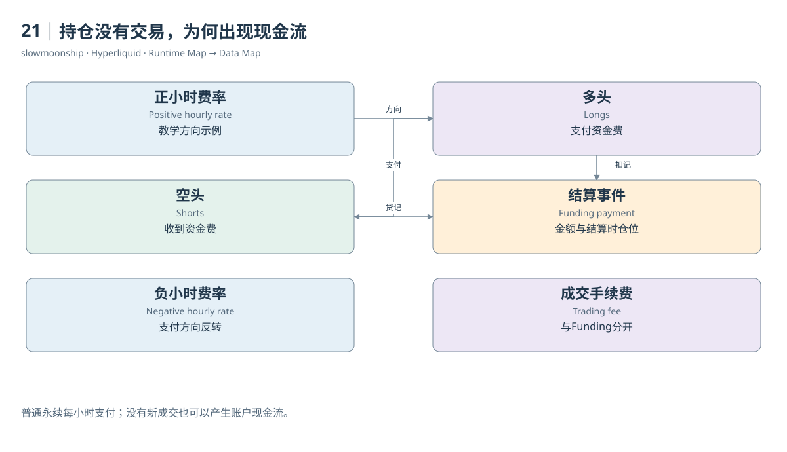

[编辑此图](assets/diagrams/funding-flow.drawio)

证据：[案例04](examples/cases/case-04.md)。

依据：[trading__funding](https://hyperliquid.gitbook.io/hyperliquid-docs/trading/funding.md)；[for-developers__api__info-endpoint__perpetuals](https://hyperliquid.gitbook.io/hyperliquid-docs/for-developers/api/info-endpoint/perpetuals.md)。

[来源目录](research/source_catalog.md) · [目录](SUMMARY.md) · [上一章](book/part-05/20-backstop.md) · [下一章](book/part-06/22-funding-rate.md)

---

# 22｜资金费率怎样从溢价产生

永续价格比参考价格高，是否就表示资金费必然等于两者的差额？不是。资金费机制将市场溢价转换成一项规定的结算率，包含取样、平均、利息成分和限制。理解计算过程，比记住界面上的一个百分比更能解释它为什么随时间变化。

第一方普通永续的Premium使用冲击价格与Oracle之间的关系。Impact Bid与Impact Ask不是最优买卖档，而是按规定名义金额穿过订单簿得到的平均执行价格。它们考虑一定深度，避免极小挂单就完全决定溢价。不同合约的冲击名义金额需要查规格。

规范以五秒间隔采样Premium，再在小时窗口平均。八小时表达的资金费率为平均溢价加上被限制范围约束的利息减溢价项；实际每小时支付该表达的八分之一。分析代码需要清楚命名`rate_8h_formula`与`rate_1h_settled`，避免在已转换率上再除一次八。

固定利息成分的介绍使用每八小时百分之0.01，换成每小时是百分之0.00125。API通常返回小数率，0.0000125对应百分之0.00125。一个数字若误把小数率当百分数，会相差一百倍；把小时与八小时混用，又会增加八倍偏差。

HIP-3使用更灵敏的冲击买卖价平均相对Oracle的溢价表达，并允许部署者配置相关资金费参数。共享每小时结算框架不代表所有市场长期成本相同。比较两个同名产品，需要连同部署者、资金费倍率、利息配置和参考价格一起读取，不能只按Ticker平均。

官方当前Funding规范还说明费率上限为每小时百分之四，并指出支付间隔和上限不随资产改变。它是规则边界，不是本篇建议采用的收益预测。把极端上限连续年化，会得到数学上很大的数，却不表示这种市场状态会长期持续或能被无风险获得。

当前上下文中的funding、历史`fundingHistory`及跨交易所`predictedFundings`属于不同观察。当前率可能面向正在形成的下一轮，历史率记录已经发生的轮次，预测包含尚未结算的估计。把它们画在同一时间轴上时，应标记状态，不能将预测点伪装成已支付结果。

本篇取得一天BTC历史资金费率，同时保存获取时间与每条事件时间。它可以支持有界小时序列分析；一天样本不能代表全年极端分布。若接口返回重复边界或分页窗口，应按市场及结算时点核对，而不是因为数值相同就删掉相邻小时。

资金费率最终是一条由市场输入和协议规则形成的时间序列。保存取样含义、结算频率、数值单位与产品参数之后，才可以讨论正负持续性、跨市场差异或年化展示。每一步都应从实际率的定义出发，而不是从某个交易所熟悉的显示方式出发。

<!-- BOOK RESOURCES -->

[编辑此图](assets/diagrams/funding-rate.drawio)

证据：[案例04](examples/cases/case-04.md)。

数据练习：[SQL07](examples/sql/07-funding-rates.sql)（静态审查，未执行）。

依据：[trading__funding](https://hyperliquid.gitbook.io/hyperliquid-docs/trading/funding.md)；[trading__contract-specifications](https://hyperliquid.gitbook.io/hyperliquid-docs/trading/contract-specifications.md)；[for-developers__api__hip-3-deployer-actions](https://hyperliquid.gitbook.io/hyperliquid-docs/for-developers/api/hip-3-deployer-actions.md)。

[来源目录](research/source_catalog.md) · [目录](SUMMARY.md) · [上一章](book/part-06/21-funding-flow.md) · [下一章](book/part-06/23-funding-payment.md)

---

# 23｜怎样核对用户实际资金费用

知道昨天BTC资金费率，能否乘以用户今天的仓位，得到他昨天支付的钱？不能。用户可能在每轮之前增仓、平仓或反手，Oracle也不断变化。精确期间费用需要每个结算时点适用的站立仓位与价格，或者直接读取已发生的用户Funding事件。

对于普通有符号仓位，账户视角的教学表达是：现金流等于负的有符号数量，乘结算Oracle，乘该小时资金费率。多仓为正，在正费率下得到负现金流；空仓为负，得到正现金流。这里只表达方向和单位，实际金额还遵循协议精度与结算规则。

案例04真实记录保存`time`、`delta.coin`、`delta.szi`、`delta.fundingRate`和`delta.usdc`。一轮空仓负9.69594、正费率0.0000110632，实际收到9.034535。我们优先使用接口给出的支付金额，不凭当前仓位替代当时`szi`，也不凭当前Mark替代结算Oracle。

该记录的hash为全零。它仍然可以包含真实结算数据，却不能按hash独立去重。分析时应选择用户、市场、结算时间和记录类型等有依据的组合键，并检查同一窗口的重复返回。缺少非零交易哈希，不等于没有事件，更不允许补造一个看似真实的哈希。

API的用户Funding与非Funding Ledger是两种请求。前者处理资金费，后者记录转移、出入金及其他账务类型。期间对账应分别保存，再按统一账户与资产范围组合。不能只读取非Funding列表，看到余额仍变化，就把差额全部归为无法解释的交易盈利。

Dune的小时持仓表也有`funding_amount_usd`，文档把它定义为账户视角的已结算金额，负数表示支付。它不是Funding Rate乘作者自行估出来的名义值。用户费用SQL可以直接按期间汇总这一列，同时保存取样小时与Trader范围，不需要把费率再乘一次。

小时快照只覆盖该轮有站立仓位的账户。没有行可能表示无仓位，也可能需要检查数据完整性与覆盖开始日期。不能把所有缺失默认当零，再宣称得到所有账户完整费用。若市场资金费序列存在而用户记录缺失，应把金额结论保留为未知或部分覆盖。

市场层的`funding_paid_usd`则表示支付方流出的正金额总量，不能与账户有符号现金流混为一列。将支付和收到两边都按绝对值相加，会把资金费转移放大两倍；将两边净额相加可能接近零，又会掩盖真实发生的总支付。名称应写出总量还是净额。

资金费对账的结果可以是一份逐轮表：结算时间、市场、当时仓位、小时率、实际金额、资产与来源。它让读者直接看见每一笔被动现金流。无法取得当时价格或完整记录的部分明确保留缺口，比分母错位的漂亮年化收益数字更有研究价值。

对账还应检查覆盖窗口的左右边界，确保相邻两次读取没有重复计入同一结算轮次。

<!-- BOOK RESOURCES -->

[编辑此图](assets/diagrams/funding-payment.drawio)

证据：[案例04](examples/cases/case-04.md)。

数据练习：[SQL08](examples/sql/08-user-funding.sql)（静态审查，未执行）。

依据：[for-developers__api__info-endpoint__perpetuals](https://hyperliquid.gitbook.io/hyperliquid-docs/for-developers/api/info-endpoint/perpetuals.md)；[dune-perp-positions-hourly](https://docs.dune.com/data-catalog/curated/perpetuals/hyperliquid/perp-positions-hourly.md)。

[来源目录](research/source_catalog.md) · [目录](SUMMARY.md) · [上一章](book/part-06/22-funding-rate.md) · [下一章](book/part-06/24-fees.md)

---

# 24｜手续费、返佣与协议收入

交易历史中的fee有时为正，有时为负。正数通常表示这条Fill支付费用，负数表示返佣。市场、角色、账户费率与资产规则决定具体结果。费用不是资金费，也不是Closed PnL；把这三列全部叫作“成本”，会失去收入去向和经济机制的区别。

Maker提供等待流动性，可能按费率得到返佣；Taker主动成交，通常承担相应费用。案例03中Maker fee为负0.0003 USDC，Taker支付0.004513 USDC。双腿净费用为0.004213。这是指定撮合的费用观察，不代表所有账户都采用相同费率。

费率层级还与规定期间成交量、质押优惠、推荐及市场配置有关。HIP-3部署者费用和Builder Code费用分别涉及市场运营者与应用入口。当前规则还有Growth Mode及Aligned Quote等调整。因此，不能只用一个固定基点乘全部历史成交额，宣称精确得到协议收入。

费用资产同样重要。Spot费用可能涉及基础或报价Token，HIP-3抵押资产也不一定是USDC。Dune列名带`usd`，官方表说明部分金额实际以市场报价代币计量。跨资产加总之前，要说明是否按一美元近似、采用哪份汇率，或者干脆保留代币分组。

当前Dune小时指标说明，`builder_fee_usd`与`deployer_fee_usd`是费用分配中的组成部分，不能再无条件加到`fee_usd`上。计算总收入时，先核对是否已包含，再决定汇总。一个名字叫share的字段，既可能是百分比，也可能是金额；类型和来源说明缺一不可。

费用去向还涉及HLP、Assistance Fund和部署者。官方费用页说明Assistance Fund按L1执行将交易费转换为HYPE，并将其持有的HYPE销毁。收入形成、买入HYPE、销毁HYPE是三个阶段。成交费用总量不自动等于同日买回数量，也不直接等于销毁价值。

HLP策略盈亏、质押奖励与资金费用应另列。做市赚到的价差或仓位收益不是普通手续费；质押奖励来自规定的奖励来源；Funding是多空现金流。一个“协议总收入”数字只有先说明包含谁的经济活动，才有可比较的意义，不能把所有正向变化简单相加。

HIP-4费用文档存在具体冲突：HIP-4介绍页仍称初始测试费用为零，当前费用页已经描述平仓或结算收费及特殊成交量计入规则。本篇保留两页版本差异，没有把所有Outcome永久称为零费。指定市场的实际收费，还需要对应Fill与当时费率证据。

费用研究可以分成交总名义额、用户净费用、分配对象收入和最终代币处理四层。每层使用自己的记录与时间边界。清楚区分这几层，才能解释返佣怎样影响用户、市场费用怎样分配，以及为什么一张手续费图不能替代完整协议经济账本。

财务报表中的收入还涉及受益主体边界。用户返佣、部署者分成和协议留存属于不同对象，分析者应明确是在研究哪一方，而不是把资金流向都称为平台盈利。

<!-- BOOK RESOURCES -->

[编辑此图](assets/diagrams/fees.drawio)

证据：[案例03](examples/cases/case-03.md)。

数据练习：[SQL03](examples/sql/03-maker-taker.sql)（静态审查，未执行）。

依据：[trading__fees](https://hyperliquid.gitbook.io/hyperliquid-docs/trading/fees.md)；[trading__builder-codes](https://hyperliquid.gitbook.io/hyperliquid-docs/trading/builder-codes.md)；[hyperliquid-improvement-proposals-hips__hip-1-native-token-standard](https://hyperliquid.gitbook.io/hyperliquid-docs/hyperliquid-improvement-proposals-hips/hip-1-native-token-standard.md)。

[来源目录](research/source_catalog.md) · [目录](SUMMARY.md) · [上一章](book/part-06/23-funding-payment.md) · [下一章](book/part-07/25-spot.md)

---

# Part 07｜现货与原生资产

# 25｜现货成交如何改变两种资产

买入HYPE现货与买入HYPE永续，界面上都可能显示Buy HYPE，账户变化却不同。现货买入通常增加基础Token数量并减少报价Token；永续买入改变有符号合约仓位，不自动增加可转走的HYPE。一个简单的市场类别字段，决定整段金额应怎样解释。

教学模拟中，Alice用100个报价单位买入2单位Token X。忽略费用时，她的X增加2，报价资产减少100；卖方正好反向变化。这次成交交换两类资产数量。不能像永续那样只用`szi`表达它，也不能把现货账本的Token余额称作合约多头持仓。

Spot订单簿仍然使用买卖盘、价格数量和撮合，但约束来自具体资产余额与账户规则。卖方需要能够交付基础资产，买方需要相应报价能力。Portfolio Margin可能允许符合规则的借入资金参与，届时还产生负债。现货交易本身与融资机制仍然应该分别记账。

本篇实际订阅HYPE现货`@107`的公开Trade与L2 Book。该市场由Spot Metadata的Pair Index映射到Token索引150和0。Trade里的coin不是永续HYPE名称。记录可以证明现货撮合存在，却不同时给出每个参与账户成交前后的完整余额或转账权限。

现货基础数量`sz`乘价格`px`形成报价名义额。HYPE数量、USDC金额和最小整数单位不能混成同一种amount。接口可能以十进制字符串呈现可读数量，而账本或EVM日志使用缩放整数。计算前先核对单位，再决定是否需要按Token精度换算。

挂单占用也会影响余额显示。未成交买单可能保留报价资产，未成交卖单保留基础资产。取消释放占用，未必产生外部转账；成交使用占用并更新两边数量。只看可用余额差额，无法区分取消、成交、转移或其他资金用途，必须接入订单与Ledger类型。

Spot成交量是资产交换名义额，但不等于平台净入金。用户可能反复买卖同一笔资金，或者两个原有用户相互交换。链上资产存量几乎不变，期间交易量仍可以很大。计算净流入应该寻找账户范围之外的资金移动，并处理同一范围内部转移。

界面命名还可能重映射。官方说明，前端显示的BTC/USDC可能对应Core原生名称UBTC/USDC。相似Ticker不足以证明原生BTC、封装或关联资产具有同样兑付关系。Spot分析应记录Token ID与具体Pair，而不是只保留界面文本。

将现货与永续并排展示是合理的市场研究，但两类指标需要清楚命名：现货交换量、永续名义量、Token余额和合约敞口分别属于不同经济对象。只要从“这次成交交付什么、形成什么状态”出发，页面上相似的买卖按钮就不会误导数据模型。

对于成交双方，费用会使最终余额变化与无费用教学数字略有不同。准确核对需要实际收费资产和整数精度，不能仅凭两条价格数量记录判断全部到账金额。

<!-- BOOK RESOURCES -->

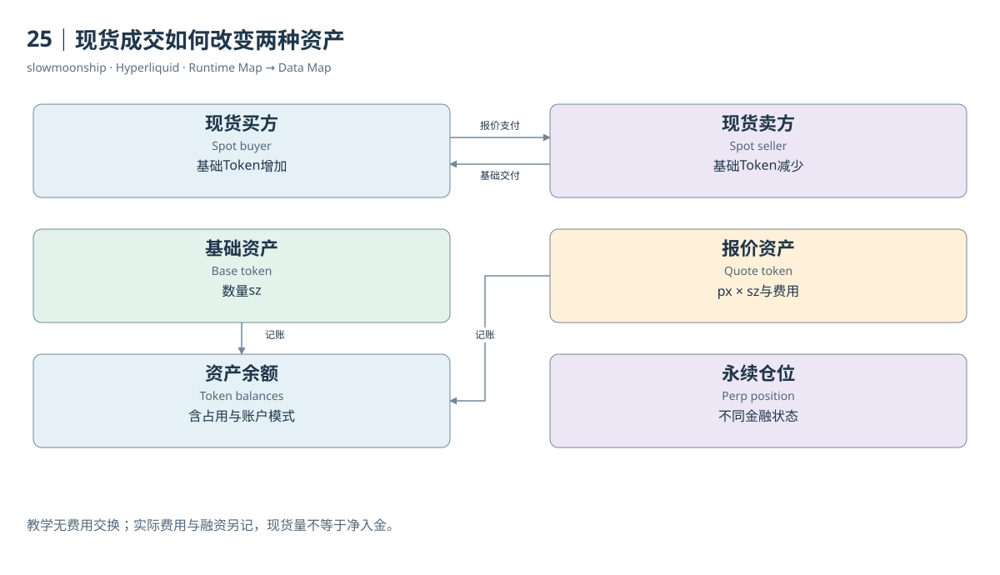

[编辑此图](assets/diagrams/spot.drawio)

证据：[案例06](examples/cases/case-06.md)。

依据：[for-developers__api__info-endpoint__spot](https://hyperliquid.gitbook.io/hyperliquid-docs/for-developers/api/info-endpoint/spot.md)；[for-developers__api__websocket__subscriptions](https://hyperliquid.gitbook.io/hyperliquid-docs/for-developers/api/websocket/subscriptions.md)。

[来源目录](research/source_catalog.md) · [目录](SUMMARY.md) · [上一章](book/part-06/24-fees.md) · [下一章](book/part-07/26-token-pair.md)

---

# 26｜Token编号与Pair编号的区别

HYPE在当前Mainnet元数据中的Token Index为150，HYPE/USDC的Spot Pair Index为107，下单用的Asset ID又是10107。三个数字都与HYPE有关，却识别三个不同对象。把Token编号写进订单市场字段，可能得到完全错误的市场；数据Join也会出现同样错配。

HIP-1定义Core原生的有上限供应可替代Token。Token对象包含名称、Token ID、索引和精度等字段，表达资产身份。Pair对象连接基础Token与报价Token，形成订单簿身份。同一个基础资产可以参与不同报价市场，因此Token与Pair不应该被设计成同一张编号表。

官方Spot Action规则使用一万加Pair Index作为Asset ID。普通第一方Perp使用其Meta顺序索引；HIP-3另有DEX与市场索引组合公式；Outcome又使用更大的独立编码空间。所有这些值都是整数，却不能脱离类别解释。编号域也是身份的一部分。

本篇实际Spot Metadata中，HYPE Token的`weiDecimals`为8、`szDecimals`为2。前者表示最小整数单位与可读Token数量的缩放关系，后者表示订单数量允许的精度。最小账本单位与最小可交易数量并不相等，因此小额余额可能存在，却不能以相同精度直接下单。

EVM常见ERC-20采用合约地址与decimals表达资产身份。HIP-1 Token不自动就是一个ERC-20，也不保证同名EVM代币与其关联。某个Token可以按协议步骤链接具体合约；链接字段、系统地址和精度差异需要分别验证，不能因Ticker相同便将两边余额合并。

Token供应机制与元数据也具有版本范围。HIP-1基础规格介绍上限、Genesis和费用影响；当前规范另有EVM来源资产的关联路径。供应上限不等于当前流通量，系统地址持有数量也不自动属于真实用户。研究发行与分配应找供应状态和Genesis证据，而不是从成交量推断。

报价资产选择已经扩展。基础HIP-1页面仍保留将任意报价对留待未来的早期表述，而当前Permissionless Quote规范描述其他报价资产。目录需要同时保存Pair实际tokens与报价资格，不应只凭旧页把所有Spot市场写成USDC对。案例HYPE/USDC只是其中一个具体市场。

市场注册表可以按网络、产品类型、Token身份、Pair身份和观察时间组织。不要按数组当前位置替代显式Index字段；保留下架或历史市场的身份，避免索引表只保存今天可见名称。Mainnet与Testnet编号不同，相同名字跨网络也不能直接Join。

当读者在SQL看到asset_id、token_id与coin，可以依次问它属于哪种编号域、映射到哪个资产或市场、来源在哪个版本。真实HYPE的150、107与10107形成一个小而完整的练习：同一金融产品的相关编号能够互相连接，却不能互相替换。

身份表还应保留报价Token与基础Token的顺序。相同两种资产组成的名称，不足以确定价格分母；倒置价格会改变数量与名义额含义。精度字段也应随Token身份保存，避免跨表使用错误的缩放规则。

Genesis是初始供应与分配进入账本的起点。部署者登记名称和精度，按协议准备供应、分配及市场配置；部署资格费用通过规定的荷兰式拍卖形成，并以HYPE计价。这笔部署费用不是每一次Spot成交的手续费，Token创建也不保证市场随后具有足够流动性。

<!-- BOOK RESOURCES -->

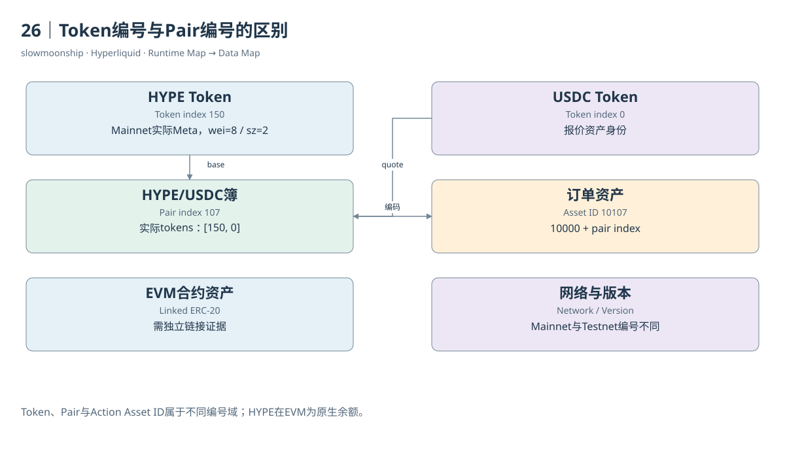

[编辑此图](assets/diagrams/token-pair.drawio)

证据：[案例06](examples/cases/case-06.md)。

依据：[for-developers__api__asset-ids](https://hyperliquid.gitbook.io/hyperliquid-docs/for-developers/api/asset-ids.md)；[hyperliquid-improvement-proposals-hips__hip-1-native-token-standard](https://hyperliquid.gitbook.io/hyperliquid-docs/hyperliquid-improvement-proposals-hips/hip-1-native-token-standard.md)；[hypercore__permissionless-spot-quote-assets](https://hyperliquid.gitbook.io/hyperliquid-docs/hypercore/permissionless-spot-quote-assets.md)。

[来源目录](research/source_catalog.md) · [目录](SUMMARY.md) · [上一章](book/part-07/25-spot.md) · [下一章](book/part-07/27-hip2.md)

---

# 27｜HIP-2怎样把流动性放进订单簿

新Token刚出现时，可能还没有很多人愿意挂买卖单。没有足够流动性，价格发现和交易都困难。HIP-2的Hyperliquidity提供一种协议执行的流动性启动策略：它按规定逻辑在Core订单簿挂单，与普通用户的流动性共同参与撮合，而不是另开一套独立AMM交易池。

官方明确说明，这项策略受到Uniswap启发，但它直接运行在区块状态转换中，没有一个私人操作员不断替它发送交易。策略改变与订单簿改变同样受L1执行规则保护。自动化来自协议逻辑，不等于风险消失，也不意味着任意市场都自动拥有深度。

策略配置包括对应Spot市场、初始价格、订单档数、每档数量以及初始买档数量。初始买档需要相应报价资金，初始卖档需要Token供应。配置决定策略从什么位置开始表达买卖意图，不能只用“有一个池子”解释所有初始资金和订单状态。

基础规范通过递推价格形成相邻档位，并按符合时序条件的区块更新。当某个档位全部成交，策略按当前资产余额在相应方向重新配置订单；还有部分余额时，可以形成部分订单。它管理的是分层挂单及资产状态，成交仍然由共同订单簿的撮合规则决定。

教学模拟可以把策略想成一排预先配置的价格阶梯。用户买走某档数量后，策略根据持有的Token与报价资金重新表达下一步挂单。这个比喻帮助理解资金与订单如何连接，但具体档数、价格舍入和更新频率必须来自正式配置，不能用模拟阶梯冒充某个实际Token。

官方当前HIP-2页面限定相应Hyperliquidity机制用于USDC报价Spot对。这项范围不能因为报价资产功能后来扩展，就自动推断所有报价市场都采用同样策略。产品能力、报价资格与某个市场是否真正启用Hyperliquidity，是三项不同事实。

数据分析需要找到策略身份、参数、余额与订单簿事件。单看一份L2快照，无法区分某档数量来自HIP-2还是普通Maker；L2已经汇总同价订单。单看成交价格的规则性，也不足以证明策略来源。归因需要协议状态或已验证的策略关联信息。

本篇没有取得完整指定HIP-2策略的真实状态与原始事件，因此案例07保留缺口。正文解释的是官方机制，不将HYPE现货簿中的某几档宣布为Hyperliquidity。一个流动性策略是否存在，以及它贡献多少成交，需要各自的直接证据和统计范围。

HIP-2最重要的数据启示，是自动策略也可以通过订单簿表达流动性。AMM式思想与CLOB实现可以组合，分析者仍需沿策略状态、挂单、撮合和余额变化分层取证。把它理解为与其他挂单共用的一项协议策略，才能看清价格发现与流动性启动之间的关系。

<!-- BOOK RESOURCES -->

[编辑此图](assets/diagrams/hip2.drawio)

证据：[案例07](examples/cases/case-07.md)。

依据：[hyperliquid-improvement-proposals-hips__hip-2-hyperliquidity](https://hyperliquid.gitbook.io/hyperliquid-docs/hyperliquid-improvement-proposals-hips/hip-2-hyperliquidity.md)。

[来源目录](research/source_catalog.md) · [目录](SUMMARY.md) · [上一章](book/part-07/26-token-pair.md) · [下一章](book/part-07/28-transfers.md)

---

# 28｜Core与EVM之间怎样移动资产

你把Core里的HYPE移到HyperEVM，EVM钱包随后出现可支付Gas的原生余额。这个过程共享同一条L1，却涉及两套余额表示与处理时点。理解转移需要同时看资产关联、系统地址、方向与结果，不能仅凭一个EVM Transfer事件就宣布整条路径已经对账完成。

HYPE是特殊情况。Core中的原生HYPE对应HyperEVM原生余额，系统地址为全长重复2的地址。EVM往Core方向可以向这个系统合约发送原生value，其Received日志记录发送者和数量。它不是必须先封装成普通ERC-20再跨一条外部L1的流程。

其他关联Spot Token采用各自系统地址，地址以前缀0x20及Token索引编码形成。Core资产与具体EVM ERC-20链接后，两个方向按规范使用相应发送操作和Transfer日志。链接记录决定哪个合约被协议识别，不是所有同名合约都能参与这一余额转换。

Core往EVM的转移排队到下一次EVM区块，由系统交易完成对应处理；EVM往Core的转移在产生EVM区块的同一L1区块里、EVM构建之后处理。这项顺序解释了为什么相邻界面可能短暂显示不同状态。查询时点需要跟在金额旁边，不能只要求两边瞬间同时更新。

精度转换会带来另一类差异。Core的Wei Decimals与EVM合约decimals可能不同，关联包含额外精度参数。官方说明，不能整除转换单位的极小余数会按规则处理。核对金额应使用整数缩放与舍入边界，而不是浮点比较两个界面最后几位数字。

系统地址与关联合约也有实现风险。官方转移文档提醒，链接不保证任意合约字节码正确，也不能盲信系统地址库存足够或transfer行为标准。共享L1降低了独立链桥模型的某些复杂性，不能因此把资产关联的具体实现称为无需核查的绝对安全路径。

数据证据至少包括起点事件、系统处理和终点状态。EVM用户交易成功，表明EVM侧执行结果；日志给出相应数量与地址；Core Ledger或余额变化才能进一步核对目标到账。只看系统地址调用次数，最多证明接口使用频率，不能得到所有成功跨环境资产金额。

本篇在固定五十个EVM区块窗口查询HYPE系统日志，返回空数组；固定取样区块的系统交易列表也为空。这个结果只描述有界窗口，没有提供真实HYPE转移案例。案例08保留资产移动取证缺口，同时记录已成功的只读预编译观察，二者不会混称。

为一笔转移建立关联时，保存网络、方向、Token身份、系统地址、EVM哈希、L1或EVM高度、金额精度与Core到账证据。这样，余额转换能够被逐段验证，也能明确哪里缺少历史状态。重要的是连接两个执行环境的账，而不是把一次成功请求扩大成全部到账事实。

<!-- BOOK RESOURCES -->

[编辑此图](assets/diagrams/transfers.drawio)

证据：[案例08](examples/cases/case-08.md)。

依据：[for-developers__hyperevm__hypercore-less-than-greater-than-hyperevm-transfers](https://hyperliquid.gitbook.io/hyperliquid-docs/for-developers/hyperevm/hypercore-less-than-greater-than-hyperevm-transfers.md)；[for-developers__hyperevm__interaction-timings](https://hyperliquid.gitbook.io/hyperliquid-docs/for-developers/hyperevm/interaction-timings.md)。

[来源目录](research/source_catalog.md) · [目录](SUMMARY.md) · [上一章](book/part-07/27-hip2.md) · [下一章](book/part-08/29-evm.md)

---

# Part 08｜HyperEVM与Core交互

# 29｜HyperEVM的区块与Gas

HyperEVM让开发者使用熟悉的EVM工具，但其区块仍由Hyperliquid共享的L1执行组织。Mainnet EVM Chain ID为999，Testnet为998；本篇实际RPC返回0x3e7，即999。Chain ID标识EVM网络，不能被当成Core资产编号、DEX索引或L1共识轮次。

EVM交易包含发送者、目的地址、nonce、Gas参数和调用数据。执行消耗Gas，以原生HYPE支付费用。交易成功与失败都需要检查收据，失败也可能消耗Gas。`value`只表示该交易随调用携带的原生金额，不能替代所有ERC-20转移或Core资产变化。

HyperEVM采用双区块结构。小区块提供较快确认节奏，大区块容纳更大的Gas预算；两类区块交错进入唯一递增的EVM编号序列。它们不是两条链，也不是两个可以各自独立相加的历史。分析区块间隔时，应在同一序列中理解不同生成节奏。

当前官方双区块页列出初始配置：小区块约一秒、三百万Gas，大区块约一分钟、三千万Gas。文档明确这些属于保守配置与持续升级背景。本篇取样区块Gas Limit为三百万，仅核对这个区块，没有持续采样并证明所有区块一直维持相同间隔。

EVM待处理交易也被描述为L1链上状态的一部分，并按两类区块来源组织。账户nonce与区块选择状态影响进入哪类区块。将一个交易长时间未出现的原因都归为“链很慢”，会忽略Gas、nonce顺序、目标区块类型和请求传播等不同条件。

读取区块与读取历史状态又不同。默认RPC可以返回指定区块及其交易或收据，却对`eth_call`、余额、代码和存储读取限制为latest。能够获取去年一张收据，不代表能对去年任意状态进行假设合约调用。历史数据对象与历史状态执行能力应分别说明。

Core来源的系统交易有专门RPC方法。普通用户交易列表未必完整表达系统资产处理；`eth_getSystemTxsByBlockNumber`用于相应系统交易。统计合约调用或资产移动前，应检查来源范围。将普通交易数量称为整个Hyperliquid全部业务次数，会同时漏掉Core原生活动。

实际取样区块和一张收据已经保存原始返回、固定高度与哈希。验证脚本检查交易与收据的区块关系，保留Gas和日志原始整数。它支撑EVM数据结构练习，不能替代独立执行字节码、校验全部状态根或证明整条L1共识正确性。

从数据分析角度，HyperEVM既继承EVM的交易、日志和调用结构，也带有双区块及系统交互特点。先理解标准对象，再补上这些边界，便能复用Ethereum篇的经验。复用的是分析方法；具体网络、接口能力与Core连接仍然需要当前证据。

固定区块读取有助于复核，因为latest会随请求推进。研究多接口关联时，先固定高度并保存区块哈希，再取相应交易和收据，比连续使用latest更容易确认观察范围。

官方开发者页将当前EVM版本描述为Cancun但不支持Blobs，原生HYPE精度为十八位。EIP-1559基础费按规则销毁，优先费也按HyperBFT环境的规定销毁，处理方式不等于Ethereum执行层给区块提议者的小费。Core交易费用与EVM Gas消耗属于不同经济过程。

<!-- BOOK RESOURCES -->

[编辑此图](assets/diagrams/evm.drawio)

证据：[案例14](examples/cases/case-14.md)。

数据练习：[SQL14](examples/sql/14-evm-transactions.sql)（静态审查，未执行）。

依据：[for-developers__hyperevm](https://hyperliquid.gitbook.io/hyperliquid-docs/for-developers/hyperevm.md)；[for-developers__hyperevm__dual-block-architecture](https://hyperliquid.gitbook.io/hyperliquid-docs/for-developers/hyperevm/dual-block-architecture.md)；[for-developers__hyperevm__json-rpc](https://hyperliquid.gitbook.io/hyperliquid-docs/for-developers/hyperevm/json-rpc.md)。

[来源目录](research/source_catalog.md) · [目录](SUMMARY.md) · [上一章](book/part-07/28-transfers.md) · [下一章](book/part-08/30-precompiles.md)

---

# 30｜智能合约怎样读取Core状态

一个借贷合约希望知道HyperCore中的价格或用户仓位，不需要先等待私人服务器把所有数据复制到合约里。HyperEVM提供读取预编译Read Precompile，合约以规定地址和编码读取Core的特定状态。这个机制连接通用合约与原生金融状态，但读取范围由接口明确限制。

预编译不是普通业务合约的同义词。它提供协议定义的执行能力，地址与输入输出遵循对应规范。官方接口覆盖特定持仓、Spot余额、Vault权益、质押委托、Oracle价格和L1高度等对象。某个字段可在Info API查询，不意味着一定存在完全相同的预编译。

官方交互规范说明，读值对应构建该EVM区块时的最新Core状态。这是重要的观察时点。在同一L1区块里随后处理的EVM到Core转移或CoreWriter操作，不应被假定已经出现在先前读取结果中。读取与后续修改共享排序，却仍存在先后关系。

本篇实际以Mainnet `eth_call`读取0x0807地址的BTC Oracle，输入是编码后的资产索引零，得到非错误整数返回。它证明该指定主网读取路径可用。规范页仍有Testnet字样，本篇将这一冲突保留为来源更新差异，没有因此推断所有预编译都已逐项测试。

返回值的缩放需要查接口。价格预编译按Perp或Spot及数量精度采用不同转换指数。ABI整数不是人类可读价格。错误地统一除以10的18次方，会得到看似精确但没有业务意义的数字。应同时保留资产Meta、原始返回与转换公式。

读取失败也属于执行事实。规范说明无效资产或Vault输入会返回错误，并消耗相应调用框架中的Gas。一个顶层交易失败，不一定说明Oracle停止更新；也可能是编码、资产索引或调用条件错误。诊断需要调用输入、执行上下文与实际错误，而不是只看成功率。

历史读取还受到RPC与状态重放限制。默认`eth_call`仅支持latest，不能用一个旧区块编号假装获得过去任意Core状态。官方说明，实际发生过的预编译调用记录与假设历史调用不是一回事；后者可能需要完整L1重放，而本篇没有部署节点完成这种工作。

Dune Trace可以记录实际接口调用，包含to、input与output等字段。它能支持调用次数和已发生调用的取样研究。没有出现Trace的某个地址，不能自动说明功能不存在；一天没有调用，也不表示整个网络从未使用。流量观察与能力证明需要分开。

读取预编译的教学闭环是：确定业务对象，选择指定地址，按正式编码提供输入，取得与时点相关的返回，再按精度解释。它把两种执行环境接起来，同时保留可观察边界。读者能够知道合约看到了什么，也能知道这与全市场完整历史状态之间还差哪些证据。

<!-- BOOK RESOURCES -->

[编辑此图](assets/diagrams/precompiles.drawio)

证据：[案例08](examples/cases/case-08.md)。

依据：[for-developers__hyperevm__interacting-with-hypercore](https://hyperliquid.gitbook.io/hyperliquid-docs/for-developers/hyperevm/interacting-with-hypercore.md)；[for-developers__hyperevm__json-rpc](https://hyperliquid.gitbook.io/hyperliquid-docs/for-developers/hyperevm/json-rpc.md)。

[来源目录](research/source_catalog.md) · [目录](SUMMARY.md) · [上一章](book/part-08/29-evm.md) · [下一章](book/part-08/31-corewriter.md)

---

# 31｜CoreWriter为何需要两阶段核对

一个HyperEVM合约成功调用CoreWriter，交易收据显示status为成功。目标Core订单是否已经成功下单？仍然需要核对。CoreWriter首先把合约意图交给后续Core处理，EVM调用结果与金融操作结果位于不同阶段。这是跨执行环境分析最容易跳过的一步。

系统合约位于全长重复3的地址。当前规范描述操作编码由版本字节、三字节Action ID和操作专属ABI参数组成。Limit Order、Vault Transfer、Spot Send、取消订单等各有指定编号。不是任何一段成功发出的字节都能成为有效金融操作。

本篇取回主网该地址的非空代码，也取回作者已有Dune结果中历史CoreWriter Trace计数。这些证据支撑系统入口及既有调用观察。它们没有执行新写操作，也没有逐一证明当前操作列表每一项在每种账户状态下均可成功。入口存在与业务完成是两层验收。

在产生EVM区块的L1处理序列中，先构建L1及EVM区块，再处理EVM到Core的转移，随后处理CoreWriter操作。规范还明确，执行该操作的Core账户需要在EVM区块构建前已存在；同一区块通过转移刚初始化账户，仍可能导致相关操作拒绝。

订单与Vault转移等指定操作还有链上延迟，目的是避免借EVM绕过L1订单入口取得时延优势。官方说明这类操作在Explorer中可以分别呈现入队与Core执行。研究者若按哈希或时间把二者当成两次独立经济成交，会重复解释同一意图。

Core后续处理仍需检查资产、权限、账户模式、余额和金融约束。EVM收据成功只说明相应EVM执行没有回滚，不保证订单满足保证金，也不保证订单发生Fill。甚至一张被接受的订单可以长期不成交，所以“写入成功”“订单接受”和“成交完成”又是三个状态。

实际研究应连接EVM交易与Trace、CoreWriter日志或入队记录、对应Core执行、订单状态及最终账户结果。缺少关联键时，可以保留候选时间窗口，却不能仅凭前后几秒两个相似数量就宣布确定关联。数据链条中的每个连接都需要明确依据。

当前规范已经列出扩展后的Borrow/Lend、账户抽象与Outcome操作，而介绍页仍有写系统尚未上线的旧文字。本篇保存这种差异，并将具体能力证明限制在已取证接口。阅读规范可以理解编码，真实主网权限与执行成功还应以当前行为证据核对。

CoreWriter展示了共享L1中的异步业务边界：合约发出意图，协议随后尝试执行，金融状态最后给出结果。把这三步画清楚，可以正确分析合约如何利用订单簿，也能避免用一个绿色EVM收据代替整个交易生命周期。本篇只教学与取证，不生成或发送可交易的签名操作。

因此，分析报告可以分别标记入口已观察、Core执行已观察与最终状态已核对。缺少其中一层时，保留该层空缺即可，不需要猜一个成功或失败结果。

<!-- BOOK RESOURCES -->

[编辑此图](assets/diagrams/corewriter.drawio)

证据：[案例08](examples/cases/case-08.md)。

数据练习：[SQL15](examples/sql/15-core-interfaces.sql)（静态审查，未执行）。

依据：[for-developers__hyperevm__interacting-with-hypercore](https://hyperliquid.gitbook.io/hyperliquid-docs/for-developers/hyperevm/interacting-with-hypercore.md)；[for-developers__hyperevm__interaction-timings](https://hyperliquid.gitbook.io/hyperliquid-docs/for-developers/hyperevm/interaction-timings.md)。

[来源目录](research/source_catalog.md) · [目录](SUMMARY.md) · [上一章](book/part-08/30-precompiles.md) · [下一章](book/part-08/32-evm-data.md)

---

# 32｜EVM交易、日志与调用树

一笔EVM交易可以产生许多日志，也可以调用多个合约。Transactions、Logs和Traces分别呈现入口、事件输出与调用结构，不能按行数互换。一个交易没有日志仍可能成功，一个交易有多个日志也不是发生了多笔用户交易。数据地图需要保留这种一对多关系。

交易表通常以交易哈希识别入口，记录from、to、value、nonce和执行结果。`to`不一定是合约，也可以是普通地址；创建合约时还有特殊形式。将所有目的地址称为“交互合约”，会把普通原生转账也归进智能合约使用量，应先取得合约身份或明确称目的地址。

日志表以交易哈希和日志序号定位一项输出。topic与data需要依据具体ABI解释，事件名相同不保证合约语义相同。ERC-20 Transfer日志属于特定合约声明的转移记录，不能自动表示Core的每一项Spot或Perp活动。合约实现与资产关联仍要核对。

Trace呈现执行调用树。`trace_address`帮助定位嵌套位置；同一交易可以多次调用CoreWriter或读取预编译。接口调用次数、涉及交易次数和独立调用者数量因而不同。三者应该分别命名，不能把Trace行数直接改称使用接口的用户人数。

Dune实时Catalog列出了`hyperevm.traces`及相关Decoded表，而其HyperEVM概览仍保留不支持Trace的说明。作者已有Query旧Result实际返回相应统计。本篇采用Catalog与结果作为指定数据存在的依据，保留概览冲突，不宣称整个最新历史范围都已重新执行核验。

Decoded数据把原始topic或调用输入转成便于阅读的字段，Curated数据还可能增加资产和业务分类。每一次加工都需要来源。Decoded表没有覆盖某个合约，不意味着原始日志不存在；Decode成功也不证明调用者的真实意图。技术记录和行为解释应分层。

连接Transactions与Logs时，若一笔交易有五条日志，交易里的value会被复制五次。要统计原生转账或Gas成本，先按交易粒度汇总，或去除这种复制。连接Trace时同样如此。重复Join不一定产生错误行，却会悄悄改变金额与次数的统计对象。

本篇SQL分别演示交易活动、日志输出和CoreWriter Trace计数，限定日期与分区。真实区块收据练习则检查日志与交易归属。它们可以支撑EVM侧结构理解，但没有任何一张表能够单独证明Core下单最终成交，尤其不能将所有Core成交改称EVM Event。

将入口、调用树和日志放在同一张图上，可以看见程序执行如何留下不同证据。再连接Core业务状态，才可能分析完整交互。读者应带着Ethereum篇的对象知识进入HyperEVM，同时始终记得：EVM数据是一部分运行时地图，整个金融系统还有另一套原生记录。

Gas使用量也不宜从日志行逐项累加。它属于执行收据的计量，日志只是执行输出；统计交易成本时回到交易或收据粒度，才能避免一次调用被重复收费。

<!-- BOOK RESOURCES -->

[编辑此图](assets/diagrams/evm-data.drawio)

证据：[案例14](examples/cases/case-14.md)。

数据练习：[SQL14](examples/sql/14-evm-transactions.sql) · [SQL15](examples/sql/15-core-interfaces.sql)（静态审查，未执行）。

依据：[dune-hyperevm](https://docs.dune.com/data-catalog/evm/hyperevm/overview.md)；[for-developers__hyperevm__json-rpc](https://hyperliquid.gitbook.io/hyperliquid-docs/for-developers/hyperevm/json-rpc.md)。

[来源目录](research/source_catalog.md) · [目录](SUMMARY.md) · [上一章](book/part-08/31-corewriter.md) · [下一章](book/part-09/33-hip3.md)

---

# Part 09｜新市场与协议参与

# 33｜HIP-3怎样定义一个独立市场

你在不同入口看到两个BTC永续，不能只因为名字一样就合并。HIP-3允许部署者建立Perp DEX并定义市场，产品的预言机、抵押资产、风险参数和管理规则可能不同。同一种价格参考，并不意味着同一张金融合约；完整市场身份比Ticker更重要。

部署者负责市场定义与运营，包括参考价格、杠杆边界和必要结算。协议提供共用的订单簿与保证金执行基础，不替每个部署者保证基础数据永远正确。研究一个HIP-3产品，需要看部署者、Oracle Updater、抵押Token、合约规格和风险配置，而不是只看成交曲线。

官方当前主网规范要求相应部署者质押五十万HYPE，并规定保持期及资产部署规则。这是版本基准下的要求，不是永不变化的常数。部署者质押与验证者自委托又是不同角色；两者都用HYPE，不代表同一资格、锁定期或罚没含义。

本篇实际`perpDexs`取得XYZ等DEX信息，再读取XYZ的Meta与市场上下文。`xyz:TSLA`明确带DEX前缀，API返回数量精度、最大杠杆与Margin Table等字段。这个合约提供特斯拉价格相关敞口，不交付股票，也不自动赋予股东投票、分红或托管权。

HIP-3订单Asset ID采用十万加DEX Index乘一万，再加Meta市场索引。DEX Index与Meta中的位置都要来自对应网络和当前注册信息。按名称猜编号，或把第一方BTC索引零直接用于另一个DEX同名市场，都会把分析或操作对象指向错误位置。

保证金能力也已经扩展。当前规范包含符合条件的Cross Margin、No Cross及严格逐仓相关状态，并规定部署者启用全仓的资格约束。用户Standard、Unified或Portfolio模式又影响资金共享范围。不能沿用早期只支持逐仓的认知，也不能认为所有HIP-3资产都支持全仓。

部署者可以通过规定的Halt Trading路径停止并结算市场，官方说明该路径取消订单、按当前Mark处理持仓，随后还可以恢复使用。这类行政结算与普通市场成交不同。Dune的settlement角色不宜纳入自愿交易量，否则一个停止市场动作可能看起来像突然爆发交易需求。

Dune Market Details将第一方与HIP-3统一组织，`coin`保留DEX前缀，`market_symbol`去掉前缀。Join应使用coin，不能用会碰撞的Symbol。资产类别、股票或商品等标签属于Curated分类；当前注册表与历史市场参数之间也有版本差异，应避免用今天分类解释过去权限。

一份HIP-3市场卡可以完整回答：谁运营，参考什么价格，使用什么抵押，如何计算资金费与风险，何时上市，是否停止，数据从何时覆盖。只有把这些条件放在同一身份下，成交与OI比较才具有经济意义。市场开放扩展的是金融产品表达能力，并不让相似名字变成相同权利。

跨市场价格比较还要检查交易时段与参考源更新时间。基础股票市场休市时，合约依然可能交易；这种差异不能自动解释为真实股票现货价格发现。

<!-- BOOK RESOURCES -->

[编辑此图](assets/diagrams/hip3.drawio)

证据：[案例09](examples/cases/case-09.md)。

数据练习：[SQL01](examples/sql/01-markets.sql) · [SQL12](examples/sql/12-hip3-classification.sql) · [SQL13](examples/sql/13-first-hip3.sql)（静态审查，未执行）。

依据：[hyperliquid-improvement-proposals-hips__hip-3-builder-deployed-perpetuals](https://hyperliquid.gitbook.io/hyperliquid-docs/hyperliquid-improvement-proposals-hips/hip-3-builder-deployed-perpetuals.md)；[for-developers__api__hip-3-deployer-actions](https://hyperliquid.gitbook.io/hyperliquid-docs/for-developers/api/hip-3-deployer-actions.md)；[dune-perp-market-details](https://docs.dune.com/data-catalog/curated/perpetuals/hyperliquid/perp-market-details.md)。

[来源目录](research/source_catalog.md) · [目录](SUMMARY.md) · [上一章](book/part-08/32-evm-data.md) · [下一章](book/part-09/34-hip4.md)

---

# 34｜HIP-4从交易走向结果结算

买一份BTC价格是否达到目标的Outcome，与买BTC永续有何不同？Outcome在规定结果或到期条件下支付有界金额，采用全额抵押结构；普通永续则持续产生价格敞口、资金费用和保证金风险。它们共用Core订单簿基础，却不是同一种金融状态机。

教学二元市场有Yes与No两侧Token。若结算比例为1，Yes支付1个报价单位、No支付0；比例为0时反过来。价格0.6可以被研究者作为市场定价信号，但它并不是经过外部统计校准的“事件真实概率”。费用、流动性、风险偏好与具体结果定义都会影响价格。

两侧订单簿通过互补关系共享流动性：买Yes价格p，与卖No价格1减p具有对偶联系。当前规范还描述价格、侧别、时间优先及Split、Merge等余额转换。不能将Yes与No的全部成交腿直接相加，尤其不能把铸造、合并和结算等引擎腿当成新的自愿交易。

Question将互斥Outcome组成一个集合，恰好一个结果结算Yes，其他结算No。当前主网`outcomeMeta`实际返回327个Outcome、35个Question及部署者信息，包含体育与价格条件等定义。这是本轮快照观察，数量会变化；不能把介绍页“初始仅二元”的文字当成当前完整市场范围。

部署权限仍需单独判断。官方HIP-4部署者接口标注Testnet-only，本篇没有执行市场创建，不能凭主网已有多种市场就宣布任意用户可无许可部署。规范中的功能、已有主网市场和创建权限是三项证据。文档时间差保存在版本附录中。

真实历史案例使用Outcome 95。实际`settledOutcome`返回目标价77363、结算细节价格76876.9、`settleFraction = 0`，规格写明对应BTC日度价格二元产品。它支撑该市场历史结果，不能从这份返回推出某个用户持有多少份额或收到多少资金。

Outcome身份也有独立编码：encoding等于十乘Outcome编号再加Side，coin为井号加encoding，Token名为加号加encoding，订单Asset ID为一亿加encoding。Side只取零或一。把这些编号当成Spot Pair Index或普通永续Asset，会将结果与产品映射错。

Dune为HIP-4提供五张独立表，包含全量腿、市场元数据、小时指标与日持有状态。该模型需要Split、Merge、Negate和Settlement来解释供应与持有变化。仅靠普通trade腿重建所有余额，会漏掉非成交产生的状态。其历史覆盖与当前数据权限也需分别记录。

全额抵押Outcome没有普通永续的杠杆清算和Funding机制，但结果定义、解析来源、期限和Token持有仍有风险。理解它应沿抵押、交易、结果解析、结算比例与支付展开。本篇将可验证结算与权限未知分开，让读者看见一种新的金融原语，而不把它改写成永续合约的简单变体。

结果解析还要读具体说明中的观察价格、时间窗口、官方来源与备用规则。同样叫BTC达到目标，有的看标记价，有的看规定期间成交条件；这些差异决定合约何时以及怎样结算。

<!-- BOOK RESOURCES -->

[编辑此图](assets/diagrams/hip4.drawio)

证据：[案例10](examples/cases/case-10.md)。

数据练习：[SQL16](examples/sql/16-outcome-volume.sql)（静态审查，未执行）。

依据：[hyperliquid-improvement-proposals-hips__hip-4-outcome-markets](https://hyperliquid.gitbook.io/hyperliquid-docs/hyperliquid-improvement-proposals-hips/hip-4-outcome-markets.md)；[for-developers__api__hip-4-deployer-actions](https://hyperliquid.gitbook.io/hyperliquid-docs/for-developers/api/hip-4-deployer-actions.md)；[trading__contract-specifications](https://hyperliquid.gitbook.io/hyperliquid-docs/trading/contract-specifications.md)；[dune-hip4](https://docs.dune.com/data-catalog/curated/prediction-markets/hip4/overview.md)。

[来源目录](research/source_catalog.md) · [目录](SUMMARY.md) · [上一章](book/part-09/33-hip3.md) · [下一章](book/part-09/35-staking.md)

---

# 35｜质押怎样连接验证者与共识

HYPE可以用于交易、支付EVM Gas，也可以进入Staking账户委托给验证者。质押的核心作用是参与共识权重与相应奖励机制，不是建立一个HYPE价格多仓。研究质押活动，需要委托与退出事件，不能从HYPE Spot成交量直接推出网络安全参与程度。

官方说明，HYPE从Spot进入Staking，再委托给一个或多个验证者。验证者按总委托权重参与区块生产与奖励，并可以收取佣金。委托地址、验证者地址和交易账户具有不同角色；同一地址采用多种角色，也不应让这些过程合并成一笔普通Token转账。

当前规范对活跃验证者规定一万HYPE自委托要求及一年锁定。普通委托到指定验证者有一天锁定期，之后可解除委托。解除委托使数量返回Staking可用状态，进一步退回Spot则进入七天退出队列。这两个步骤不能都叫“已经到账”。

等待队列还包含数量、申请时点和完成状态。若研究某天可退出的HYPE，应按队列条件计算，而不是看到undelegate便从网络质押中推断即时可流通供应。公开账户的委托摘要只是当前状态，没有历史事件时，不能编造过去某次退出或奖励领取。

奖励来源与计算也不同于手续费盈利。官方质押文档说明奖励来自未来发行储备，随总质押等条件变化；奖励累计与分配有规定节奏，并自动再委托。实际收益还受验证者佣金、活跃状态和相应Epoch最小委托量等规则影响，不是固定利率存款。

共识中的Quorum按质押权重计算。官方说明质押Epoch按十万轮次划分，验证者集合及共识质押在Epoch内固定；执行高度与轮次分别编号。统计验证者时，应记录权重、集合时点与状态，不把累计出现过的所有验证者地址当成当前活跃集合。

Jailing与Slashing也需要区分。前者可能因消息响应等表现被投票暂停共识参与，影响奖励；后者涉及罚没。当前基础质押页说明没有自动罚没机制，而HIP-3另有部署者罚没规则。两个页面讨论不同角色，不能将部署者条件全部套给普通委托者。

本篇取得样本账户`delegatorSummary`，但它不足以形成一条真实委托、奖励或退出事件链。案例12因此保留状态观察与事件缺口，不以零值或空状态证明用户从未质押。要重建历史，需Delegator History、Rewards或节点Misc Events等实际记录。

HYPE的不同用途在数据上可以并列，却不能互相代替。Spot数量说明持有，EVM Gas说明执行费用，Staking说明共识参与，HIP-3质押说明部署资格。沿角色、账户分区和事件类型组织证据，才能理解同一种资产如何支持不同协议功能，而不把全部活动写成代币投资叙事。

<!-- BOOK RESOURCES -->

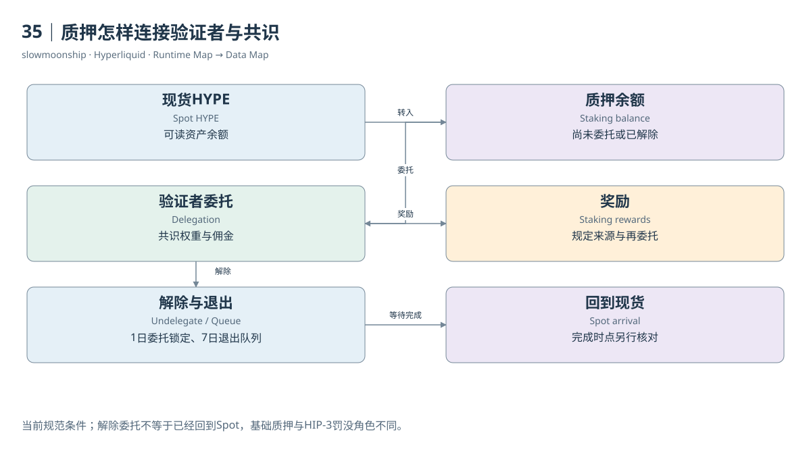

[编辑此图](assets/diagrams/staking.drawio)

证据：[案例12](examples/cases/case-12.md)。

依据：[hypercore__staking](https://hyperliquid.gitbook.io/hyperliquid-docs/hypercore/staking.md)；[validators](https://hyperliquid.gitbook.io/hyperliquid-docs/validators.md)。

[来源目录](research/source_catalog.md) · [目录](SUMMARY.md) · [上一章](book/part-09/34-hip4.md) · [下一章](book/part-09/36-vault.md)

---

# 36｜HLP与Vault的份额和盈亏

你向一个Vault投入资金，后来界面显示价值增加。增加可能来自策略盈利，但存入资金本身也会抬高Vault总权益。判断策略表现，需要区分总资产变化、净出入金和单位份额价值。一个Vault越来越大，不自动表示每位出资人的收益率越来越高。

Vault用自身账户执行交易，出资人通过相应份额参与结果。份额不等于一笔固定本金债权，也不意味着Vault买入的每个资产都直接记在每位出资人的交易账户。研究资金流与交易行为时，应分别观察Vault地址与出资人记录，再用份额关系连接。

教学模拟中，Vault初始权益1000、份额100，单位价值10。策略盈利100后，在份额不变的简化条件下单位价值11。另一个人此时存入110，会增加10份额；总权益变为1210，单位价值仍是11。把110新增入金当策略盈利，会得到明显错误回报。

真实制度还涉及费用、锁定、申赎时点和会计规则，不能用这一模拟替代所有Vault实现。当前协议Vault文档说明HLP最近存款后有四天锁定。锁定中的权益可以随策略变化，但不等于随时可提款。当前状态与当时申赎资格应一起保存。

HLP是协议Vault，提供多种做市策略、参与清算、向Earn供应USDC并取得部分费用。它不是只有一种清算策略，也不只是被动收息账户。策略承受库存价格变化、执行条件和极端市场风险，历史正收益不形成未来固定支付承诺。

本篇实际调用公开HLP地址的`vaultDetails`并保存元数据、权益相关状态与历史呈现。返回名称用于核对所研究的Vault身份，不凭地址记忆直接贴标签。它提供指定观察时点及接口历史片段，没有完整取得所有出资人的存入、份额变化与提款链。

分析Vault PnL时，应检查是否扣除存入和取出，以及统计的是总额还是单位份额。以总权益简单相减，可能主要测到资金募集；以当前出资比例乘历史盈亏，又可能把加入前的收益分给后来出资人。正确归属需要份额生效期间与协议会计规则。

Dune的Perp Position表将HLP及其子Vault视为普通账户，文档不提供完整实体角色标记。看到大量仓位不能自动认定某地址是HLP。Vault身份、子策略关系和资本参与需要外部登记或官方状态证据；交易数据只是其中一层，不是完整组织关系表。

把Vault画成资金、份额、策略仓位、费用与盈亏相互连接的状态模型，就能避免将资金管理活动简化成一条“收益”曲线。读者应能回答钱从哪里来、由谁交易、收益如何计量、何时能够取回。回答这些问题，比展示一个漂亮的历史百分比更接近可核验的金融研究。

<!-- BOOK RESOURCES -->

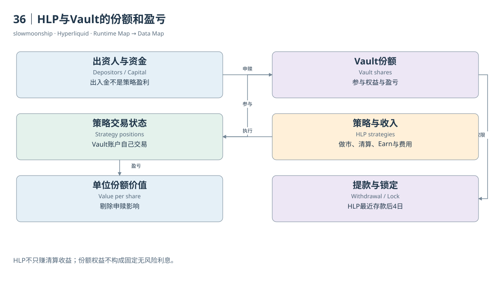

[编辑此图](assets/diagrams/vault.drawio)

证据：[案例11](examples/cases/case-11.md)。

依据：[hypercore__vaults](https://hyperliquid.gitbook.io/hyperliquid-docs/hypercore/vaults.md)；[hypercore__vaults__protocol-vaults](https://hyperliquid.gitbook.io/hyperliquid-docs/hypercore/vaults/protocol-vaults.md)；[trading__fees](https://hyperliquid.gitbook.io/hyperliquid-docs/trading/fees.md)。

[来源目录](research/source_catalog.md) · [目录](SUMMARY.md) · [上一章](book/part-09/35-staking.md) · [下一章](book/part-10/37-data-sources.md)

---

# Part 10｜数据地图与研究方法

# 37｜协议状态怎样进入数据接口

同一笔金融行为可以在节点文件、Info API、WebSocket和Dune中出现不同形态。它们不是四个彼此独立的事实来源，而是从协议执行向外呈现的不同路径。研究开始时，先画运行时地图，再画数据地图，最后找到两张图之间哪些连接已经有实际证据。

Info API适合市场元数据、当前簿和账户状态，也提供有界历史Fill、Funding与Ledger查询。虽然使用POST，明确只读的请求类型仍然是读取。本篇只允许这些类型，没有调用Exchange写接口。响应中保存请求参数、获取时间、业务粒度和原始结果，以便检查实际观察范围。

WebSocket适合实时订阅。BTC与HYPE现货的本篇会话各自最多十二秒、八条消息，取得Trades与L2 Book。簿消息是聚合快照，不应当作逐张订单增量；用户时间序列还可能先发送`isSnapshot`历史快照。重连后重复收到的数据，需要按相应身份与状态处理。

节点可以输出Replica Commands、Trades、Order Status、Raw Book Diffs和Misc Events，也保存周期状态快照。官方路径与JSON样例帮助理解结构，但文档中的示例不是本篇取得的真实节点样本。没有运行节点时，不应把复制的示例标成已下载的Mainnet原始事件。

节点输出结构还因版本和启动选项不同。Trades可将双方信息放在一条记录的`side_info`里，Fills则从用户角度呈现两侧。转换不是简单改列名，它会改变一行对应什么。官方样例中有注释及格式问题，教学JSON需明确规范化来源，不能称作未改动原始返回。

历史归档提供另一路径。官方说明部分Asset Context和L2快照按月上传，可能缺失且不保证及时；节点成交与非交易事件位于另外的目录。S3可能由请求方支付传输费用。本篇只研究目录和格式，没有触发Requester-pays下载，也没有取得全链历史。

HyperEVM RPC提供区块、收据、日志与指定状态读取。默认历史状态能力有限，范围查询也有边界。Explorer可以帮助定位具体业务记录，却不能替代完整事件流；本篇没有取得原始Action，因此订单案例只说明订单状态与Fill的关联，不宣称完整Action验证。

Dune在这些来源上进行索引、解码、规范化和汇总。Curated字段可能分类金融角色、补充元数据或按结算轮次构造状态。表中的美元金额、资金费和OI不应被自动称为原生协议字段。追溯血缘，才知道哪些步骤可能丢失精度、造成延迟或引入研究分类。

选来源可以从问题反推：当前有多少仓位用状态，发生多少成交用事件，订单为何结束用生命周期，过去一秒的簿用快照加完整变化。不同入口都可能有用，但没有一种有限接口天然回答所有历史问题。数据地图的价值，是让每个问题找到对应记录，也让缺口有明确位置。

<!-- BOOK RESOURCES -->

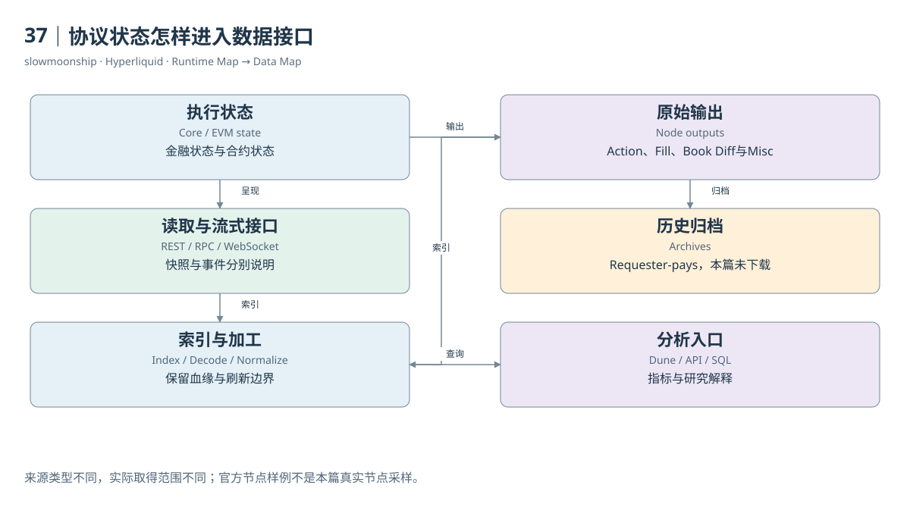

[编辑此图](assets/diagrams/data-sources.drawio)

依据：[for-developers__nodes__l1-data-schemas](https://hyperliquid.gitbook.io/hyperliquid-docs/for-developers/nodes/l1-data-schemas.md)；[historical-data](https://hyperliquid.gitbook.io/hyperliquid-docs/historical-data.md)；[for-developers__api__websocket__subscriptions](https://hyperliquid.gitbook.io/hyperliquid-docs/for-developers/api/websocket/subscriptions.md)。

[来源目录](research/source_catalog.md) · [目录](SUMMARY.md) · [上一章](book/part-09/36-vault.md) · [下一章](book/part-10/38-dune.md)

---

# 38｜Dune表的粒度、覆盖与权限

Dune在2026-07-22宣布加入HyperCore数据，因此“只支持HyperEVM”已经不是当前完整描述。但上线公告与本账户查询权限是两件事。官方说明HyperCore为企业附加数据；Catalog可以展示字段，读者仍需确认工作区授权。看见表名，不能立即宣称已经读到全部数据。

本篇实时取得七张Perp表、五张HIP-4表及八张HyperEVM表的Catalog字段。Perp Oracle表取得官方详细页，但限定Catalog搜索没有返回它，单列文档核验状态。此前运行记录显示Perp数据权限受限；本轮没有执行新增SQL，因此没有重新证明最新读取授权或最新数据时间。

Perp Trades每行是一侧Fill；Market Metrics每行是市场小时或市场日；Positions Hourly每行是账户、市场和资金费轮次；Accounts Daily每行是账户日，没有市场维度。Market Details是当前市场注册视图。这些粒度决定怎样Join，尤其不能给账户日表凭空增加coin再与所有市场连接。

官方覆盖说明，Perp成交从2025-07-27，OI与Funding从2025-09-27，历史簿从2026-06-29开始。第一方价格文档可追溯更早，HIP-3价格有另一覆盖起点。这些是来源声明，具体最早和最新行仍需运行核对。缺失OI的早期交易日不能默认填零。

分区过滤也各不同。Trades与Accounts按`block_date`裁剪；小时和日市场指标按`block_month`；Positions还需要`trader_prefix`；Book用`block_date`。只写coin等业务过滤不一定减少扫描。静态SQL应同时限定分区和事件时间，避免小问题读取整段历史。

当前分类使用coin保留DEX前缀，market_symbol可能碰撞。Details还提供资产类别等加工字段，属于当前分类，不是所有历史时点的原生产品定义。已下架市场可以保留注册行，新上市市场却可能暂时领先轮询注册表；左连接及未匹配检查有助于暴露这种时差。

HIP-4使用独立`hip4_hyperliquid`命名空间，不属于Perp表。其全量腿包含普通交易以及Split、Merge、Negate、Settlement等状态变化。Dune官方文档给出2026-05-02历史起点，Catalog验证五表结构；当前本账户能否读结果没有新增执行证据，不从public可见性推断授权。

作者现有看板主要研究HyperEVM与Core接口。本篇取回十二个已有Query原SQL和两个旧Result，保留原运行日期及窗口。旧结果中的调用量证明那段历史观察，不是2026-10-13的新统计。新SQL标为静态审查，不能借旧看板通过状态替自己声明已运行。

每张表的说明卡应同时写来源、粒度、单位、覆盖、刷新、分区、权限和不适用问题。数据库名字解决“去哪里找”，这些说明解决“找到之后能说什么”。将资料核验与运行验证分级，读者便能复用SQL，也能清楚知道当前仍需哪些外部检查。

Refresh说明也不是数据完整性的证明。已结束小时仍可能尚未摄入资金费轮次；最新价格还可能因上游归档延迟落后数周。正式结果应检查最大业务时间、缺失比例和构建时间，并把这些与预期延迟一起报告。

<!-- BOOK RESOURCES -->

[编辑此图](assets/diagrams/dune.drawio)

数据练习：[SQL01](examples/sql/01-markets.sql) · [SQL18](examples/sql/18-kpi-and-quality.sql)（静态审查，未执行）。

依据：[dune-perps](https://docs.dune.com/data-catalog/curated/perpetuals/hyperliquid/overview.md)；[dune-hip4](https://docs.dune.com/data-catalog/curated/prediction-markets/hip4/overview.md)；[dune-hyperevm](https://docs.dune.com/data-catalog/evm/hyperevm/overview.md)。

[来源目录](research/source_catalog.md) · [目录](SUMMARY.md) · [上一章](book/part-10/37-data-sources.md) · [下一章](book/part-10/39-sql.md)

---

# 39｜把金融问题写成可审查的SQL

“昨天BTC有多少交易量”看起来只需要SUM，实际先要回答四个问题：BTC是哪个市场，昨天按什么时区，一行是成交还是Fill，金额是否包含强制或行政行为。将问题改写成这些可检查条件，SQL才会成为研究方法，而不是只会返回数字的代码。

市场清单从Market Details开始，保留coin、DEX、Asset ID和风险参数。成交层SQL按完整coin筛选，限定UTC完整日，按Taker侧计算每笔匹配一次。若研究自愿交易，再选择相应Fill Role；若采用Metrics的总量，应明确其文档包含的行政或强制成分。

账户参与量则保留该账户所有正常两侧角色，不能为了市场去重而删掉Maker。案例03的Maker在平空且有返佣，删除它会漏掉真实用户行为。相同的`is_taker`条件，在市场指标里可能必要，在账户指标里却会改变问题。过滤规则应跟随统计对象。

订单SQL按账户、coin与oid聚合已发生Fill，可以计算执行数量与加权价格。它只能描述至少有一次成交的订单。未成交、取消与拒绝需要额外生命周期表；成交表中的不同oid数不能直接叫下单次数。静态审查不仅检查字段存在，也要检查指标名是否超出数据。

OI SQL保留指定小时的来源双边量，必要时另列按文档换算的经典单边量，不跨时间相加。与Volume比较时，先把成交聚合到同一小时，再一对一连接。不能将一个小时OI连接到每条Fill后求和，否则站立仓位会按成交行数被复制。

资金费SQL将Rate与Payment分别输出。用户金额直接使用已结算字段，支付方为负、收到为正；市场支付总量采用其独立正值口径。清算SQL按角色与事件身份统计，不把两腿都作为两个被清算人。费用SQL还必须处理返佣负数与分配字段重叠。

订单簿SQL从数组展开买卖价档，先转换十进制字符串，按同一快照计算Spread与价格带深度。买卖数组不要在同一行直接双重展开形成笛卡尔积。价格Join则需要coin与有界时间对齐，保留原始更新时间及陈旧程度，避免没有历史价格时静默用今天价格。

HyperEVM练习分别统计交易、日志与Trace，系统交互只命名为接口调用。HIP-4练习先选择正常trade和Taker，再与市场定义连接；铸造、销毁及结算另行分析。本地SQL包提供十八个主题，所有新增语句静态检查，没有Dune服务端执行结果。

SQL审查最后可以用一张清单闭环：表与列有来源，输入粒度已定义，时间与分区受限，Join不会重复，金额单位可解释，输出名称没有夸大，执行状态真实。它把金融问题与数据地图接起来，让一个数字既能够计算，也能够被另一个读者追溯和质疑。

如果静态检查发现字段只有文档依据而没有当前Catalog返回，应把该区别保留在SQL说明中，等待运行验证。

<!-- BOOK RESOURCES -->

[编辑此图](assets/diagrams/sql.drawio)

数据练习：[SQL01](examples/sql/01-markets.sql) · [SQL02](examples/sql/02-volume.sql) · [SQL03](examples/sql/03-maker-taker.sql) · [SQL04](examples/sql/04-hourly-flow.sql) · [SQL05](examples/sql/05-open-interest.sql) · [SQL06](examples/sql/06-flow-stock.sql) · [SQL07](examples/sql/07-funding-rates.sql) · [SQL08](examples/sql/08-user-funding.sql) · [SQL09](examples/sql/09-liquidation.sql) · [SQL10](examples/sql/10-depth.sql) · [SQL11](examples/sql/11-spread.sql) · [SQL12](examples/sql/12-hip3-classification.sql) · [SQL13](examples/sql/13-first-hip3.sql) · [SQL14](examples/sql/14-evm-transactions.sql) · [SQL15](examples/sql/15-core-interfaces.sql) · [SQL16](examples/sql/16-outcome-volume.sql) · [SQL17](examples/sql/17-trade-book-join.sql) · [SQL18](examples/sql/18-kpi-and-quality.sql)（静态审查，未执行）。

依据：[dune-perp-trades](https://docs.dune.com/data-catalog/curated/perpetuals/hyperliquid/perp-trades.md)；[dune-perp-market-metrics-hourly](https://docs.dune.com/data-catalog/curated/perpetuals/hyperliquid/perp-market-metrics-hourly.md)；[dune-perp-orderbook-1m](https://docs.dune.com/data-catalog/curated/perpetuals/hyperliquid/perp-orderbook-1m.md)；[dune-hip4](https://docs.dune.com/data-catalog/curated/prediction-markets/hip4/overview.md)。

[来源目录](research/source_catalog.md) · [目录](SUMMARY.md) · [上一章](book/part-10/38-dune.md) · [下一章](book/part-10/40-reconstruction.md)

---

# 40｜重建历史状态并解释研究边界

取得今天订单簿，不等于知道昨天每一秒有哪些订单；取得全部成交，也不自动知道哪些挂单曾经撤回。当前状态、历史事件和历史状态重建是三种任务。它们可以连接，但需要不同输入。一本数据书的最后一步，是让读者知道哪些问题能直接回答，哪些需要算法和额外证据。

重建订单簿通常需要可信起始快照、覆盖完整的增量、正确排序和明确变更语义。新增订单、修改数量和移除订单必须按相应身份应用。只有成交记录，会漏掉未成交新单与撤单；只比较两个快照，无法补出期间所有事件。线性插值更不能创造真实订单历史。

WebSocket的L2 Book在本篇规范下是聚合快照，不是逐张订单Diff。节点Raw Book Diff才表达另一类变化。重连必须先明确订阅类型，不能把新的完整快照继续叠加到旧簿上。记录断线、重连与最后完整时点，有助于将“没有观察”与“市场没有变化”区分开。

Dune一分钟Book文档有更具体的模型保证：其事件驱动系列缺少某分钟表示簿未变，可按该模型向前延续。这项保证适用于该经过加工的来源及其覆盖，不应泛化为所有WebSocket缺失分钟都是无变化。实际使用仍需检查边界、取样时间和模型版本。

持仓重建也需要前态和完整状态变化。Fill给出局部增减，Funding轮次快照给出站立仓位；某段只取得部分账户Fill时，无法重建全市场OI。Dune称其现有Fill覆盖不能补出早期OI，描述的是该数据集缺失站立状态的边界，不意味着数学上任何完整状态重放都不可能。

保证金历史比持仓更复杂，还需要当时账户模式、资金、所有相关仓位、价格与风险参数。Portfolio还包括借款、供给和折算。把最新快照退回到过去，或只用静态杠杆算一条清算线，应标作近似情景，不能冒充直接观察的历史风险状态。

可靠分析可以将结论标为Directly Observed、Reconstructed、Approximate、Incomplete或Unknown。重建结果应保留输入版本、算法、缺失窗口和与后续快照的校验差异。没有足够资料时，Unknown是一项准确结果；随意填零或平滑会使后续指标失去可验证基础。

综合看板也应保留不同对象：成交量是流量，OI是存量，Funding是持仓现金流，净入金是指定范围资金移动，清算量是强制风险转移，EVM调用量是程序执行活动。它们可以共同解释市场，却不能揉成一个所谓总活跃度，更不能单靠其中一项推断现实用户或资本归属。

回到全篇的两张地图：运行时说明意图怎样进入订单簿、形成成交并改变金融状态；数据地图说明这些过程怎样被接口与索引呈现。把两张图连接起来，读者就能提出准确问题、选择合适记录、建立有界SQL，并让研究结论始终保留来源、单位、时间和可检验的范围。

<!-- BOOK RESOURCES -->

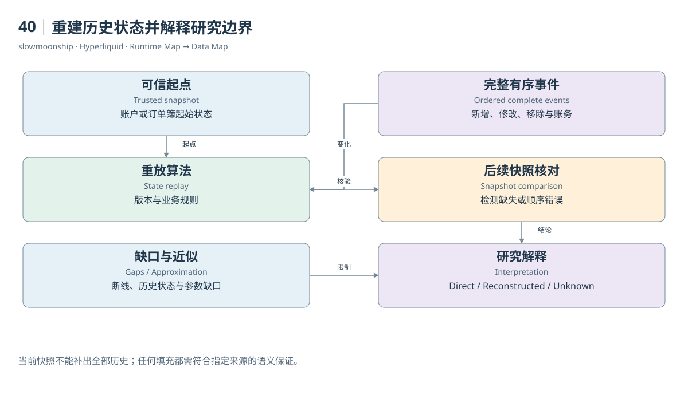

[编辑此图](assets/diagrams/reconstruction.drawio)

数据练习：[SQL17](examples/sql/17-trade-book-join.sql) · [SQL18](examples/sql/18-kpi-and-quality.sql)（静态审查，未执行）。

依据：[for-developers__nodes__l1-data-schemas](https://hyperliquid.gitbook.io/hyperliquid-docs/for-developers/nodes/l1-data-schemas.md)；[dune-perp-orderbook-1m](https://docs.dune.com/data-catalog/curated/perpetuals/hyperliquid/perp-orderbook-1m.md)；[for-developers__api__websocket__subscriptions](https://hyperliquid.gitbook.io/hyperliquid-docs/for-developers/api/websocket/subscriptions.md)。

[来源目录](research/source_catalog.md) · [目录](SUMMARY.md) · [上一章](book/part-10/39-sql.md)

---

# 附录A｜术语表

| 中文 / English | 本篇含义 |
|---|---|
| 一层链 / Layer 1 | 具有自身共识与状态执行的网络 |
| HyperBFT | 受HotStuff家族启发的共识，不能与EVM执行互换 |
| 验证者 / Validator | 参与提议与确认，权重依质押规则 |
| 法定权重集合 / Quorum | 当前官方质押规范中的超过三分之二质押权重集合 |
| 轮次 / Round | 共识推进单位，不等于EVM区块编号 |
| 执行高度 / Height | L1执行区块的编号体系 |
| 最终性 / Finality | 在协议安全假设下已提交历史不由正常共识改写 |
| HyperCore | 原生金融执行，包括簿、撮合与风险状态 |
| HyperEVM | 同一L1中的通用EVM合约环境 |
| 状态转换 / State transition | 依规则从前态计算后态 |
| 操作 / Action | 进入协议的用户或系统操作 |
| 订单 / Order | 限定方向、数量、价格与执行条件的交易意图 |
| 订单编号 / oid | 订单业务身份，跨来源仍需核对范围 |
| 客户端编号 / cloid | 用户追踪订单的编号，不是经济成交身份 |
| 成交 / Trade | 撮合形成的经济事件 |
| 用户成交腿 / Fill leg | 某一参与账户的成交记录 |
| 成交标识 / tid | 官方WS建议结合coin与事件时间使用，不单独宣称全局唯一 |
| 买盘 / Bid | 等待买入的意图 |
| 卖盘 / Ask | 等待卖出的意图 |
| 最优价 / Best bid / ask | 当前最有利的买卖等待价格 |
| 点差 / Spread | 指定最优买卖价格之间的距离 |
| 深度 / Depth | 指定价格范围内的等待数量或名义金额 |
| 中价 / Mid | 最优买卖价平均，不保证可成交 |
| 数量精度 / Lot size | 允许的订单数量步长或最小可交易数量 |
| 价格约束 / Tick rules | 价格有效数字与小数位规则 |
| 等待侧 / Maker | 提供等待流动性的成交角色 |
| 主动侧 / Taker | 与等待流动性相遇的角色 |
| GTC | 合规未成交余量可继续等待 |
| IOC | 立即成交后终止余量 |
| ALO / Post-only | 只挂单意图，不按普通跨簿路径立即吃单 |
| 部分成交 / Partial fill | 一张订单的一部分被执行 |
| 撤单 / Cancel | 终止未执行意图，不删除已发生历史 |
| 触发订单 / Trigger order | 条件满足后进入相应执行路径 |
| TWAP | 随时间切片的执行计划；父、子订单、Fill分别统计 |
| 只减仓 / Reduce-only | 限制不得按规则增加敞口 |
| 基础资产 / Underlying | 合约参考的价格对象，不自动交付所有权 |
| 永续 / Perpetual | 无普通到期日的合约，仍可能停止与行政结算 |
| 多头 / Long | 有符号仓位为正的价格敞口 |
| 空头 / Short | 有符号仓位为负的价格敞口 |
| 反手 / Position flip | 成交跨过零仓位并建立另一方向 |
| 名义价值 / Notional | 数量按指定价格估值，不等于现金本金 |
| 入场价 / Entry price | 持仓会计参考，可能由多次成交形成 |
| 未实现盈亏 / Unrealized PnL | 未平部分按指定价格估值的结果 |
| 已实现盈亏 / Realized PnL | 关闭部分的会计结果，不包含所有账户现金流 |
| 未平仓量 / Open interest | 时点站立敞口，必须声明单双边与估值规则 |
| 全仓 / Cross margin | 适用集合共享抵押与权益 |
| 逐仓 / Isolated margin | 指定仓位及资金与其他范围隔离 |
| 严格逐仓 / Strict isolated | 还具有保证金移除限制 |
| 初始保证金 / Initial margin | 开仓及相应维持操作的资金要求 |
| 维持保证金 / Maintenance margin | 持仓继续满足的风险底线 |
| 权益 / Equity | 风险账户价值，不同模式有不同范围 |
| 标记价 / Mark price | 风险与未实现盈亏的估值参考 |
| 预言机价 / Oracle price | 规定的参考价格，资金费使用其名义估值 |
| 冲击价 / Impact price | 规定规模穿过订单簿的平均执行价格 |
| 市场清算 / Market liquidation | 风险触发后尝试在簿上处置 |
| 后备接管 / Backstop liquidation | 接管适用仓位与资金的风险路径 |
| 自动减仓 / ADL | 在适用条件下强制减少盈利对手方敞口 |
| 资金费率 / Funding rate | 无量纲结算率，区别预测、当前与历史 |
| 资金费用 / Funding payment | 真实持仓结算现金流，不计作普通成交 |
| 返佣 / Maker rebate | 指定Fill负费用，不自动代表整体交易盈利 |
| 部署者费用 / Deployer fee | 市场运营相关费用分配，检查是否已包含 |
| Builder code | 应用入口费用相关标识，区别HIP-3市场部署者 |
| HIP-1 | Core原生有上限供应Token与Spot结构 |
| HIP-2 | 在共同订单簿上执行的协议流动性策略 |
| HIP-3 | 部署者建立的Perp DEX与市场 |
| HIP-4 | 全额抵押、有界结果支付的Outcome原语 |
| 现货 / Spot | 实际Token数量交换，区别永续敞口 |
| Token Index | 资产编号，区别Pair Index |
| Spot Pair Index | 基础与报价资产订单簿编号 |
| Asset ID | Action的产品编码，按不同类别使用不同编号域 |
| Wei Decimals | 原始整数与可读Token数量的缩放精度 |
| Size Decimals | 市场订单数量允许的小数精度 |
| Outcome | 一个有结果支付规则的市场及两侧Token |
| Question | 互斥Outcome集合，按定义恰有一个Yes |
| Settle fraction | Yes对应的报价支付比例，No为其补数 |
| Read Precompile | 从EVM读取指定Core状态的协议接口 |
| CoreWriter | EVM表达Core后续操作的系统入口 |
| 系统交易 / System transaction | 与Core交互相关的特殊EVM处理记录 |
| Vault | 自身执行策略、出资人通过份额参与的账户结构 |
| HLP | 多策略协议Vault，不是固定收益产品 |
| 委托 / Delegation | 将HYPE质押权重关联到验证者 |
| 退出队列 / Unstaking queue | 从Staking退回Spot的等待状态 |
| 粒度 / Grain | 数据一行对应的业务对象 |
| 快照 / Snapshot | 一个观察时点的状态 |
| 增量 / Delta | 指定语义的状态变化，不能与完整快照混用 |
| 血缘 / Lineage | 原始输入、加工与指标之间的来源链 |
| Curated | 经过规范化、分类或汇总的数据 |

完整版本边界与来源见[附录D](book/appendix/hip-standards.md)及[附录E](book/appendix/references.md)。

---

# 附录B｜市场与资产身份

| 编号域 | 构造 / 来源 | 不能混用 |
|---|---|---|
| 第一方Perp Asset | 对应网络meta中的市场索引 | 不是Token Index |
| HIP-3 Perp Asset | 100000 + dex_index × 10000 + index_in_meta | 不按裸Symbol猜索引 |
| Spot Token | spotMeta.tokens显式index及tokenId | 不等于Pair Index |
| Spot Pair | spotMeta.universe中的index及tokens顺序 | 不按数组位置替代字段 |
| Spot Action Asset | 10000 + Pair Index | 不使用Token Index代入 |
| Outcome encoding | 10 × outcome + side，side为0或1 | 与Spot Pair不同编号域 |
| Outcome coin / Token | `#encoding` / `+encoding` | 不是Perp coin |
| Outcome Action Asset | 100000000 + encoding | 独立产品编码 |
| HyperEVM Mainnet / Testnet | Chain ID 999 / 998 | 不是Core DEX或Asset |
| EVM Token | 网络与具体合约地址；HYPE为原生余额 | 同名Ticker不能代替链接证据 |

实际HYPE案例：Token Index150，Pair Index107，tokens为[150,0]，Spot Action Asset10107。当前精度weiDecimals8、szDecimals2。接口原始返回见[案例06](examples/cases/case-06.md)。

实际XYZ市场：完整coin为xyz:TSLA，DEX来自perpDexs，市场索引来自对应Meta；编号推导与原返回见[案例09](examples/cases/case-09.md)。它是价格关联永续，不交付股票。

推荐身份键：网络 + 产品类别 + 完整原生市场标识；注册表另外保存DEX、Asset ID、基础/报价Token、抵押、Oracle及观察版本。Dune市场连接使用coin，market_symbol可能跨DEX碰撞。当前注册快照不自动提供全部历史参数。

订单键、成交键和账务键分别记录。官方WS对tid建议结合coin与事件时间使用；oid与cloid识别订单；全零hash不能作为唯一去重键。EVM哈希与Core业务hash没有天然一对一连接。

来源：[Asset IDs](https://hyperliquid.gitbook.io/hyperliquid-docs/for-developers/api/asset-ids)、[Spot Info](https://hyperliquid.gitbook.io/hyperliquid-docs/for-developers/api/info-endpoint/spot)、[WS数据类型](https://hyperliquid.gitbook.io/hyperliquid-docs/for-developers/api/websocket/subscriptions)。基准2026-10-13。

---

# 附录C｜数据表索引

[逐表字段与限制](research/data_table_cards.md) · [当前Catalog JSON](research/dune/verified-schema.json)。

| 表 | 粒度 | 适用范围 |
|---|---|---|
| `hip4_hyperliquid.open_interest_hourly` | Outcome market × hour | Outcome |
| `hip4_hyperliquid.positions_daily` | account × outcome token × day | Outcome |
| `hip4_hyperliquid.ohlcv_hourly` | Outcome token × hour | Outcome |
| `hip4_hyperliquid.market_details` | Outcome market_id一行，Question为event维度 | Outcome |
| `hip4_hyperliquid.market_trades` | 全量Outcome腿，含引擎操作 | Outcome |
| `hyperliquid.perp_trades` | 账户成交腿；非经济撮合一行 | Perps |
| `hyperliquid.perp_market_details` | 当前注册市场coin一行 | Perps |
| `hyperliquid.perp_positions_hourly` | trader × coin × funding hour | Perps |
| `hyperliquid.perp_accounts_daily` | trader × UTC day，无市场维度 | Perps |
| `hyperliquid.perp_market_metrics_daily` | coin × UTC day，OI为日末 | Perps |
| `hyperliquid.perp_orderbook_1m` | coin × minute，稀疏L2聚合快照 | Perps |
| `hyperliquid.perp_market_metrics_hourly` | coin × hour，流量与结算存量并列 | Perps |
| `hyperevm.logs` | EVM transaction log | EVM |
| `hyperevm.transactions` | EVM user transaction | EVM |
| `hyperevm.traces` | EVM call frame | EVM |
| `hyperevm.creation_traces` | EVM creation frame | EVM |
| `hyperevm.blocks` | EVM block | EVM |
| `hyperevm.contracts` | indexed contract metadata | EVM |
| `hyperevm.logs_decoded` | ABI decoded log | EVM |
| `hyperevm.traces_decoded` | ABI decoded call | EVM |

Oracle表为文档核验，未由本轮Catalog返回。Perp官方覆盖：成交2025-07-27；OI/Funding2025-09-27；Book2026-06-29；HIP-4文档覆盖2026-05-02。实际首尾行、缺失和权限尚未运行验证。

---

# 附录D｜HIP与版本边界

| 原语 | 改变的对象 | 本篇核验 | 边界 |
|---|---|---|---|
| HIP-1 | 原生Token、精度、供应及Spot身份 | 官方规范与实际HYPE Meta | 旧USDC-only文字不能替代当前Quote规则 |
| HIP-2 | 协议流动性策略与共同订单簿 | 正式规范 | 指定策略真实状态链未取得 |
| HIP-3 | 部署者Perp DEX、Oracle、风险与管理 | 当前规范、XYZ实际Meta | 当前Cross能力不能按早期isolated-only理解 |
| HIP-4 | 全额抵押、结果解析与支付 | 当前规范、327 Outcome/35 Question快照、历史Outcome95 | 主网市场存在不证明任意市场创建权限 |

HIP-3当前规范涉及符合资格的Cross、DEX独立后备与用户模式相关共享。HIP-4部署者接口仍标注Testnet-only。初始Mainnet范围与今天API市场集合不是同一时间描述。

几处来源差异必须保留：HyperEVM介绍页保留写系统未主网上线文字，交互规范已扩展操作，实际Mainnet读取0807和CoreWriter代码成功；HIP-4介绍页保留初始零费用，费用页描述收费机制；HIP-1基础页保留USDC主导的旧范围，Quote规范与HIP-3抵押规则已扩展；Dune概览称无Trace，Catalog及作者旧结果可见Trace。

这些差异不能靠任意选择一页消除。本篇对具体API实际观察负责；未调用的操作、权限和完整最新数据范围仍留待外部验证。[版本事实表](research/protocol_timeline.md)记录对应来源与观察。

---

# 附录E｜来源与证据等级

[完整来源目录](research/source_catalog.md) · [协议版本记录](research/protocol_timeline.md) · [案例证据](research/evidence_index.md)。

| 等级 | 含义 | 本篇使用方式 |
|---|---|---|
| 1 | 协议事件证据 | API呈现的真实成交、账务与结算；非独立共识重放 |
| 2 | 状态与快照 | Book、账户、市场Meta、Vault状态，保留时点 |
| 3 | 索引或Curated | Dune Catalog、已有SQL与旧结果，保留血缘 |
| 4 | 重建状态 | 仅指定Fill的局部前后态推导；未全链重建 |
| 5 | 研究解释 | 口径转换、情景与推论均说明前提 |

正文模拟小簿与Alice/Bob例子均明确模拟，不列为真实案例。来源为官方Hyperliquid文档、官方Dune文档与已有Query；金融原理使用独立解释，无大段翻译或转载。

资料获取、静态审查与运行验证分级。已取得页面可能保留旧文字，实时API也不能证明所有产品权限。外部独立技术评审尚未进行。

---

