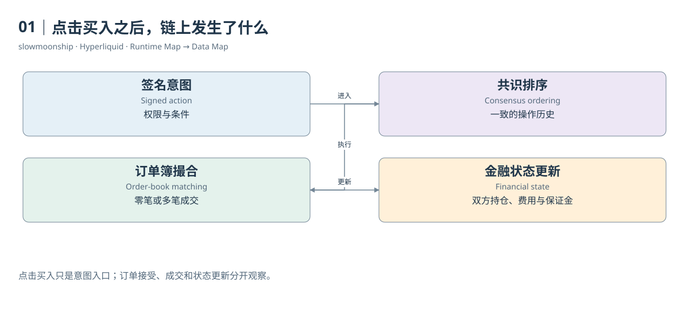

# 01｜点击买入之后，链上发生了什么

你准备买入一小笔BTC永续合约。页面上有价格、数量和买入按钮，操作看起来与中心化交易所差不多。但按钮不是成交事实，它首先表达一项意图：你愿意在什么条件下买入多少。网络还需要检查权限、决定处理顺序、寻找对手方，才可能改变你的持仓。

在传统交易所里，这些步骤由交易所服务器和内部数据库完成。用户通常只能看见交易所愿意提供的账户记录。Hyperliquid将订单簿和金融账户的核心状态放进自己的Layer 1。验证者就这些状态的演变达成一致；某台前端服务器的显示结果，不能独自替代协议已经接受的执行结果。

入口是一项Action，即用户签名的操作。下单是一种Action，撤单、调整账户设置或转移资产也有各自的类型。签名让系统验证操作权限，不能保证业务上必然成功。价格格式不合法、余额不足或其他约束不满足时，一项通过身份检查的请求仍然可能被拒绝。

系统接受订单后，HyperCore执行撮合。假设你提交限价买单，而卖盘已有符合价格条件的挂单，订单可能立即吃掉这些数量。如果价格还没有遇到对手方，允许继续挂单的订单可以留在簿上等待。把“请求被接受”解释成“已经买到”，会把意图、等待状态与成交混成一件事。

发生撮合时，系统记录成交价格与数量，并更新买卖双方的金融状态。永续合约还需要检查持仓和保证金，扣收手续费或给予返佣。你没有收到现货BTC，而是取得或减少与BTC价格相关的合约敞口。账户变化需要比一次代币转账更丰富的状态表示。

链上共识解决的是这些操作及状态变化如何形成一致的历史。订单簿回答谁愿意以什么价格交易；撮合规则回答哪两项意图能够相遇；Clearinghouse负责持仓和风险账户。这些职责相互联系，却不应画成一个叫“交易”的黑箱。后面每章会逐个打开其中一层。

本篇真实案例03提供了一个很有帮助的观察：同一笔BTC撮合，买方Fill写着Close Short，卖方Fill写着Close Long。双方都在减少原有敞口。页面上的买和卖，是成交方向；开仓和平仓，是对各自原有状态的改变。这两套语言从第一笔交易开始就应该分开。

数据分析可以按同样顺序追问：取得了Action还是订单状态？取得了一个经济成交还是某个用户的Fill？状态是成交前、成交后，还是更晚查询得到的快照？只有回答这些问题，价格、数量和余额才能组成一段有证据的交易过程。

因此，本篇的起点并不是代币价格，也不是如何选择杠杆。它是一条简单的因果链：用户表达意图，网络排列操作，执行环境改变状态，数据接口呈现不同侧面的记录。点击按钮只是入口；把这条链条连接起来，才是理解链上交易系统的开始。

<!-- BOOK RESOURCES -->

[编辑此图](../../assets/diagrams/click.drawio)

证据：[案例03](../../examples/cases/case-03.md)。

依据：[about-hyperliquid](https://hyperliquid.gitbook.io/hyperliquid-docs/about-hyperliquid.md)；[hypercore__overview](https://hyperliquid.gitbook.io/hyperliquid-docs/hypercore/overview.md)。

[来源目录](../../research/source_catalog.md) · [目录](../../SUMMARY.md) · [下一章](../../book/part-01/02-consensus.md)

[上一章](../00-preface.md)
