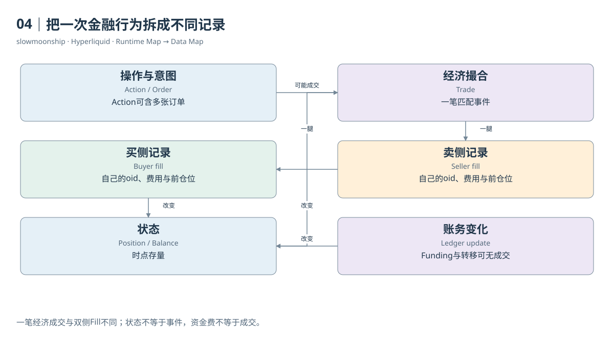

# 04｜把一次金融行为拆成不同记录

一位分析师拿到一张表，发现每行都有价格、数量和时间，于是把行数叫作交易次数。问题在于，这张表可能是一侧用户的Fill，也可能是一笔撮合，也可能是订单更新。看起来相似的字段，不能替代行粒度的定义。先问一行代表什么，比先写SUM更重要。

Action是进入系统的操作。Order是交易意图及其业务身份。一个批量下单Action可以包含多张订单；一张订单也会经历接受、挂单、部分成交和终止等变化。订单更新是这些变化的记录，不是每次更新都发生了一笔经济成交。

Trade通常指一次撮合形成的经济成交。Fill从某个参与账户的角度记录成交结果。因此，一笔Trade可以对应买卖两侧的Fill。这两行有各自的订单编号、手续费和持仓变化。把两行数量与价格乘积相加，会把同一市场成交的名义金额放大。

本篇案例03中，一笔BTC成交数量为0.00012，价格为83592。经济名义金额是10.03104个报价单位。买侧和卖侧各有一条相同价格、数量、时间与Trade ID的Fill，双侧直接相加会得到20.06208。两个参与账户各自交易了10.03104，与市场只撮合一次并不冲突。

Position是持仓状态。它记录账户在一个市场当前有多少净敞口，而不是已经交易过多少。Balance或Ledger Update描述资金和资产状态及其变化。资金费、转移资产和费用都可能改变账户，但不一定产生一笔普通交易。不同记录解决不同的业务问题。

标识符也各有范围。订单编号oid识别订单，客户端编号cloid用于用户自行追踪，tid关联成交。官方WebSocket规范说明，tid来自买卖订单编号的五十位哈希，建议用事件时间、coin与tid组合形成全局成交键。仅凭tid或毫秒时间，不应假定跨全部市场绝对唯一。

哈希字段尤其容易被误读。API Fill的hash与EVM交易哈希属于不同记录体系；某些返回还使用全零哈希。案例资金费记录就出现这种值。不能把全零哈希当成有效交易的唯一身份，也不能拿Core Fill hash直接连接EVM交易表，期待找到一一对应的收据。

当一项查询同时涉及多张表时，应该先画出连接关系。订单到Fill通常是一对多；Trade到双侧Fill也是一对多；小时市场指标到该小时所有成交则是一对多。先连接再汇总，如果忘记右侧有多行，左侧的OI或资金费就会被重复复制。

一份清楚的研究说明，应给每张输入表写一句粒度定义，并为指标指定统计对象：市场成交、账户参与、订单、持仓快照还是资金流。这样即使字段名都叫size或amount，读者仍能知道它们在说什么。金融行为复杂，可靠的数据建模从保存这些区别开始。

保留原始记录身份，也让后续汇总可以回到每一行。一个无法追溯到输入范围的总数，即使计算没有语法错误，也很难审查。

<!-- BOOK RESOURCES -->

[编辑此图](../../assets/diagrams/records.drawio)

证据：[案例03](../../examples/cases/case-03.md) · [案例13](../../examples/cases/case-13.md)。

依据：[for-developers__nodes__l1-data-schemas](https://hyperliquid.gitbook.io/hyperliquid-docs/for-developers/nodes/l1-data-schemas.md)；[for-developers__api__websocket__subscriptions](https://hyperliquid.gitbook.io/hyperliquid-docs/for-developers/api/websocket/subscriptions.md)；[dune-perp-trades](https://docs.dune.com/data-catalog/curated/perpetuals/hyperliquid/perp-trades.md)。

[来源目录](../../research/source_catalog.md) · [目录](../../SUMMARY.md) · [上一章](../../book/part-01/03-runtime.md) · [下一章](../../book/part-02/05-accounts.md)
