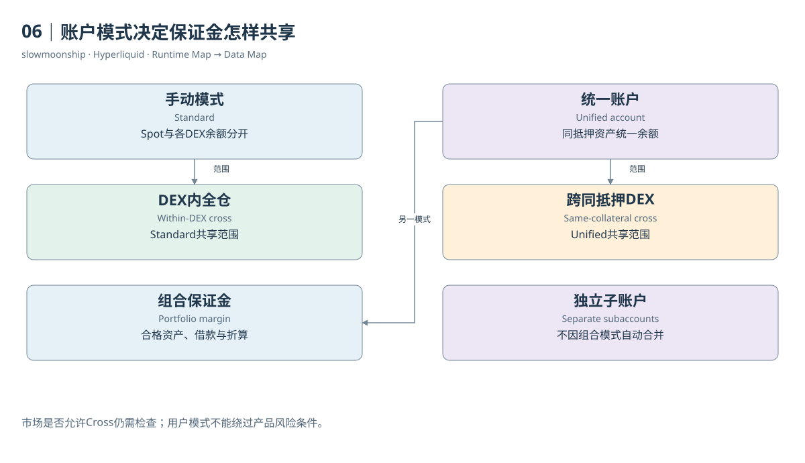

# 06｜账户模式决定保证金怎样共享

同一个人，在两个Perp DEX都有USDC计价仓位。这两笔仓位能否共享保证金？答案不能只看抵押品同名。Hyperliquid的账户抽象模式决定Spot与Perps如何连接、不同DEX之间怎样使用资金。旧版本中“每个DEX永远独立”的说法，不能覆盖当前全部账户模式。

Standard或Manual模式保留现货与永续分类余额，也保留不同DEX的余额。Cross Margin在各自DEX内部作用。好处是状态边界清楚，适合需要显式控制资金分配的账户；分析时也必须分别读取各DEX，不能把一个DEX的余额直接当作另一个DEX的可用抵押。

Unified Account按资产统一余额。同一抵押资产支持的全仓仓位可以共享这一资产的保证金，同时与该资产Spot余额连接。官方以USDC支持第一方与XYZ等市场、USDT支持相应USDT市场为例。共享基于抵押资产及模式规则，不是所有不同代币都能按一比一互换。

Portfolio Margin进一步将符合资格的资产纳入组合。用户的Spot资产、永续盈亏和借入资产共同参与风险计算。文档目前列出HYPE、BTC、USDC、USDT等适用资产，并规定准入、供给和借款上限。它既扩大抵押能力，也引入借款利息与额外清算维度。

可以用教学模拟理解差别：账户有一单位BTC现货和一单位BTC永续空仓。价格变化让现货价值与空仓盈亏方向相反。在组合规则允许的范围内，这种关系可以影响风险计算。它并不消除资金费、借款成本、价差、额度限制或基础资产变动带来的风险。

账户模式会改变API的解释方式。官方说明，Unified与Portfolio模式的余额和占用在Spot Clearinghouse State呈现，单独DEX用户余额状态不能按Standard方式理解。研究者应先读取`userAbstraction`，再选择账户汇总路径。拿到JSON结构相似的响应，并不意味着业务语义相同。

市场层的Margin Mode则是另一维度。一个HIP-3资产可能允许全仓、仅逐仓，或采用严格逐仓规则。用户选择了统一账户，也不能无条件绕过市场自身限制。判断保证金共享，应同时保存用户模式、DEX抵押资产和每个市场的保证金能力，而不是只保存一个cross布尔值。

清算监控也随模式变化。普通全仓检查某个保证金集合；统一账户还需要按抵押代币组织维持保证金需求；组合保证金要处理借款与资产折算。组合文档甚至说明，永续与现货借款的清算先后可能受价格更新顺序影响。将所有模式塞进单一杠杆公式，无法得到可靠风险值。

本篇不将复杂模式压缩成一句“更省钱”。对于数据分析，真正重要的是状态范围发生了变化：哪些余额可以担保哪些仓位，哪些借款加入负债，哪些账户仍然分离。先确定这一范围，再谈账户价值、可用保证金和清算，计算才有明确的对象。

<!-- BOOK RESOURCES -->

[编辑此图](../../assets/diagrams/abstraction.drawio)

实际状态：[账户模式](../../examples/api/22-abstraction.json)、[永续账户](../../examples/api/18-account.json)、[现货账户](../../examples/api/19-spot-account.json)、[BTC市场上下文](../../examples/api/01-meta-context.json)。字段含义见[教学卡](../../research/api-field-guide.md)。

依据：[trading__account-abstraction-modes](https://hyperliquid.gitbook.io/hyperliquid-docs/trading/account-abstraction-modes.md)；[trading__margining](https://hyperliquid.gitbook.io/hyperliquid-docs/trading/margining.md)；[trading__portfolio-margin](https://hyperliquid.gitbook.io/hyperliquid-docs/trading/portfolio-margin.md)。

[来源目录](../../research/source_catalog.md) · [目录](../../SUMMARY.md) · [上一章](../../book/part-02/05-accounts.md) · [下一章](../../book/part-02/07-identities.md)
