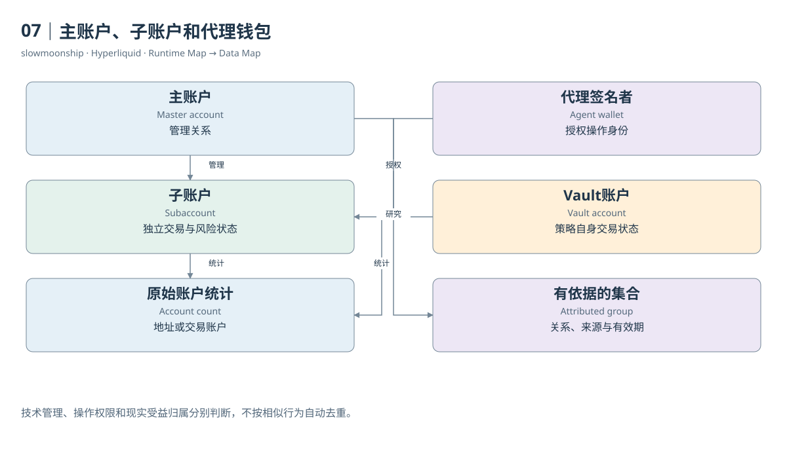

# 07｜主账户、子账户和代理钱包

你发现两组地址经常在相同时间交易，还互相转移USDC。它们可能是同一主账户的子账户，也可能只是两个有业务关系的账户。地址关联是一项研究结论，不能靠同时交易就直接认定。Hyperliquid提供多种账户角色，先理解角色，才能决定怎样统计用户。

主账户Master Account可以管理子账户Subaccount。子账户具有独立的交易身份和状态，适合分隔策略或账户管理。把主账户与所有子账户的交易量汇总，得到的是某个管理范围的活动；只统计其中一个地址，得到的是该交易账户活动。两个结果都可以有用，但名称应不同。

案例13中的实际Ledger Update标记为`subAccountTransfer`，给出了转出与目的地址。这比单纯看见两条金额相似的转账更有力，因为接口直接提供了账户关系相关的操作类型。不过，它仍然没有告诉我们现实中的受益所有人。技术管理关系与现实身份归属不是同一个问题。

Agent或API Wallet主要承担授权操作的签名角色。官方API说明，查询用户状态应使用实际用户地址，而不是误把代理地址当成持仓账户。授权者可以允许代理进行某些操作，资产和仓位仍按相应用户或子账户记账。签名者地址不一定就是被查询资金状态的地址。

客户端订单编号cloid又是更细的一层身份。它帮助自动化系统追踪订单，不是账户地址，也不是全网独立用户编号。不同账户可以采用相似命名习惯。仅凭cloid前缀相同，不能将账户自动归入同一个实体，更不能把一张订单的编号当作一笔成交的唯一键。

Vault也有自己的地址和金融状态。出资人通过份额参与其盈亏，Vault本身执行交易。若把出资人与Vault交易同时算作独立个人交易行为，可能重复解释了同一经济关系。计算地址数可以保留两者；估计实际交易者人数则需要更明确的范围和归属假设。

质押与交易地址还可能使用官方支持的关联机制，用于费用层的资格判断。关联不会使所有余额自动合并，也不能证明任何外部地址都是同一人。模式、授权、管理和经济受益分别构成不同关系。一个简单的“地址去重表”通常装不下这些差异。

分析时可以维护两张表：一张记录原始账户身份和角色，另一张记录有依据的关系及有效期间。来源可能是官方账户查询、明确Ledger操作或人工研究；关系类型应写清。没有证据的地址保持独立，不因同名、同时间或相似行为被强行合并。

这样一来，“活跃地址”“交易账户”“主账户集合”“Vault出资人”就能分别计算。它们没有一种天然最正确的用户数。正确性来自指标名与统计对象一致，以及读者能够看见关系证据和未覆盖部分。身份清楚以后，持仓与资金流的汇总边界才会清楚。

<!-- BOOK RESOURCES -->

[编辑此图](../../assets/diagrams/identities.drawio)

证据：[案例13](../../examples/cases/case-13.md)。

依据：[trading__sub-accounts](https://hyperliquid.gitbook.io/hyperliquid-docs/trading/sub-accounts.md)；[for-developers__api__nonces-and-api-wallets](https://hyperliquid.gitbook.io/hyperliquid-docs/for-developers/api/nonces-and-api-wallets.md)；[hypercore__vaults](https://hyperliquid.gitbook.io/hyperliquid-docs/hypercore/vaults.md)。

[来源目录](../../research/source_catalog.md) · [目录](../../SUMMARY.md) · [上一章](../../book/part-02/06-abstraction.md) · [下一章](../../book/part-02/08-account-state.md)
