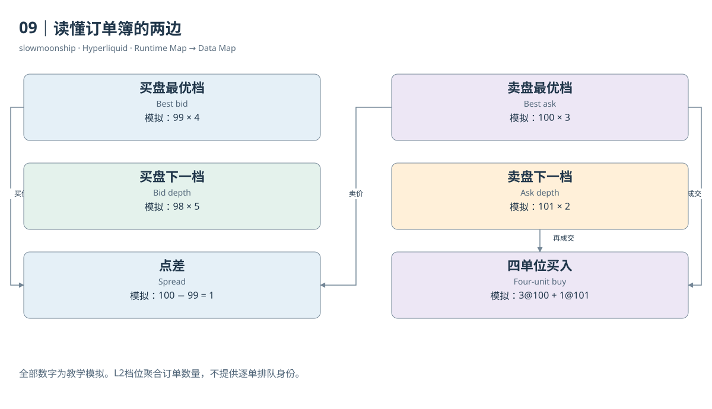

# 09｜读懂订单簿的两边

交易页面中间不断跳动的价格，不是一张订单簿的全部。订单簿记录正在等待成交的买卖意图：Bid是买盘，Ask是卖盘，每个价格档位有相应数量。它告诉你当前愿意成交的条件，而成交历史告诉你已经发生的事情。两张列表描述不同的时间方向。

先看一份教学模拟。卖盘100有3单位、101有2单位；买盘99有4单位、98有5单位。最优卖价是100，最优买价是99，两者之间的Spread为1。价格越接近成交边界，越容易与新订单相遇。显示中价99.5，只是两个最优价的平均，并不是已有订单承诺以99.5成交。

Depth是一定价格范围内的挂单数量或名义金额。如果买入4单位，最优卖档的3单位不够，还需要走到101档。最后一个单位价格更高，平均成交价为100.25。这个简单例子说明，最优价适合描述很小的立即交易条件，大额交易需要看多档深度。

L2订单簿把同一价格的订单汇总。实际Info响应中的每档包含`px`、`sz`和`n`，分别表示价格、总数量与聚合订单数。一个档位有3单位，不代表只有一位卖家或一张订单。L3若保留每张订单，就有更细的身份与排队信息；不能从聚合数量直接还原它们。

本篇实际取得BTC的`l2Book`响应和一次WebSocket簿消息。两者都带有市场与时间；数据中的`levels`分为买档和卖档。它们可以支持获取时点的点差与深度计算。取样时间不同，档位变化完全正常，不能要求两个相隔数分钟的快照逐项相等。

价格与数量还有合法精度。数量遵循市场的`szDecimals`；价格同时受到最多五位有效数字和小数位规则约束，整数价格有例外。Perps与Spot的最大精度基准不同。不要把Tick Size理解成全市场永远固定的小数步长，尤其在价格量级改变时。

订单簿还会被撤单、改单和新挂单改变，而不产生成交。看到某档数量减少，原因可能是被买走，也可能是卖方撤回。只靠两张快照的差额，不能精确区分原因。若要解释每一次变化，需要对应订单事件或Book Diff，而不是补造一笔成交。

与AMM比较时，重点也在状态。常见AMM通过储备和定价规则表达流动性；CLOB通过离散价格上的挂单及撮合规则表达流动性。两者都有价格影响和流动性风险，但数据入口不同。不能把订单簿的总挂单金额当成某个流动性池的锁仓价值。

读完这张小簿，你可以依次问四个问题：最便宜的卖方在哪里，最高价买方在哪里，两边隔多远，我的数量会碰到几档？将它们对应到Bid、Ask、Spread和Depth，就能从页面直觉进入可计算的数据结构。更细的排队和成交规则，将在下一章解释。

<!-- BOOK RESOURCES -->

[编辑此图](../../assets/diagrams/book.drawio)

依据：[hypercore__order-book](https://hyperliquid.gitbook.io/hyperliquid-docs/hypercore/order-book.md)；[for-developers__api__tick-and-lot-size](https://hyperliquid.gitbook.io/hyperliquid-docs/for-developers/api/tick-and-lot-size.md)；[for-developers__api__info-endpoint](https://hyperliquid.gitbook.io/hyperliquid-docs/for-developers/api/info-endpoint.md)。

[来源目录](../../research/source_catalog.md) · [目录](../../SUMMARY.md) · [上一章](../../book/part-02/08-account-state.md) · [下一章](../../book/part-03/10-matching.md)
