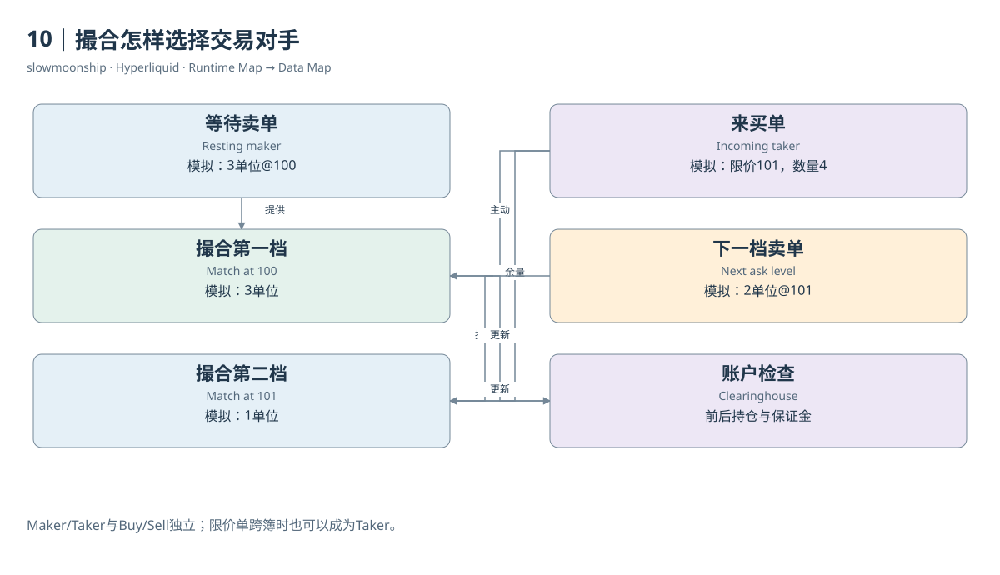

# 10｜撮合怎样选择交易对手

教学订单簿里，卖价100有3单位，卖价101有2单位。现在来了一张限价101、买入4单位的订单。限价101表示愿意支付的最高价格，而不是要求所有单位都以101成交。只要协议允许，撮合首先寻找更有利的现有卖价，再继续处理剩余数量。

因此，这张买单先在100成交3单位，再在101成交1单位，共花401个报价单位。它跨越两个价档，形成两次成交。市场中的“限价单”并不必然是Maker。限价足以跨过当前卖盘时，它也可以立即吃掉已有订单，成为这些成交的Taker。

Maker是提供等待流动性的一侧，Taker是主动与现有流动性相遇的一侧。这两个角色与买卖方向独立。买方可以是Maker，也可以是Taker；卖方同样如此。只有知道哪张订单原先在簿上等待，才能解释角色。不能用Buy或Sell字段直接替代Maker分类。

HyperCore普通订单簿遵循价格时间优先。对于来买单，更低的可成交卖价优先；同价挂单再按时间排列。两位卖方各挂100时，较早进入相应队列的订单通常先被撮合。这是簿内排队规则，与上一Part介绍的Action批次排序属于不同层次。

永续撮合还要访问Clearinghouse。新订单提交时有保证金检查，等待订单被撮合时也可能再次检查。价格或账户状态在挂单后变化，使一张曾经合法的挂单不再符合约束。因此，一份过时簿截图不能保证未来来单一定得到截图中展示的全部数量。

实际案例03中，买方Fill的`crossed`为false，卖方为true。买方在簿上提供流动性，卖方主动成交。两条记录共享价格、数量、事件时间与tid，但各自有oid和费用。这里Taker卖出并不是新开空仓，而是减少原有多仓，角色与开平仓又是两组不同概念。

手续费也依据角色及账户规则计算。案例Maker收到负值fee，代表这条Fill里的返佣；Taker支付正值费用。返佣不意味着整个交易盈利，账户可能同时承担持仓亏损。费用是一项现金流，撮合角色是一项业务角色，交易盈亏则依赖持仓会计。

用户与自己控制的其他订单相遇，还涉及自成交防护。官方普通自成交规则会取消相应等待订单，而不是无条件制造一笔可统计的成交。分析刷量或重复交易时，必须先看协议允许的事件路径，不能只根据相似地址或对向订单推断已经发生自成交。

撮合引擎像一位严格执行规则的配对者：先检查可以成交的条件，再按优先级选择等待订单，随后将结果交给金融账户更新。理解这三个步骤，才知道一笔Trade为何同时需要订单簿证据与账户证据，以及为什么“最早发来”不是一条完整的成交保证。

<!-- BOOK RESOURCES -->

[编辑此图](../../assets/diagrams/matching.drawio)

证据：[案例03](../../examples/cases/case-03.md)。

依据：[hypercore__order-book](https://hyperliquid.gitbook.io/hyperliquid-docs/hypercore/order-book.md)；[trading__self-trade-prevention](https://hyperliquid.gitbook.io/hyperliquid-docs/trading/self-trade-prevention.md)；[trading__fees](https://hyperliquid.gitbook.io/hyperliquid-docs/trading/fees.md)。

[来源目录](../../research/source_catalog.md) · [目录](../../SUMMARY.md) · [上一章](../../book/part-03/09-book.md) · [下一章](../../book/part-03/11-partial.md)
