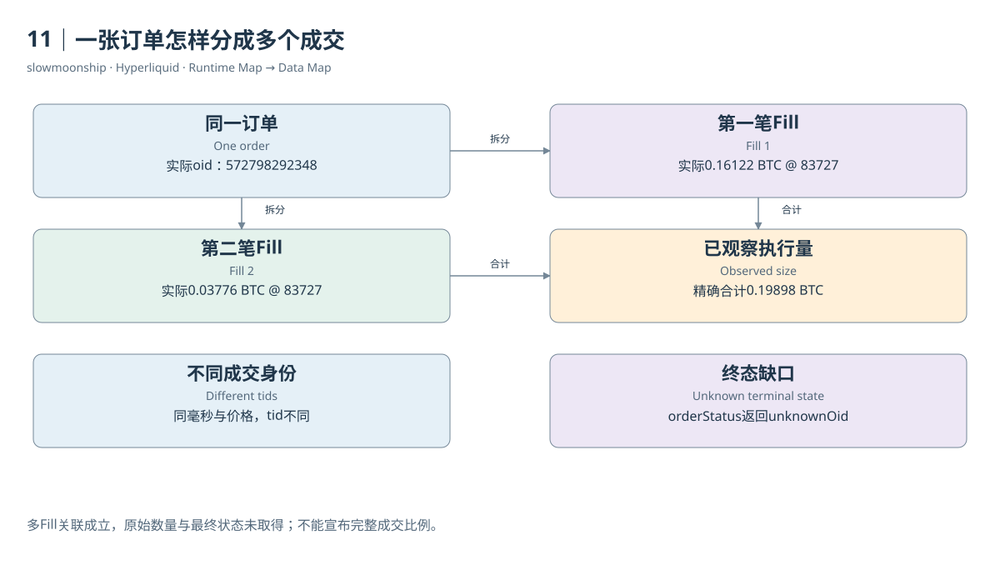

# 11｜一张订单怎样分成多个成交

一张BTC卖单在实际取得的Fill中出现两次：第一笔0.16122，第二笔0.03776，合计0.19898 BTC。它们不是重复数据，而是同一张订单在撮合中分成两份。这正是本篇案例02实际取得的记录，订单编号为572798292348。

两条Fill的价格都为83727，且事件时间相同，但tid不同。它们共享同一个oid与cloid，表示来自同一订单；两个成交标识表示两次撮合。单纯按时间、价格、用户和数量形态去重，会错误删除真实事件。识别重复与识别拆分，需要不同的键。

用十进制精确相加，0.16122加0.03776等于0.19898。随后调用`orderStatus`，实际返回`unknownOid`，没有取得原始数量、余量与终止状态。因此，目前只能证明已取样Fill共享订单，不能宣布完整成交比例或最终状态，也没有取得原始签名Action。

“部分成交”有两个不同场景。一张订单此刻只成交一部分，余量仍在簿上；或者一张最终全部成交的订单，执行过程包含多次部分Fill。案例02直接观察到多笔Fill，但缺少终态，不能进一步判断属于哪一种结束场景。没有中间快照时，不应进一步编造它曾经等待了多少秒，或剩余数量在某时点怎样显示。

数量核对还要留意接口聚合。`userFillsByTime`支持`aggregateByTime`，开启后会按官方规则合并某些部分成交。本篇明确使用false，保留未聚合的用户Fill。拿聚合接口与原始逐笔表比较行数，如果没有先保存这个参数，会把呈现差异误认为数据遗漏。

一张订单产生多个Fill，也意味着费用与盈亏可能分行计算。每行有自己的size、fee与closedPnl。想计算订单层总费用，可以按确认过的账户、市场与oid汇总；想算平均成交价，应按数量加权。简单平均每行价格，会让很小的一笔成交与大笔成交拥有同样权重。

订单层分析还有无法从Fill看见的部分。完全没有成交的订单，不会凭空出现在成交表里；撤回余量，也未必产生Fill。于是，`COUNT(DISTINCT oid)`在Fill表中数到的是“至少成交过一次的订单”，不能直接称作全部下单次数，更不能得到真实撤单率。

同一oid的多条Fill可以跨不同时间和价档。教学模拟中买入4单位，在100与101成交，均价100.25；真实案例则同价拆分。两种情况都满足一对多关系，但原因和价格影响不同。把它们画成“订单节点连接多个成交节点”，比把行数统称交易数更准确。

分析订单执行质量时，完整问题通常包含原始意图、实际Fill、未成交余量与结束原因。本篇取得其中可观察部分，并把缺失Action单独记录。这样既能用真实拆分理解订单与成交的关系，也能避免把局部证据扩大成一份完整执行轨迹。

真正的余量还必须由原始数量与已执行数量共同确定。仅观察到两个Fill时，能够证明它们共享订单，却不能保证没有未取得的第三笔成交。

<!-- BOOK RESOURCES -->

[编辑此图](../../assets/diagrams/partial.drawio)

证据：[案例02](../../examples/cases/case-02.md)。

依据：[for-developers__api__info-endpoint](https://hyperliquid.gitbook.io/hyperliquid-docs/for-developers/api/info-endpoint.md)；[for-developers__api__websocket__subscriptions](https://hyperliquid.gitbook.io/hyperliquid-docs/for-developers/api/websocket/subscriptions.md)。

[来源目录](../../research/source_catalog.md) · [目录](../../SUMMARY.md) · [上一章](../../book/part-03/10-matching.md) · [下一章](../../book/part-03/12-orders.md)
